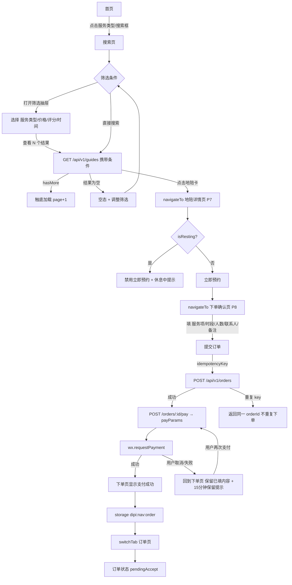
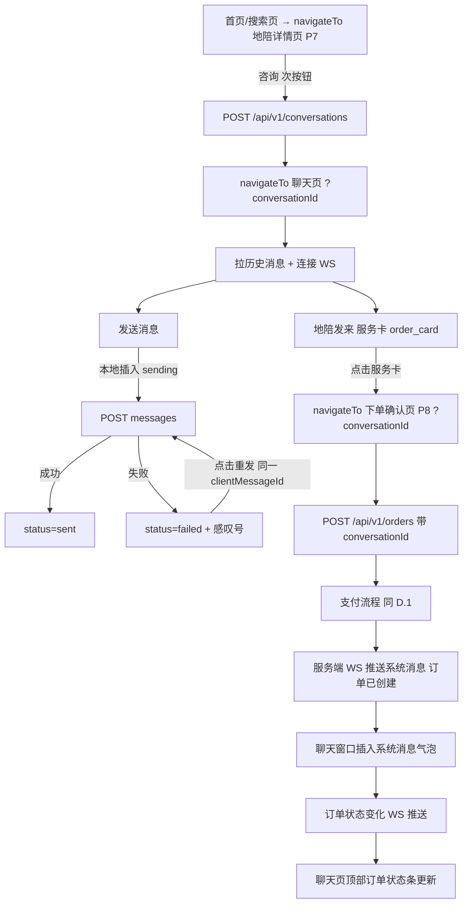
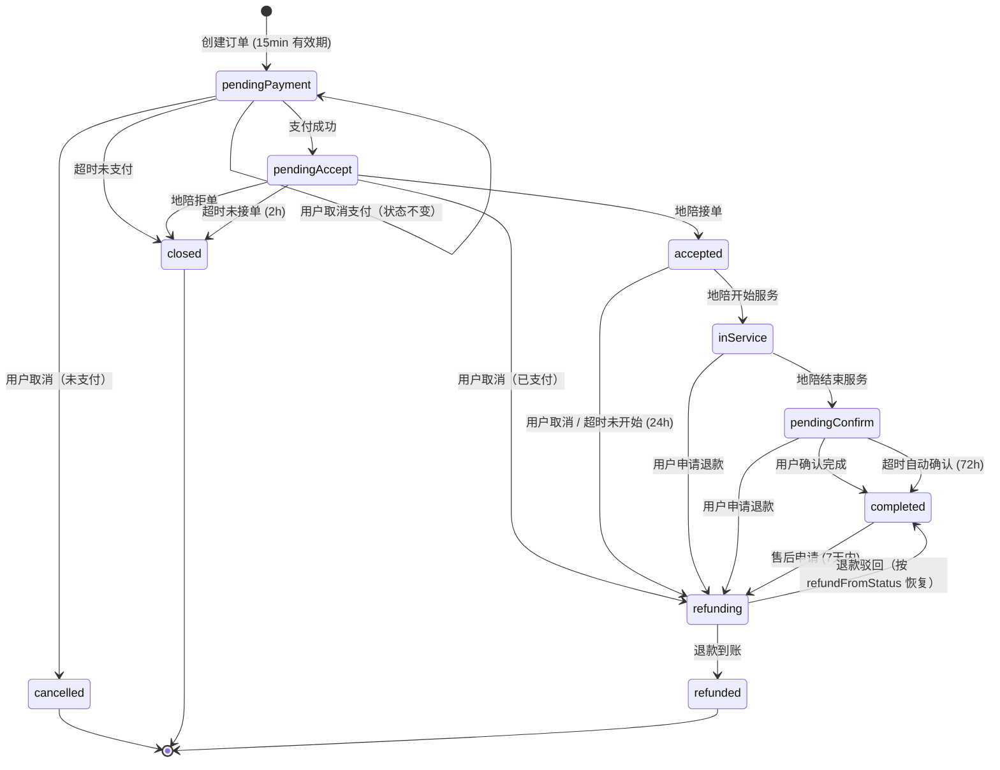
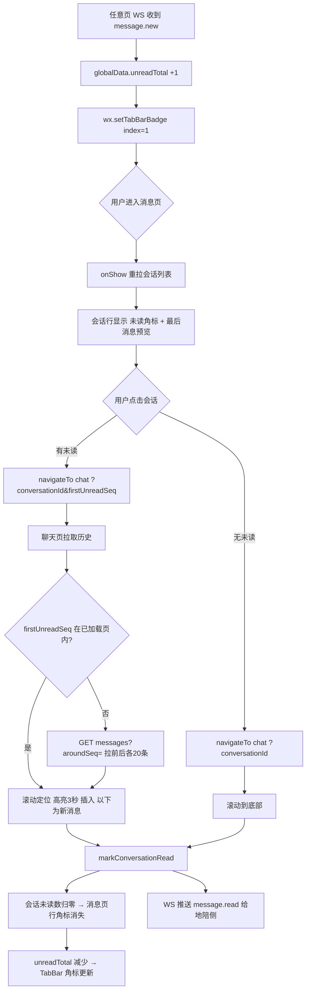

# 随行（dipi）· 小程序端体验设计规范（UX Spec）

> 文档版本：**v1.0** · Phase 2 体验规范 · 负责人：**优希**（体验设计专家）
> 视觉唯一来源：`docs/01-visual-design.md` + `styles/tokens.wxss` + `styles/components.wxss`
> 覆盖范围：信息架构 / 交互流程 / 状态态 / 响应式 / 无障碍 / 防错与降级
> **本文档不定义颜色、字阶、间距的数值**——一律引用 `var(--dipi-*)` 令牌名；数值以 WXSS 为唯一真相源。
> 覆盖页面：**8 个** = 6 个必需页（首页 / 搜索页 / 聊天页 / 订单页 / 消息页 / 用户主页）＋ 2 个转化主路径二级页（**地陪详情页** / **下单确认页**），TabBar 4 项。
> 修订记录：**v1.1（IA 裁决后）** — IA-01 由「半屏面板」改为**独立二级页**；新增 §B.7 地陪详情页、§B.8 下单确认页。详见 §A.2.1。
> **v1.2（对齐 03 契约）** — 服务项 ID 统一 `serviceId`；`slotId` 原子核销约定；收藏端点改幂等 toggle；**订单徽章样式改由服务端 `statusBadge`/`statusTone` 下发**（补齐 IA-06 铁律最后一块）；`orderCounts` 改**互斥分桶**；金额字段对齐 `unitPriceAmount`/`subtotalAmount`；`serviceType` 规范枚举钉死为 camelCase；WS 事件表补客户端→服务端方向与发送确认路径。

---

## 0. 给前端的 TL;DR（先读这 18 行）

1. 本文档写的是**行为与契约**，不写代码。字段名可直接当接口契约用。
2. **接口路径、字段命名、分页与信封格式以 `docs/03-api-contract.md`（服务端产出，Phase 3 锁定）为准；如两者冲突，以 03 为准。** 本文档的字段表是 03 的体验侧镜像。
3. **字段命名统一 camelCase**，全链路（URL query / storage key / 接口 body / WS 消息）一致；禁止 snake_case。
4. **金额一律整数分**，字段名后缀 `Amount`（`priceAmount` / `totalAmount` / `refundAmount`）；单位独立字段 `priceUnit`。
5. **时间一律 ISO 8601 带时区**（`2026-11-23T15:04:05+08:00`），不用时间戳数字。
6. **分页统一格式**：`{ list, page, pageSize, total, hasMore }`，`page` 从 1 起；数组键名 = 资源名复数 camelCase。
7. **响应体统一信封**：`{ code, message, data }`，`code === 0` 为成功；`code !== 0` 时 `message` 直接可展示给用户。
8. **【全局铁律】订单的状态、操作与样式一律由服务端下发**（`status` / `statusText` / `statusBadge` / `statusTone` / `allowedActions[]` + 6 个 `canUserXxx` 布尔位），前端**只渲染、不自算**，**严禁**硬编码「状态 → 按钮 / 状态 → 徽章样式」映射表。这条从根上消除前后端状态漂移。
9. 订单状态共 **10 个**（含 `closed` 与 `cancelled` 两个不同语义），迁移见 §D.3；非法迁移服务端拒绝，前端必须容错。
10. **路由共 8 页**：TabBar 4 项 + 二级页 4 个（搜索 / 聊天 / **地陪详情** / **下单确认**）。地陪详情与下单确认**是独立 push 页，不是弹层**。
11. 一屏 ≤ 1 主色实心按钮、≤ 1 陶土红实心块——列表项里的按钮**一律次级**。
12. 所有可点击元素渲染盒子 ≥ `88rpx × 88rpx`；所有可读文字 ≥ `24rpx`。
13. **≤360px 小屏例外**：rpx 会把正文缩到 12.8px、caption 缩到 11.1px，低于可读下限 → 该断点下正文/辅助文字**必须改用 px 固定值（15px / 13px）**，不依赖 rpx 自动适配。
14. 列表页**不做本地无限滚动**，统一走 `page/pageSize` 显式分页（`hasMore=false` 才触发加载更多）。
15. 全部页面都必须实现 **5 态**：加载中 / 空态 / 错误 / 无权限 / 离线，文案见 §B。
16. 图标按钮**必须**写 `aria-label`；状态徽章**必须**含文字（不能只靠颜色）。
17. 基础库要求 **≥ 2.32.0**（依赖 ARIA 属性与 `wx.getWindowInfo`）。
18. 本文档中 **P0** 标记 = 不做会漏核心链路；**P1** = 可延后但必须排期。

---

# Part A — 信息架构

## A.1 路由与页面清单

| # | 页面 | 路由 | 类型 | 导航栏标题（用户可见） | 备注 |
|---|---|---|---|---|---|
| P1 | 首页 | `/pages/home/home` | TabBar | 随行 | TabBar 第 1 项 |
| P2 | 搜索页 | `/pages/search/search` | 二级页 | 搜索 | 非 Tab，`navigateTo` |
| P3 | 聊天页 | `/pages/chat/chat` | 二级页 | 地陪昵称（动态） | 非 Tab，`navigateTo` |
| P4 | 订单页 | `/pages/order/order` | TabBar | 订单 / 订单详情（详情态动态） | TabBar 第 3 项 |
| P5 | 消息页 | `/pages/message/message` | TabBar | 消息 | TabBar 第 2 项 |
| P6 | 用户主页 | `/pages/profile/profile` | TabBar | 我的 | TabBar 第 4 项 |
| **P7** | **地陪详情页** | **`/pages/guide/detail`** | **二级页** | **地陪昵称（动态）** | **非 Tab，`navigateTo`；IA-01 升格为独立页；长滚动富内容** |
| **P8** | **下单确认页** | **`/pages/order/create`** | **二级页** | **确认订单** | **非 Tab，`navigateTo`；表单 + 吸底 CTA，键盘场景需完整屏高** |

> **TabBar 顺序固定**：首页 / 消息 / 订单 / 我的（与视觉规范 §9 一致）。使用**原生 `tabBar`**，未读角标用 `wx.setTabBarBadge({ index: 1, text })` 实现（消息页 index=1）。
> **页面栈约束**：二级页统一用 `wx.navigateTo`，单次进入最多压栈 **2 层**（如 首页 → 地陪详情 → 下单确认 = 3 层）。从下单确认页返回时**逐级回退**到首页，不允许 `reLaunch`（会丢上下文）。

## A.2 导航结构图（谁跳谁）

```
┌─────────────────────────── TabBar 层（4 项 · 切换不销毁页面栈） ───────────────────────────┐
│                                                                                            │
│   [首页 P1]        [消息 P5]        [订单 P4]        [我的 P6]                              │
│      │  ▲            │  ▲             │  ▲             │  ▲                               │
│      │  │            │  │             │  │             │  │                               │
│      │  │            │  │             │  │             │  └── switchTab（任何页可跳）        │
│      │  │            │  │             │  │                                                    │
│      └──────────────┴──┴─────────────┘  │                                                    │
│                                          │                                                    │
└──────────────────────────────────────────┼────────────────────────────────────────────────────┘
                                           │ switchTab
   ┌───────────────────────────────────────┴────────────────────────────────────────────────────┐
   │                        二级页层（navigateTo，可返回）                                        │
   │                                                                                              │
   │   ┌──────────────┐   ┌──────────────┐   ┌──────────────┐   ┌──────────────┐               │
   │   │ 搜索页 P2     │   │ 聊天页 P3     │   │ 地陪详情 P7   │   │ 下单确认 P8   │               │
   │   └──────────────┘   └──────────────┘   └──────────────┘   └──────────────┘               │
   │                                                                                              │
   └──────────────────────────────────────────────────────────────────────────────────────────────┘

【二级页的进入来源（全部用 wx.navigateTo）】
   → 搜索页 P2      ：首页 P1（搜索框 / 金刚区 / 场景入口）、用户主页 P6（收藏）
   → 聊天页 P3      ：消息页 P5（会话行）、地陪详情页 P7（咨询按钮）
   → 地陪详情页 P7  ：首页 P1（推荐卡）、搜索页 P2（结果卡）、聊天页 P3（头像/昵称）、用户主页 P6（收藏）
   → 下单确认页 P8  ：地陪详情页 P7（立即预约）、聊天页 P3（服务卡 order_card）

【主要链路（当前页 → 下一页）】
   首页 P1 → 搜索页 P2 → 地陪详情页 P7 → 下单确认页 P8 → （支付成功）→ 订单页 P4
   首页 P1 ──────────────────────────→ 地陪详情页 P7 → 下单确认页 P8
   消息页 P5 → 聊天页 P3 ──────────────→ 下单确认页 P8

【页内视图切换】（不算二级页，不入栈）
   P4 订单页      ▸ 列表视图 ⇄ 详情视图（同页 viewMode 切换，无 push）

【页内弹层】（层叠在当前页之上，不入栈；仅用于轻量选择/确认）
   城市选择面板 / 筛选抽屉 / 退款原因面板 / 资料编辑面板 / 确认弹层

【跨 Tab 的参数传递】
   P3 聊天页 ▸ P4 订单页：wx.setStorageSync('dipi:nav:order') → wx.switchTab()
   P1 首页   ▸ P4 订单页：同上（用于「查看进行中订单」入口）
   P6 我的   ▸ P4 订单页：同上（用于「我的订单」入口，带 tab 预选）
   P8 下单页 ▸ P4 订单页：同上（支付成功后 switchTab，带 highlightOrderId）
```

### A.2.1 关键 IA 决策（必须被前端遵循）

| ID | 决策 | 理由 | 备注 / 升级路径 |
|---|---|---|---|
| **IA-01** | **地陪详情与下单确认升为独立二级页**：`/pages/guide/detail`（P7）、`/pages/order/create`（P8），均用 `wx.navigateTo` push | ① **下单确认是长表单**（日期 / 时段 / 人数 / 联系人 / 备注 / 实时算价 + 吸底 CTA），半屏在 50% 屏高里会被键盘顶飞——这是可实测的失败，不是风格偏好；② 地陪详情是长滚动富内容（照片轮播 / 服务项 / 评价 / 可约时段），半屏必须折叠反而丢信息；③ 6 个必需页是**能力下限而非上限**，补充转化主路径的二级页不违反需求 | 保留收敛路径：若后续要压回页数，详情页与下单页可降级为**全屏 sheet**（`position: fixed` 覆盖 100% 屏高、保留独立路由与返回栈），**但不得再降级为 50% 半屏面板**——表单会被键盘顶飞 |
| **IA-02** | 订单详情 = 订单页内的 `viewMode: 'detail'` 子视图，**不 push 新页** | 订单列表与详情共享同一份 `order` 数据结构与状态徽章映射，push 会导致两份状态渲染逻辑漂移 | 保持现状 |
| **IA-03** | 消息页采用 **双 Tab**（会话 / 通知），Tab 状态存 `storage`，**不**写入 TabBar | 系统通知与会话是两种内容模型，塞进一个列表会让人无法区分「地陪消息」与「平台通知」 | 保持现状 |
| **IA-04** | 首页不设任何实心主按钮；实心主按钮只出现在**地陪详情页 P7** 与**下单确认页 P8**（各自页面内 1 个） | 视觉规范原则 1；首页有 N 张地陪卡，每张配按钮必然违规。卡片整体可点已足够 | 保持现状 |
| **IA-05** | 搜索结果与首页推荐**共用同一 `guide` 摘要结构与同一张卡片组件**；详情页与下单页**不复用**摘要结构，各自用完整结构 | 避免两套卡片在字段缺失/下架态上表现不一致（最容易漏的边界）；详情/下单是独立页，可用完整字段 | 保持现状 |
| **IA-06** | **订单可用操作一律由服务端下发**（`canUserPay` / `canUserCancel` / `canUserConfirm` / `canUserRefund` / `canUserContact` / `canUserReview` + `statusText`），前端**只渲染不计算** | 从根上消除前后端状态漂移：状态机有 10 态、23 条迁移，前端硬编码映射必然漏边 | **全局铁律**，见 §0 第 8 条 |

## A.3 页面层级与统一命名表（用户可见文案）

### A.3.1 页面标题

| 页面 | 导航栏标题 | 返回键文案（读屏） |
|---|---|---|
| 首页 | 随行 | —（TabBar 根） |
| 搜索页 | 搜索 | 返回 |
| 搜索页（筛选抽屉打开时） | 筛选 | 关闭筛选 |
| 聊天页 | `{guideName}`（≤8 字，超出省略） | 返回消息列表 |
| 订单页（列表态） | 订单 | —（TabBar 根） |
| 订单页（详情态） | 订单详情 | 返回订单列表 |
| 消息页 | 消息 | —（TabBar 根） |
| 用户主页 | 我的 | —（TabBar 根） |
| 地陪详情页 P7 | `{guideName}`（≤8 字，超出省略） | 返回上一页 |
| 下单确认页 P8 | 确认订单 | 返回上一页 |

### A.3.2 通用操作文案（按钮/图标）

| 场景 | 文案 | 变体 | 备注 |
|---|---|---|---|
| 进入搜索 | 输入目的地或服务 | 搜索框占位符 | 首页搜索框 placeholder |
| 提交搜索 | 搜索 | 幽灵/文字按钮（**不用实心**） | 见视觉规范 §6.2 |
| 打开筛选 | 筛选 | 幽灵按钮 + 图标 | 需 aria-label="打开筛选条件" |
| 应用筛选 | 查看 {n} 个结果 | **主按钮**（抽屉内唯一） | n 为结果数 |
| 重置筛选 | 重置 | 幽灵按钮 | 需二次确认？否，清空即生效（可逆） |
| 咨询地陪 | 咨询 | 次按钮 | 详情页内，与主按钮同屏时用次按钮 |
| 立即预约 | 立即预约 | **主按钮** | 详情页底部唯一主按钮 |
| 提交订单 | 提交订单 | **主按钮** | 下单确认页底部吸底 CTA |
| 去支付 | 立即支付 | **主按钮** | 订单详情底部 |
| 取消订单 | 取消订单 | 危险幽灵 `.dipi-btn--danger-ghost` | 需二次确认弹层 |
| 确认完成 | 确认完成 | **主按钮** | 待确认态 |
| 申请退款 | 申请退款 | 危险幽灵 `.dipi-btn--danger-ghost` | 需二次确认 + 原因选择 |
| 重发消息 | （图标，aria-label="重新发送"） | — | 失败气泡右上角 |
| 清空输入 | （图标，aria-label="清空输入内容"） | — | 输入框内 |
| 加载更多 | （触底自动触发） | — | 显示「没有更多了」 |
| 返回顶部 | （图标，aria-label="回到顶部"） | — | 列表滚动 > 800rpx 时出现 |

### A.3.3 状态文案与徽章

> **🔴 徽章样式由服务端下发，前端不做状态→样式的运行时映射（IA-06 铁律的延伸）**
> 服务端在订单对象中下发 **`statusBadge`**（徽章类名后缀）与 **`statusTone`**（语义色调），前端**直接套用**：
> ```
> class="dipi-badge--{{ order.statusBadge }}"
> ```
> - **`statusBadge`** = 下表「`statusBadge`」列的值，**必须是 Phase 1 `components.wxss` 中已存在的类名后缀**（白名单见下）。前端**不维护任何映射表**，CSS **零改动**。
> - **`statusKey`** = 语义状态键（下表「`statusKey`」列），供客户端做**逻辑判断 / 埋点 / 读屏补充**时使用；**不用于样式**。
> - **`statusTone`** = 语义色调（`warning` / `info` / `brand` / `accent` / `success` / `neutral` / `error`），作为**第二重信息**：色弱 / 单色 / 高对比模式下，读屏与图标可依据 `statusTone` + `statusText` 表达，**不依赖颜色**。
> - **下表是「服务端的生成依据」**（服务端据此产出 `statusBadge` / `statusKey`），**不是前端的运行时映射表**。
> - 前端**禁止**写 `status === 'pendingPayment' ? 'dipi-badge--pending' : ...` 这类判断（检查项 G-83）。
> - **白名单兜底（必做）**：前端拼出的类名必须在白名单内；服务端下发未知值 → 降级 `.dipi-badge--closed`（中性灰）+ 显示 `statusText`，**不得渲染出不存在的类**（否则徽章丢失底色变成默认样式，视觉全错）。

**`statusBadge` 白名单（= Phase 1 `components.wxss` 现有 7 个状态类，CSS 零改动）**：
`pending` · `confirmed` · `ongoing` · `review` · `done` · `closed` · `refund`

| `status` | `statusKey` | 徽章文案 | `statusBadge`（样式类后缀） | 底/字 token | 用户可执行操作 | 详见 §D.3 |
|---|---|---|---|---|---|---|
| `pendingPayment` | `pending` | 待支付 | `pending`（`.dipi-badge--pending`） | `--dipi-warning-100` / `--dipi-warning-700` | 去支付、取消订单 | D.3 |
| `pendingAccept` | `pendingAccept` | 待接单 | `confirmed`（`.dipi-badge--confirmed`） | `--dipi-info-100` / `--dipi-info-700` | 取消订单、联系地陪 | D.3 |
| `accepted` | `accepted` | 已接单 | `confirmed`（`.dipi-badge--confirmed`） | `--dipi-info-100` / `--dipi-info-700` | 联系地陪、取消订单 | D.3 |
| `inService` | `inService` | 服务中 | `ongoing`（`.dipi-badge--ongoing`） | `--dipi-brand-100` / `--dipi-brand-700` | 联系地陪、申请退款 | D.3 |
| `pendingConfirm` | `pendingConfirm` | 待确认 | `review`（`.dipi-badge--review`） | `--dipi-accent-100` / `--dipi-accent-700` | 确认完成、申请退款 | D.3 |
| `completed` | `completed` | 已完成 | `done`（`.dipi-badge--done`） | `--dipi-success-100` / `--dipi-success-700` | 再次预约、评价 | D.3 |
| `cancelled` | `cancelled` | 已取消 | `closed`（`.dipi-badge--closed`） | `--dipi-ink-100` / `--dipi-ink-500` | 再次预约、再次咨询 | D.3 |
| `closed` | `closed` | 已关闭 | `closed`（`.dipi-badge--closed`） | `--dipi-ink-100` / `--dipi-ink-500` | 再次预约、再次咨询 | D.3 |
| `refunding` | `refunding` | 退款中 | `refund`（`.dipi-badge--refund`） | `--dipi-error-100` / `--dipi-error-700` | 查看进度、联系客服 | D.3 |
| `refunded` | `refunded` | 已退款 | `closed`（`.dipi-badge--closed`） | `--dipi-ink-100` / `--dipi-ink-500` | 再次预约 | D.3 |

> ⚠️ **`statusBadge` 与 `statusKey` 是两回事**：`statusKey` 是**语义身份**（与订单状态同名/近似，1:1），`statusBadge` 是**视觉决策**（多个状态可共用一个类，如 `pendingAccept` 与 `accepted` 共用 `confirmed`、`cancelled`/`closed`/`refunded` 共用 `closed`）。
> ⚠️ **服务端不得下发 `status` 的原值当 `statusBadge`**：`dipi-badge--pendingAccept` / `--inService` / `--completed` / `--refunding` / `--refunded` / `--accepted` / `--cancelled` **在 Phase 1 CSS 中都不存在**，直接拼会渲染成无底色的默认徽章。
> ⚠️ **徽章纪律**：徽章紧贴订单标题**左上角**；右侧留给价格与操作按钮。徽章**必须**带文字（色弱可达性，见 §E.3 A-07、A-21）。`pendingPayment` 在订单页**顶部强调条**用 `.dipi-badge--solid`（`--dipi-warning-600` 实心），列表卡片内不得用实心徽章。

### A.3.4 空态 / 错误 / 离线文案表（全局统一，各页引用）

| 状态 | 标题 | 描述 | 行动 |
|---|---|---|---|
| 空 · 无搜索结果 | 没有找到符合条件的地陪 | 试试放宽价格区间，或换个服务类型 | 调整筛选（主按钮） |
| 空 · 无订单 | 还没有订单 | 约一位本地地陪，让这趟行程有人带路 | 去找地陪（主按钮） |
| 空 · 无会话 | 还没有聊天 | 咨询地陪，聊聊你的行程 | 去找地陪（主按钮） |
| 空 · 无通知 | 暂无通知 | 订单状态变化、售后进度会在这里通知你 | — |
| 空 · 未实名 | 还未实名认证 | 实名认证后可预约部分实名服务 | 去实名（主按钮） |
| 错误 · 加载失败 | 加载失败 | 网络好像不太稳定，点击重试 | 重试（主按钮） |
| 错误 · 无权限 | 无权查看 | 该内容不属于当前账号 | 返回（次按钮） |
| 错误 · 越权 | 无权查看该订单 | 该订单不属于当前账号 | 返回订单列表（主按钮） |
| 离线 | 网络连接已断开 | 当前显示的是上次同步的内容，操作将无法提交 | 重新连接（主按钮） |

> 加载态统一：骨架屏（`.dipi-skeleton`），**不先渲染白屏**（视觉规范 §6.13）。Toast 时长：成功 1500ms / 常规 2000ms / 错误 2500ms。

## A.4 内容分组策略（首页模块顺序 + 理由）

首页模块自上而下固定为 **7 段**，顺序即用户决策顺序（先「在哪」→ 再「做什么」→ 再「找谁」→ 最后「敢不敢下单」）：

| 序 | 模块 | 内容 | 为什么在这个位置 |
|---|---|---|---|
| 1 | **定位条** | 当前城市 / 定位中 / 手动选择城市 | 用户的第一约束是「在哪」。异地用户打开 App 时最怕定位错城市，城市错 = 后面全错 |
| 2 | **搜索框** | 搜目的地、服务类型、地陪昵称 | 主动意图入口。放在视觉第一屏可达位置 |
| 3 | **服务类型金刚区** | 美食陪逛 / 城市漫游 / 景点讲解 / 拍照跟拍 / 亲子陪玩 / 代排队办事 | 品类认知教育。**不认知产品的人不知道怎么搜**。横排 6 个，横向可滚动 |
| 4 | **推荐地陪（横滑）** | 4–6 张地陪卡 | 转化核心区。横滑而非瀑布流，因为**转化对象是人不是图文**（视觉规范 §1.3）。横滑让「浏览多家」成本极低。卡片点击 → **地陪详情页 P7 入口**（独立 push 页） |
| 5 | **场景入口（横滑）** | 今天就能约 / 周末可用 / 亲子优选 / 机场接送 | 把「模糊需求」翻译成「可下单的确定需求」，接住第 4 段没转化的人 |
| 6 | **进行中订单提醒**（条件显示） | 有 `pendingPayment` / `inService` 订单时出现 | 履约中用户的第一诉求是「我的订单怎么样了」。**不占用首屏固定位**（条件渲染），避免所有人被无关信息打扰 |
| 7 | **服务保障说明** | 实名认证 / 平台保障 / 售后无忧 | 信任兜底放最后。信任是**决策后**才需要的确认，前置会拖慢浏览 |

**分组硬规则**：
- 区块标题统一用 `.section__title`（`--dipi-fs-title`），右上角「更多」用 `.section__more`。
- 区块间距 `--dipi-space-6`，卡片间距 `--dipi-space-5`。
- **模块 6 的出现会让页面变长，但不得把模块 4 挤出首屏**：模块 4 必须在无滚动时可见 ≥ 2 张完整卡片。
- **模块 4 的「详情页入口」是独立的 push 页**（`/pages/guide/detail`，P7），**不是半屏面板**：卡片整体可点 → `navigateTo` → 详情页底部「立即预约」→ 再 `navigateTo` 下单确认页（`/pages/order/create`，P8）。返回时逐级回退，不得 `reLaunch`。
- 首页 7 段**顺序不因新增二级页而改变**——详情页与下单页是「第 4 段之后」的延伸，不插入首页结构。

---

# Part B — 8 个页面逐一详述

> ⚠️ **接口契约权威声明**
> 本文件的**接口路径、字段命名、分页与信封格式以 `docs/03-api-contract.md`（服务端产出，Phase 3 锁定）为准；如两者冲突，以 03 为准。**
> 本文档的字段表是 03 的**体验侧镜像**——它回答的是「每个字段在界面上扮演什么角色、什么时机出现、缺了会怎样」，**不用于定义 API 本身**。字段表中的「接口来源」列仅用于标明该字段来自哪个接口，便于前后端对账。

---

## B.1 首页（`/pages/home/home`）

### B.1.1 核心功能（用户视角）

1. **选城市**：查看/切换当前服务城市（定位或手动选择），切换后整个首页内容刷新。
2. **发起搜索**：点搜索框或服务类型入口进入搜索页，条件自动带入。
3. **浏览推荐地陪**：横向滑动查看推荐地陪（含评分、服务标签、价格、是否休息中），点卡片进入**地陪详情页 P7**（独立 push 页）。
4. **下单预约**：在详情页选服务项 → 进入**下单确认页 P8** 选时间、填人数与备注 → 提交订单并调起支付。
5. **查看进行中订单**：首页条件区块直达当前进行中的订单详情。
6. **了解保障**：查看平台实名/保障/售后规则。

### B.1.2 交互逻辑

#### 流程 1：首次进入 → 定位 → 渲染首页

1. `onLoad` → 读取 `storage` 中的 `dipi:user:city`（上次选择的城市）。
2. **同步**发起 `GET /api/v1/home`（带 `city` 参数），先渲染骨架屏，**不阻塞首屏**。
3. 异步请求定位权限：`wx.getLocation({ type: 'wgc02' })`。
   - **成功** → 与 `city` 比对：
     - 一致 → 定位条显示「{city} · 定位中」→「{city}」，不刷新内容（避免无谓跳动）。
     - 不一致 → 定位条更新为「{当前定位城市}」，**顶部出现一次轻提示条**「已切换到你当前所在的城市」+「撤销」按钮；内容**不自动刷新**（防止用户正在看时被换掉），仅当用户点「切换」才重新拉数据。
   - **失败/拒绝** → 定位条显示「{city} ›」，右侧显示定位图标，点击弹底部选择城市面板；**不弹任何模态阻断**（定位拒绝绝不能挡住浏览）。
4. 首页数据返回 → 填充模块 3/4/5/7；模块 6 按订单摘要决定是否渲染。

#### 流程 2：点搜索框 → 进入搜索页

1. 点击搜索框（整个框 `bindtap`，不是只点输入框）→ `wx.navigateTo('/pages/search/search?from=home')`。
2. 搜索页 `onLoad` 读取 `from=home`，自动 `focus` 搜索框，键盘弹出。
3. 取消（返回）→ 回到首页，**首页不重新拉数据**（数据 ≤ 5 分钟内视为新鲜）。

#### 流程 3：点服务类型 → 带入条件进入搜索页

1. 点击金刚区「美食陪逛」→ `wx.navigateTo('/pages/search/search?from=home&serviceType=foodTour')`。
2. 搜索页用 `serviceType=foodTour` 初始化筛选面板并**立即拉取结果**（不等用户点「搜索」）。
3. 金刚区每个入口的 `serviceType` 值固定为**规范枚举**（见 B.2.3），**不可变**。

#### 流程 4：点地陪卡 → 地陪详情页 P7 → 下单确认页 P8

1. 点击卡片任意位置 → `wx.navigateTo('/pages/guide/detail?guideId={guideId}&from=home')` → 进入**地陪详情页**（独立 push 页）。
2. 详情页 `onLoad` 读 `guideId` → 请求 `GET /api/v1/guides/{guideId}` → 展示：头像、姓名、头衔、评分、标签、简介、服务项清单、可约时段、价格、评价、认证（详见 **§B.7**）。
3. 用户在详情页选服务项 → 点「立即预约」（详情页底部唯一主按钮）→ `wx.navigateTo('/pages/order/create?guideId={guideId}&serviceId={选中服务项的 serviceId}')` → 进入**下单确认页**（详见 **§B.8**）。
4. 下单确认页内可改：日期、时段、人数、联系人、备注、见面地点；金额**实时算价**。
5. 点「提交订单」→ 按钮进入 loading 并**禁用** → `POST /api/v1/orders` → 成功则跳转支付（见流程 5）。
6. **边界**：
   - `guide.isResting === true` → 「立即预约」按钮置为禁用态（`.dipi-btn.is-disabled`），详情页顶部出现 `.dipi-notice--warning`：「该地陪今日休息，可先咨询或看看其他地陪」。**不能只禁用不解释**。
   - 详情接口失败 → 详情页整页错误态（插画位 `--dipi-error-100` + 「加载失败，点击重试」+ 重试按钮），**页面不自动返回**（用户可能想重试而不是退出）。
   - 服务项全部不可约（`availableSlots` 为空）→ 「立即预约」禁用 +「该地陪近期暂无可约时段，可先咨询」。
   - 用户从详情页返回 → `wx.navigateBack()` 回首页，**首页不重新拉数据**（≤5 分钟视为新鲜）。

#### 流程 5：下单 → 支付（防重复 + 中断恢复）

1. 提交订单前生成 `idempotencyKey`（客户端 UUID，存在 `storage` 的 `dipi:idem:{key}`），随请求发送。
2. `POST /api/v1/orders` 返回 `data.orderId` + `data.payParams`（微信支付参数）。
3. 立即 `wx.requestPayment(payParams)`：
   - **成功** → **下单确认页 P8** 切「支付成功」态，展示订单摘要 + 主按钮「查看订单」→ `wx.setStorageSync('dipi:nav:order', { tab: 'all', highlightOrderId })` → `wx.switchTab('/pages/order/order')`。
   - **用户取消** → 回到下单确认页（**保留用户填写的所有内容**），顶部 `.dipi-notice--warning`：「支付未完成，订单已保留 15 分钟」。
   - **支付失败** → 同上，文案：「支付未成功，可重试或稍后在订单页支付」。
4. **订单页兜底**：订单列表 `pendingPayment` 项显示倒计时（基于 `expireAt`），到点后自动转 `closed`。
5. **防重复**：同一 `idempotencyKey` 重复提交，服务端返回同一 `orderId`，前端不重复下单。
6. **支付页栈**：支付发生在下单确认页 P8 内。支付成功后 `switchTab` 到订单页并 `navigateBack` 掉多余的二级页栈（用 `wx.reLaunch` 会丢上下文，**不使用**）。

#### 流程 6：切换城市

1. 点定位条右侧箭头 → 底部弹出城市面板（热门城市 + 搜索）。
2. 选择城市 → 写 `storage.dipi:user:city` → 关闭面板 → **重新拉取首页数据**（`GET /api/v1/home?city=xxx`）→ 骨架屏 → 新内容。
3. **不重置** TabBar 状态、不清空搜索缓存。

### B.1.3 数据字段

| 字段名 | 类型 | 必填 | 说明 | 示例值 | 来源 |
|---|---|---|---|---|---|
| `currentCity` | string | 是 | 当前服务城市名 | `"成都"` | `GET /api/v1/home` → `data.currentCity` |
| `locating` | boolean | 是 | 是否正在定位（UI 态，非服务端字段） | `true` | 客户端本地 |
| `cityOptions` | object[] | 否 | 可选城市列表 | `[{code, name, guideCount}]` | `GET /api/v1/cities` → `data.list` |
| `searchPlaceholder` | string | 是 | 搜索框占位文案 | `"输入目的地或服务"` | `GET /api/v1/home` → `data.searchPlaceholder` |
| `serviceTypes` | object[] | 是 | 金刚区服务类型 | `[{code,name,iconName,guideCount}]` | `GET /api/v1/home` → `data.serviceTypes` |
| `featuredGuides` | object[] | 是 | 推荐地陪（摘要结构，同 B.2） | 见下 | `GET /api/v1/home` → `data.featuredGuides` |
| `scenes` | object[] | 否 | 场景入口 | `[{code,name,iconName,subtitle,query}]` | `GET /api/v1/home` → `data.scenes` |
| `activeOrderSummary` | object\|null | 否 | 进行中订单提醒（无则不渲染模块 6） | `{orderId, orderNo, status, guideName, serviceName, scheduledAt}` | `GET /api/v1/home` → `data.activeOrderSummary` |
| `guarantees` | object[] | 是 | 保障说明 | `[{code,title,description,iconName}]` | `GET /api/v1/home` → `data.guarantees` |
| `guideId` | string | 是 | 地陪 ID | `"g_2051"` | `GET /api/v1/home` → `data.featuredGuides[].guideId` |
| `name` | string | 是 | 地陪姓名（≤8 字显示） | `"阿May"` | 同上 |
| `title` | string | 是 | 头衔/一句话介绍 | `"成都本地美食向导"` | 同上 |
| `avatarUrl` | string | 是 | 头像 | `"https://cdn.dipi.cn/g/2051.jpg"` | 同上 |
| `rating` | number | 否 | 评分 0.0–5.0，1 位小数；**缺失时整组评分不渲染** | `4.9` | 同上 |
| `ratingCount` | int | 否 | 评价数 | `128` | 同上 |
| `tags` | string[] | 否 | 服务标签（显示前 3 个 + `+N`） | `["美食陪逛","川菜","本地人"]` | 同上 |
| `city` | string | 是 | 城市 | `"成都"` | 同上 |
| `district` | string | 否 | 区域 | `"武侯区"` | 同上 |
| `priceAmount` | int | 是 | 价格（分）；缺失 → 「价格面议」 | `12000` | 同上 |
| `priceOriginAmount` | int\|null | 否 | 划线原价（分） | `15000` | 同上 |
| `priceUnit` | enum | 是 | `hour`/`session`/`day`/`person` | `"hour"` | 同上 |
| `isResting` | boolean | 是 | 休息中/已下架 → 卡片禁用态 | `false` | 同上 |
| `isFavorite` | boolean | 否 | 是否已收藏 | `false` | 同上 |
| `distanceKm` | number\|null | 否 | 距离（km），1 位小数 | `2.4` | 同上 |
| `responseTimeMin` | int\|null | 否 | 平均响应时长（分钟） | `10` | 同上 |
| `completedOrderCount` | int | 否 | 累计完成订单数 | `312` | 同上 |
| `idempotencyKey` | string | 是 | 下单幂等键（**在 P8 下单确认页使用**，首页不生成） | `"b7f3-4c21-…"` | 客户端生成 |

> **本页只消费「地陪摘要」结构**。地陪详情（简介 / 服务项 / 评价 / 认证 / 可约时段）属于**地陪详情页 P7**，字段见 **§B.7.3**；下单表单字段属于**下单确认页 P8**，字段见 **§B.8.3**。同一字段**不在两页重复定义**。
> 首页卡片点击仅使用 `guideId` 跳转 P7，不预取详情。

### B.1.4 状态态

| 状态 | 用户可见表现 | 文案 |
|---|---|---|
| **加载中** | 首页整体骨架屏：定位条占位 + 金刚区占位 + 2 张地陪卡骨架（`.dipi-skeleton--card`）。**先骨架，后数据**；不出现白屏 | 骨架屏右下价格块占位 `--dipi-skeleton` |
| **空态** | ① 当前城市无推荐地陪 → 模块 4 区域替换为空态块「{city}暂时还没有开放的地陪」+「看看其他城市」；② 模块 5 场景无内容 → **整段隐藏**（不留空标题）；③ 推荐接口返回空列表但模块 3 正常 | 见 §A.3.4 |
| **错误** | 首页数据请求失败 → 整页错误空态（`.dipi-empty__art--error` 底）+「加载失败」+「网络好像不太稳定，点击重试」+「重试」主按钮。**局部模块失败**（如评价接口失败）→ 仅该模块内提示，不影响整页 | 「加载失败，点击重试」 |
| **无权限** | 定位权限被拒 **不进入无权限态**，降级为「手动选择城市」（见 F-04）。实名信息仅在需要下单时校验 | 定位条：「选择城市 ›」 |
| **离线** | 顶部导航栏下方固定一条 `.dipi-notice--warning`：「网络连接已断开，显示的是上次缓存的内容」；所有提交类按钮禁用 | 「网络连接已断开」 |
| **模块 6 条件渲染** | 仅当 `activeOrderSummary` 非空时渲染 | — |

### B.1.5 可点击热区与无障碍

| 元素 | 触达尺寸 (rpx) | 无障碍名（`aria-label`） | 说明 |
|---|---|---|---|
| 定位条（整条可点） | 高 88，宽满 | `{city}，当前服务城市，点击切换城市` | 整条是按钮，不是只有箭头 |
| 定位条右侧箭头 | 88×88 | `切换城市` | 与整条点击区重叠时，箭头需 `stopPropagation` 或不单独绑事件 |
| 搜索框 | 高 88（视觉 72 + 上下 padding 补足） | `搜索目的地或服务` | `aria-role="button"` |
| 金刚区入口 ×6 | 88×88 以上 | `美食陪逛，128 位地陪` | 每个入口读出「名称 + 可选数量」 |
| 地陪卡片（整张） | 高 ≥ 180（卡片本身） | `{name}，{title}，评分 {rating}，{price} 元每小时，点击查看详情` | **卡内不放实心按钮**（IA-04） |
| 地陪卡头像 | 120×120 | `{name} 的头像` | `aria-hidden="false"`，图片 alt |
| 地陪卡评分星组 | 24 高（不可点时） | `评分 {rating} 分，{ratingCount} 条评价` | 图形本身 `aria-hidden="true"`，数字读屏 |
| 地陪卡标签组 | 36 高 | `{tag}` 逐个朗读 | `aria-hidden="true"` 由父级合并朗读，避免碎读 |
| 地陪卡价格区 | 不可点 | `{price} 元 每 {unit}` | 独立可读，不合并到卡片名 |
| 场景入口 ×4 | 88×88 | `{name}，{subtitle}` | — |
| 保障说明 ×3 | 88×88 | `{title}：{description}` | — |
| 进行中订单提醒 | 高 ≥ 96 | `进行中的订单，{status}，点击查看` | — |

> 详情页 P7 与下单页 P8 的热区清单分别见 **§B.7.5** / **§B.8.5**，本页不重复列出。
| 城市面板城市项 | ≥ 88 高 | `{name}，{guideCount} 位地陪` | — |

---

## B.2 搜索页（`/pages/search/search`）

### B.2.1 核心功能（用户视角）

1. **关键词搜索**：搜地陪昵称、服务名、城市；输入即联想（300ms 防抖）。
2. **多维筛选**：目的地、服务类型、价格区间、评分下限、最快可约时间。
3. **排序**：综合 / 价格从低到高 / 价格从高到低 / 评分优先。
4. **分页浏览**：结果列表触底加载更多，无匹配时给「放宽条件」引导。
5. **一键清空**：一键清空全部筛选条件。
6. **直达下单**：结果卡 → 地陪详情页 P7 → 下单确认页 P8。

### B.2.2 交互逻辑

#### 流程 1：进入页面并初始化条件

1. `onLoad(options)` 读取 `from / keyword / city / serviceType / priceMin / priceMax / sortBy`。
2. **写入 `this.filters`**（本页唯一筛选状态源），回显到筛选按钮标签上。
3. `onLoad` 末尾**立即** `GET /api/v1/guides`（带当前 filters），先骨架屏后数据。
4. `from=home` 且无 `keyword` → 自动 `focus` 输入框、弹出键盘。
5. **有 `keyword`** → 不自动聚焦（避免键盘遮挡结果），结果区直接展示。

#### 流程 2：输入关键词（联想）

1. `bindinput` → 300ms 防抖 → `GET /api/v1/guides/suggest?keyword=xxx`。
2. 联想结果展示在输入框下方浮层，**最多 5 条**；每条 88rpx 高。
3. 点联想词 → 填入输入框 → 关闭浮层 → 立即拉结果。
4. 输入框为空且未聚焦 → 浮层不显示。
5. **边界**：网络慢时联想浮层显示 3 个骨架条；请求失败 → 浮层静默关闭（不打扰），输入框下方显示 caption「联想失败，直接搜索试试」。

#### 流程 3：打开筛选面板（底部抽屉）

1. 点「筛选」→ 弹出底部抽屉（`.dipi-mask` + 面板），面板可下滑关闭。
2. 抽屉内分组：**目的地**（横向 chip）/ **服务类型**（多选 chip）/ **价格区间**（横向 chip）/ **评分**（chip）/ **最快可约**（chip）。
3. **价格区间 chip 是全 App 唯一允许的红色 chip**（`.dipi-chip--price.is-active`，视觉规范 §6.3）——因此：
   - 价格 chip 选中态最多 1 个（单选）；
   - 同屏其他 chip 选中态全部用 `.dipi-chip.is-active`（松绿）；
   - **红色实心/红底元素在本页只有价格 chip 一处**（原则 1）。
4. 点「重置」→ 清空全部条件（价格区间、评分、服务类型、目的地）→ **不自动刷新**，需点「查看 N 个结果」才生效（避免连续请求）。
5. 点「查看 N 个结果」→ 关闭抽屉 → 拉取结果 → 滚动位置**回到顶部**。

#### 流程 4：排序切换

1. 顶部排序行（综合 / 价格↓ / 价格↑ / 评分）横向排列，选中项用 `.dipi-chip.is-active`。
2. 点选 → **立即**重新请求，`sortBy` 变更，`page` 重置为 1，滚动回顶部。
3. 排序行**不吸顶**（避免与筛选条抢空间），随列表滚动。

#### 流程 5：列表分页

1. 首次 `page=1, pageSize=20`。
2. `onReachBottom` → 若 `hasMore === true` 且**没有正在进行的请求** → 拉 `page+1`，追加到列表。
3. 追加时底部显示「加载中…」骨架条（3 个列表项占位）。
4. `hasMore === false` → 底部显示 caption「— 没有更多了 —」。
5. **防抖锁**：请求进行中时 `onReachBottom` 重复触发无效（`this.loadingMore` 锁）。
6. **筛选变化后必须重置** `page=1` 且清空旧列表（否则会拼上不匹配的旧数据）。

#### 流程 6：结果为空

1. 结果为空 → 搜索框下方显示空态块（不用全屏遮盖，保留用户调整条件的上下文）。
2. 文案：「没有找到符合条件的地陪」+「试试放宽价格区间，或换个服务类型」。
3. 主按钮「调整筛选」→ 打开筛选抽屉（**保留当前条件**，让用户微调而不是重来）。
4. 副操作：显示当前已选条件的 chip 行（可单个删除），让用户知道「卡在哪一条」。

#### 流程 7：从搜索结果 → 详情页 P7 → 下单页 P8

1. 点结果卡 → `wx.navigateTo('/pages/guide/detail?guideId={guideId}&from=search')` → 进入**地陪详情页 P7**（详见 §B.7）。
2. 详情页点「立即预约」→ `wx.navigateTo('/pages/order/create?guideId={guideId}&serviceId={选中服务项的 serviceId}')` → 进入**下单确认页 P8**（详见 §B.8）。
3. 搜索页**不预取详情**，只用列表已有的 `guideId` 跳转；详情页自己拉 `GET /api/v1/guides/{guideId}`。
4. 从 P7/P8 逐级返回 → 回到搜索页，**搜索列表不重新拉取**（条件与滚动位置保持不变）。

### B.2.3 数据字段

| 字段名 | 类型 | 必填 | 说明 | 示例值 | 来源 |
|---|---|---|---|---|---|
| `keyword` | string | 否 | 搜索关键词 | `"成都美食"` | 本地 `filters` → `GET /api/v1/guides?keyword=` |
| `city` | string | 否 | 目的地筛选 | `"成都"` | 同上 `?city=` |
| `serviceType` | string | 否 | 服务类型枚举，**只能用规范形式**（camelCase，见下方枚举表） | `"foodTour"` | 同上 `?serviceType=` |
| `priceMin` | int | 否 | 价格下限（分） | `5000` | 同上 `?priceMin=` |
| `priceMax` | int | 否 | 价格上限（分），`null` = 不限 | `30000` | 同上 `?priceMax=` |
| `minRating` | number | 否 | 评分下限 | `4.5` | 同上 `?minRating=` |
| `availableWithin` | enum | 否 | `none`/`today`/`weekend`/`week` | `"today"` | 同上 `?availableWithin=` |
| `sortBy` | enum | 是 | `default`/`priceAsc`/`priceDesc`/`rating` | `"default"` | 同上 `?sortBy=` |
| `page` | int | 是 | 页码，从 1 起 | `1` | 同上 `?page=` |
| `pageSize` | int | 是 | 每页条数（固定 20） | `20` | 同上 `?pageSize=` |
| `list` | object[] | 是 | 地陪摘要数组，字段同 B.1.3 的 guide 摘要段 | — | `GET /api/v1/guides` → `data.list` |
| `total` | int | 是 | 总条数 | `137` | 同上 → `data.total` |
| `hasMore` | boolean | 是 | 是否还有更多 | `true` | 同上 → `data.hasMore` |
| `suggestList` | object[] | 否 | 联想词 | `[{type:'guide'\|'city'\|'service',value,guideId}]` | `GET /api/v1/guides/suggest?keyword=` → `data.list` |
| `filterOptions` | object | 否 | 筛选项字典 | 见下 | `GET /api/v1/guides/filter-options` → `data` |
| `filterOptions.cities` | object[] | 是 | 目的地选项 | `[{code,name,guideCount,isHot}]` | 同上 |
| `filterOptions.serviceTypes` | object[] | 是 | 服务类型选项 | `[{code,name,guideCount}]` | 同上 |
| `filterOptions.priceRanges` | object[] | 是 | 价格区间选项（**单选**） | `[{min,max,label:"¥50-100"}]` | 同上 |
| `filterOptions.ratings` | object[] | 是 | 评分选项 | `[{value:4.5,label:"4.5 分以上"}]` | 同上 |
| `filterOptions.availableWindows` | object[] | 是 | 可约时间选项 | `[{code:"today",label:"今天就能约"}]` | 同上 |
| `activeFilterCount` | int | 是 | 已生效筛选条件数量（筛选按钮上的角标） | `3` | 客户端计算 |
| `loadingMore` | boolean | 否 | 是否正在加载更多（本地态） | `false` | 客户端本地 |

> **本页只消费「地陪摘要」结构**（`list[]` 的字段与首页推荐卡完全一致，见 §B.1.3 的 guide 摘要段）。地陪详情字段见 **§B.7.3**，下单表单字段见 **§B.8.3**，**不在本页重复定义**。

#### 服务类型规范枚举（`serviceType` 唯一合法取值）

| `code` | 中文名 | 图标 |
|---|---|---|
| `foodTour` | 美食陪逛 | 餐饮食具 |
| `cityWalk` | 城市漫游 | 街景 |
| `sightseeing` | 景点讲解 | 建筑 |
| `photo` | 拍照跟拍 | 相机 |
| `parentChild` | 亲子陪玩 | 玩偶 |
| `errand` | 代排队办事 | 单据 |

> **入参规范**：客户端**只允许发送上表的 camelCase `code`**（URL query `?serviceType=`、请求体 `serviceType` 同理）。
> 服务端为兼容性**可以**接受历史别名（如 `food` / `food_tour`）并做归一化，但——
> ① **响应只回 camelCase**（`serviceTypes[].code` 永远是上表形式）；
> ② **客户端不得依赖别名**，也不得为别名写兼容分支（检查项 G-82）。
> ③ 收到未在表内的 `code` → 视为未知类型：该 chip **置灰不可选**并提示「有筛选条件无法识别，已为你重置」，不抛错、不白屏。

### B.2.4 状态态

| 状态 | 用户可见表现 | 文案 |
|---|---|---|
| **加载中（首屏）** | 5 个列表项骨架（左侧 88rpx 圆形块 + 右侧 2 条文字块） | — |
| **加载中（触底）** | 底部 3 个列表项骨架 | — |
| **空态 · 无结果** | 输入框下方（**不覆盖整屏**）空态块 + 已选条件 chip 行（可单删）+ 主按钮「调整筛选」 | 「没有找到符合条件的地陪」「试试放宽价格区间，或换个服务类型」 |
| **空态 · 联想无结果** | 联想浮层不展示；不弹提示（避免噪音） | — |
| **错误 · 首屏加载失败** | 整页错误空态 +「重试」主按钮 | 「加载失败，点击重试」 |
| **错误 · 加载更多失败** | 列表保留已有内容，底部显示「加载失败，点击重试」**文字按钮**（不是 Toast，Toast 会消失） | 「加载更多失败，点击重试」 |
| **错误 · 非法筛选值** | 若 URL 传入非法 `serviceType`/`priceMin`，服务端返回 `code=40001`；客户端**忽略该条件并回退到默认值**，同时在筛选按钮上方显示 `.dipi-notice--error` | 「有筛选条件无法识别，已为你重置」 |
| **无权限** | 搜索本身无权限概念。**「我的收藏」等需登录的能力**若未登录 → 顶部提示条 + 引导登录 | 「登录后可查看收藏的地陪」 |
| **离线** | 全局断网提示条；筛选抽屉的「查看 N 个结果」置禁用；列表保留上次结果 | 「网络连接已断开，显示的是上次缓存的内容」 |

### B.2.5 可点击热区与无障碍

| 元素 | 触达尺寸 (rpx) | 无障碍名 | 说明 |
|---|---|---|---|
| 搜索输入框 | 高 88 | `搜索地陪或目的地` | `aria-role="input"` |
| 输入框内清除按钮 | 88×88 | `清空搜索词` | 视觉 56×56，padding 补足 |
| 搜索框右端「搜索」 | 88 高 | `开始搜索` | **文字按钮，非实心** |
| 联想结果项 | 88 高 | `{type中文} {value}` | 最多 5 条 |
| 「筛选」按钮 | 88 高 | `筛选条件，已选 {activeFilterCount} 项` | 有角标时读出数量 |
| 筛选抽屉遮罩 | 满屏 | `关闭筛选面板` | `aria-hidden` 给面板外内容 |
| 筛选分组标题 | — | `aria-role="heading"` `aria-level="2"` | — |
| 筛选 chip（目的地/服务类型/评分/时间） | 56 视觉 + 上下 padding 16 → 88 触达 | `{label}，{选中/未选中}` | 选中态用 `aria-selected` |
| 价格区间 chip | 同上 | `价格 {label}，{选中/未选中}` | 唯一红 chip |
| 「重置」 | 88 高 | `重置全部筛选条件` | — |
| 「查看 N 个结果」 | 88 高，块级 | `查看 {n} 个符合条件的地陪` | 抽屉内唯一实心主按钮 |
| 排序项 ×4 | 88 高 | `按{label}排序，{当前选中项}` | — |
| 结果地陪卡 | ≥180 高 | 同 B.1.5 | 整卡可点 |
| 空态「调整筛选」 | 88 高 | `调整筛选条件` | — |
| 已选条件 chip（可单删） | 88 触达 | `移除筛选条件 {label}` | 删除用图标按钮 |
| 「加载更多失败，点击重试」 | 88 高 | `重试加载更多结果` | — |

---

## B.3 聊天页（`/pages/chat/chat`）

### B.3.1 核心功能（用户视角）

1. **查看对话**：与地陪的历史消息（文字 + 订单卡 + 系统提示）。
2. **发送消息**：输入文字发送，实时看到自己与对方的消息。
3. **未读定位**：从消息页进入时，滚动定位到**第一条未读**并高亮。
4. **失败重发**：发送失败的气泡可点击重发。
5. **离线草稿**：断网时输入的内容本地保存，恢复后自动填回输入框。
6. **直接下单**：在聊天中发送「服务意向卡」，或点地陪发来的服务卡 → 下单确认面板。
7. **看订单**：聊天气泡里的订单卡可点进订单详情。

### B.3.2 交互逻辑

#### 流程 1：进入聊天页 → 加载历史 → 连接 WS

1. `onLoad(options)` 读取 `conversationId`（有）或 `guideId`（无会话时）。
2. **若有 `guideId` 无 `conversationId`** → 先 `POST /api/v1/conversations`（幂等，同 guide 只创建一个活跃会话）→ 拿 `conversationId` → 替换当前 URL（`wx.redirectTo` 或改写 storage）。
3. 拉历史：`GET /api/v1/conversations/{conversationId}/messages?page=1&pageSize=20`（**倒序返回**，前端反转后渲染；`page=1` 是**最新**一页）。
   - 成功 → 渲染 + 滚动到底部。
   - 失败 → 错误态（错误插画 + 重试）。
4. 立即 `connectWebSocket()`，并 `markConversationRead()`。
5. **历史分页（向上翻）**：滚动到顶部 → 拉 `page+1` → **前插**到列表顶部 → **保持滚动位置不跳**（记录 `scrollTop` 与新内容高度差，差值补偿）。

#### 流程 2：发送文本消息（核心）

1. 点「发送」→ **先本地插入消息**（`status: 'sending'`，`clientMessageId`）→ 立刻清空输入框 → `POST /api/v1/conversations/{conversationId}/messages`。
2. 成功 → 用服务端返回的 `messageId` 替换本地 `clientMessageId`，`status: 'sent'`。
3. 失败（网络错误/非 0 code）→ `status: 'failed'`，气泡右下显示 `.dipi-chat__status--error` 感叹号图标（`--dipi-error-600`），点击区 72×72rpx。
4. **重发**：点感叹号 → 该气泡变回 `sending` → 用**同一个 `clientMessageId`** 重发（服务端据此去重，不会产生两条）。
5. **发送中禁用**：同一气泡在 `sending` 状态时点感叹号不生效（防并发重发）。
6. **空内容不可发**：输入框为空 → 发送按钮 `.dipi-inputbar__send.is-disabled`（底 `--dipi-ink-200`）。
7. **只含空格/换行** → 视为空。
8. 发送后列表自动滚动到底部（若用户原本在底部附近；用户正在往上翻历史时**不强制滚动**，改为在右下角显示「N 条新消息 ↓」浮标）。

#### 流程 3：WS 断线与重连（关键）

1. WS 连接建立 → 状态 `connected`，隐藏「连接中」提示条。
2. 连接断开 → 状态 `reconnecting` → 顶部显示 `.dipi-notice--warning`：「连接已断开，正在重连…」。
3. **重连退避**：1s → 2s → 4s → 8s → 15s → 30s（封顶 30s），每档随机 ±20% 抖动。
4. 超过 **60s 未连上** → 降级为**轮询模式**：`setInterval` 每 15s 拉 `GET /api/v1/conversations/{id}/messages?since={lastSeq}`。
5. 重连成功 → 状态 `connected` → **主动补拉** `messages?since={lastSeq}`（用单调递增的 `seq` 字段去重，避免 WS 丢包导致漏消息）。
6. 前台恢复（`onShow`）→ 若 WS 非 connected → 立刻尝试重连一次。
7. 后台切走（`onHide`）→ **不断开 WS**（保持重连），但暂停轮询；`onShow` 恢复轮询。
8. **离线**：完全无网络 → 状态 `offline`，提示条「网络连接已断开，消息将无法发送」；输入框**仍可输入**（草稿），发送按钮禁用。

#### 流程 4：离线草稿

1. 输入内容时监听 `wx.onNetworkStatusChange`，`networkType === 'none'` → 把当前输入框内容写入 `storage.dipi:draft:chat:{conversationId}`。
2. `bindblur` / `onHide` 时也写一次（防进程被杀）。
3. 网络恢复 → 自动把草稿填回输入框 → 提示条消失 → **不自动发送**（必须用户手动点发送，避免误发）。
4. 发送成功 → 清除草稿。
5. **切换会话时**必须先把当前草稿落盘再切走。

#### 流程 5：未读定位（从消息页进入）

1. 消息页点会话项 → `navigateTo('/pages/chat/chat?conversationId=xxx&firstUnreadSeq=123')`。
2. 聊天页拉历史后，若 `firstUnreadSeq` 存在：
   - 在渲染好的消息列表中定位 `seq === firstUnreadSeq` 的那条；
   - 滚动到该条，使其位于屏幕**上方 1/3 处**（下方留出阅读空间）；
   - 该条**高亮 3 秒**（底色用 `--dipi-brand-50` → 渐隐回透明，动画 300ms）。
   - 该条上方插入一条分隔提示：「以下为新消息」（`.dipi-notice--brand`）。
3. 若 `firstUnreadSeq` 的消息**不在已加载页内** → 调 `GET /api/v1/conversations/{id}/messages?aroundSeq=123` 拉该位置前后各 20 条。
4. 定位完成后调 `markConversationRead()`，消息页角标同步清零。

#### 流程 6：聊天下单（服务卡 / 意向）

1. 地陪发来的「服务卡」气泡（`messageType: 'order_card'`）→ 点卡片 → `wx.navigateTo('/pages/order/create?guideId={guideId}&serviceId={服务卡上的 serviceId}&conversationId={conversationId}')` → 进入**下单确认页 P8**（内容来自卡片里的 `orderSummary` + `GET /api/v1/guides/{guideId}`，详见 §B.8）。
2. 下单页底部「提交订单」→ `POST /api/v1/orders`（带 `conversationId`，服务端自动关联会话与订单）→ 支付。
3. 下单成功后：
   - 下单页切「支付成功」态 → 「查看订单」→ `switchTab` 订单页；
   - 聊天窗口**自动插入一条系统消息**（`messageType: 'system'`，`content: "订单已创建，去支付"`）——由服务端在 WS 推送，前端不本地伪造。
4. **服务中会话**：若会话关联的订单 `status === 'inService'` → 下单页顶部显示订单状态条；聊天页输入栏上方提示「服务进行中，注意沟通集合点」。
5. **返回**：下单页返回 → 回到聊天页，**聊天列表不重拉**（`onShow` 只校验会话有效性）。

#### 流程 7：会话关闭

1. 会话 `isActive === false`（订单已完成/已关闭，且超过 7 天）→ 输入栏整体 `.dipi-inputbar.is-disabled`，上方显示 `.dipi-inputbar__notice`：「订单已完成，无法继续沟通」。
2. 禁用态下仍可**查看历史**，但输入框置灰、发送按钮禁用态。
3. 若用户主动再咨询 → 顶部提供次按钮「再次咨询」→ `POST /api/v1/conversations` 创建新会话。

### B.3.3 数据字段

| 字段名 | 类型 | 必填 | 说明 | 示例值 | 来源 |
|---|---|---|---|---|---|
| `conversationId` | string | 是 | 会话 ID | `"cv_77213"` | URL query / `POST /api/v1/conversations` |
| `guideId` | string | 是 | 对端地陪 ID | `"g_2051"` | `GET /api/v1/conversations/:id` → `data.guide.guideId` |
| `guideName` | string | 是 | 地陪昵称（导航栏标题） | `"阿May"` | 同上 → `data.guide.name` |
| `guideAvatarUrl` | string | 是 | 地陪头像 | `"https://cdn.dipi.cn/g/2051.jpg"` | 同上 |
| `guideTitle` | string | 否 | 地陪头衔（导航栏副标题） | `"成都本地美食向导"` | 同上 |
| `isActive` | boolean | 是 | 会话是否可继续沟通 | `true` | 同上 → `data.isActive` |
| `closedReason` | string\|null | 否 | 关闭原因 | `"订单已完成"` | 同上 |
| `linkedOrderId` | string\|null | 否 | 关联订单 ID | `"SO202611230001"` | 同上 → `data.linkedOrderId` |
| `linkedOrderStatus` | enum\|null | 否 | 关联订单状态 | `"inService"` | 同上 |
| `messageId` | string | 是 | 服务端消息 ID | `"m_99301"` | `GET /api/v1/conversations/:id/messages` → `data.list[].messageId` |
| `clientMessageId` | string | 是 | 客户端消息 ID（幂等键） | `"c_7a1f"` | 客户端生成，请求时上传 |
| `seq` | int | 是 | 会话内单调递增序号（用于断线补拉与定位） | `1247` | 同上 → `data.list[].seq` |
| `senderType` | enum | 是 | `user`/`guide`/`system` | `"guide"` | 同上 |
| `messageType` | enum | 是 | `text`/`image`/`order_card`/`system` | `"text"` | 同上 |
| `content` | string | 否 | 文本内容（`text`/`system` 时有值） | `"明天中午有空吗？"` | 同上 |
| `imageUrl` | string\|null | 否 | 图片消息链接 | `null` | 同上 |
| `orderSummary` | object\|null | 否 | 订单卡摘要（`order_card` 时有值） | `{orderId,orderNo,serviceName,status,totalAmount,scheduledAt,priceUnit}` | 同上 |
| `sentAt` | string | 是 | 发送时间（ISO 8601） | `"2026-11-23T15:04:05+08:00"` | 同上 |
| `status` | enum | 是 | `sending`/`sent`/`failed`（本地态+服务端确认） | `"sent"` | 同上 / 客户端 |
| `isRead` | boolean | 是 | 是否已读 | `true` | 同上 |
| `unreadCount` | int | 是 | 会话未读数 | `3` | `GET /api/v1/conversations/unread-count` → `data.total` |
| `lastMessageId` | string | 否 | 最后一条消息 ID | `"m_99301"` | `GET /api/v1/conversations` → `data.list[].lastMessageId` |
| `lastMessageContent` | string | 否 | 最后一条消息预览（≤1 行） | `"明天中午有空吗？"` | 同上 |
| `lastMessageAt` | string | 否 | 最后一条消息时间 | `"2026-11-23T15:04:05+08:00"` | 同上 |
| `lastMessageType` | enum | 否 | 最后一条消息类型（决定预览图标） | `"text"` | 同上 |
| `wsState` | enum | 否 | `connected`/`connecting`/`reconnecting`/`offline`（本地态） | `"connected"` | 客户端 |
| `retryCount` | int | 否 | 已重连次数（用于退避） | `3` | 客户端 |
| `lastSeq` | int | 否 | 已收到的最大 seq（补拉游标） | `1247` | 客户端维护 |
| `draftText` | string | 否 | 离线草稿 | `"明天中午有空吗？"` | `storage.dipi:draft:chat:{conversationId}` |
| `firstUnreadSeq` | int | 否 | 未读定位锚点（来自 URL） | `1240` | URL query |

### B.3.4 状态态

| 状态 | 用户可见表现 | 文案 |
|---|---|---|
| **加载中** | 消息区骨架：3–4 条气泡占位（左右交替），输入栏已可点但禁用 | — |
| **空态** | ① 新会话（无任何消息）→ 消息区居中显示地陪头像 + 「{name} 很高兴认识你」+ 引导话术卡（3 条建议问题，如「能帮我推荐一顿本地菜？」）；② 历史加载成功但全被清空（异常）→ 「会话已清空」 | 「{name} 很高兴认识你」 |
| **错误** | ① 首屏加载失败 → 消息区错误空态 +「重试」；② WS 断开 → **不是错误空态**，用顶部提示条（见下）；③ 发送失败 → 气泡旁感叹号（不弹 Toast，避免打断连续对话） | 「加载失败，点击重试」 |
| **无权限** | `conversationId` 不属于当前用户 → 服务端返回 `code=40301` → 整页错误态「无权查看该会话」+「返回消息列表」主按钮；**不渲染任何消息内容**（防止越权数据泄露） | 「无权查看该会话」 |
| **离线** | 顶部提示条「网络连接已断开，消息将无法发送」；输入框可输入（存草稿）；发送按钮禁用态 | 「网络连接已断开」 |
| **WS 重连中** | 顶部提示条（warning）「连接已断开，正在重连…」；连续 3 次失败后追加「（第 {n} 次）」；60s 后改为「网络不稳定，已切换为轮询更新」 | 「连接已断开，正在重连…」 |
| **会话已关闭** | 输入栏禁用 + `.dipi-inputbar__notice` | 「订单已完成，无法继续沟通」 |
| **发送失败** | 气泡旁感叹号图标 | 图标 aria-label「重新发送」 |
| **未读定位高亮** | 目标消息底色 `--dipi-brand-50` 渐隐 + 上方「以下为新消息」 | 「以下为新消息」 |

### B.3.5 可点击热区与无障碍

| 元素 | 触达尺寸 (rpx) | 无障碍名 | 说明 |
|---|---|---|---|
| 导航返回 | 88×88 | `返回消息列表` | — |
| 对方头像 | 72×72 | `{guideName} 的头像` | 气泡可点进资料时另设 |
| 自己头像 | 72×72 | `我的头像` | — |
| 对方气泡 | 48 高起 | 文本自动朗读 | 气泡内容**必须**在可访问树内 |
| 消息时间戳 | 30 高 | `发送于 {时间}` | `aria-hidden="true"`（重复朗读噪音） |
| 发送失败感叹号 | 72×72 | `消息发送失败，点击重新发送` | 视觉规范 §6.8 |
| 「发送中」指示 | 24 图标 | `消息发送中` | `aria-live="polite"` |
| 订单卡气泡 | 88+ 高 | `订单 {orderNo}，{serviceName}，状态 {status}，合计 {total} 元，点击查看订单` | 整卡可点 |
| 输入框 | 高 72（+ 容器补足 88） | `给 {guideName} 发消息` | 多行最多 4 行 |
| 输入框内清空 | 88×88 | `清空输入内容` | — |
| 表情/语音图标 | 88×88 | `表情` / `切换到语音输入` | — |
| 发送按钮 | 高 72 | `发送` | 禁用时 `aria-disabled="true"` |
| 「以下为新消息」分隔 | — | `以下为新消息` | `aria-live="polite"` |
| 「N 条新消息 ↓」浮标 | 88×88 | `有 {n} 条新消息，点击回到最新` | 用户向上翻阅时出现 |
| 顶部「再次咨询」次按钮 | 88 高 | `再次咨询 {guideName}` | 会话关闭时 |
| 建议问题卡 ×3 | ≥88 高 | `{话术}` | 空态引导 |

---

## B.4 订单页（`/pages/order/order`）

### B.4.1 核心功能（用户视角）

1. **按状态查看订单**：全部 / 待支付 / 待接单 / 服务中 / 待确认 / 已完成 / 退款。
2. **查看订单详情**：地陪信息、服务项、时间地点、金额明细、状态时间轴。
3. **去支付**：待支付订单直接调起微信支付。
4. **取消订单**：待支付 / 待接单 / 已接单可取消。
5. **确认完成**：待确认订单一键确认。
6. **申请退款**：服务中及之后可申请，需选原因。
7. **联系地陪**：一键进入该地陪的会话。

### B.4.2 交互逻辑

#### 流程 1：列表视图与状态 Tab

1. `onLoad` 读 `storage.dipi:nav:order`（可能是 `{tab, highlightOrderId}`）→ 消费后**立即删除该 key**（防重复消费）。
2. `onShow` **总是**重新拉列表（订单状态是最易变的数据）。
3. 状态 Tab（横向滚动 chip）：`all / pendingPayment / pendingAccept / accepted+inService / pendingConfirm / completed / refunding`。
   - 合并规则：`accepted` 与 `inService` 合并为「进行中」；`cancelled`/`closed`/`refunded` 合并进「已结束」（在「全部」中可见，其他 Tab 不单列）。
   - 每个 Tab 上带**数量角标**（数字用 `.dipi-badge--sm`）。
4. 切换 Tab → `page=1` 重拉 → 列表滚动回顶部 → **保留 Tab 选择**。
5. Tab 行**吸顶**（`--dipi-z-sticky`），滚动时保持在导航栏下方。

#### 流程 2：进入订单详情

1. 点订单卡 → `viewMode = 'detail'`，`this.orderId = 订单ID` → `GET /api/v1/orders/{orderId}`。
2. 导航栏标题切换为「订单详情」，出现返回箭头 → 返回时 `viewMode = 'list'`，**回到列表且不清空列表**（保留滚动位置）。
3. 详情页加载失败 → 详情区错误态 +「重试」。

#### 流程 3：待支付 → 去支付

1. 订单卡底部显示倒计时「剩余 14:32」+ 次按钮「去支付」（`.dipi-btn--sm .dipi-btn--secondary`）。
2. 点「去支付」→ **先校验状态**：`GET /api/v1/orders/{orderId}` 确认仍为 `pendingPayment` 且未过期。
   - 已过期 → Toast「订单已超时关闭」+ 自动切 `closed` 态刷新列表。
   - 仍有效 → `POST /api/v1/orders/{orderId}/pay` → 返回 `payParams` → `wx.requestPayment`。
3. 支付成功 → 更新该订单为 `pendingAccept`，列表原地更新（不整页刷新），Toast 成功「支付成功，等待地陪接单」。
4. 支付取消/失败 → 保留 `pendingPayment`，提示「支付未完成，可稍后再试」。
5. **倒计时**：`expireAt` 与服务器时间偏差由 `data.serverTime` 校正；每秒刷新文案，到 0 时**本地乐观置为 `closed`**，随后以服务端返回为准。

#### 流程 4：取消订单（防错 + 可逆）

1. 可取消状态：`pendingPayment`、`pendingAccept`、`accepted`。
2. 点「取消订单」→ 弹出确认弹层（`.dipi-mask` + 居中对话框），内容：「取消后不可恢复，确定取消这笔订单吗？」
3. 提供**取消原因**选择（临时有事 / 计划有变 / 选到其他地陪 / 其他）——选择**可选**，不强制（防填写摩擦）。
4. 点「确定取消」→ `POST /api/v1/orders/{orderId}/cancel` → 成功：
   - `pendingPayment` → 状态变 `cancelled`；
   - `pendingAccept`/`accepted` → 状态变 `refunding`（已付款需退款），文案「取消申请已提交，退款将在 1–3 个工作日原路退回」。
5. 失败 → 保留原状态 + Toast 错误「取消失败，请稍后重试」。
6. **可逆性**：若订单为 `pendingPayment` 且尚未支付，取消是**完全可逆**的（用户可再预约）；若已付款，进入 `refunding` 后不可逆 → 需在弹层明确写「已支付，取消后将发起退款」。

#### 流程 5：待确认 → 确认完成

1. `pendingConfirm` 状态订单卡显示主操作次按钮「确认完成」。
2. 点「确认完成」→ 二次确认弹层：「确认服务已完成？确认后金额将结算给地陪。」→ 「确认完成」→ `POST /api/v1/orders/{orderId}/confirm` → 状态 `completed`。
3. 成功后 → 弹出评价引导（**不阻塞**）：Toast「已确认完成」+ 详情页顶部出现「去评价」次按钮（评价功能本期不实现，仅占位文案）。

#### 流程 6：申请退款

1. 可申请状态：`inService`、`pendingConfirm`、`completed`（完成后 7 天内）、`accepted`。
2. 点「申请退款」→ 底部面板选择**退款原因**（必选）：服务未开始 / 服务中止 / 与约定不符 / 服务质量不达标 / 其他（附文字说明，最多 200 字）。
3. 提交 → `POST /api/v1/orders/{orderId}/refund` → 状态 `refunding`。
4. 详情页 `refunding` 态显示进度说明 + 「退款进度」时间轴 + 「联系客服」次按钮。
5. **驳回处理**：服务端 `refundStatus` 变为 `rejected` → 订单状态**回到 `refundFromStatus`**（原状态），并通过系统通知 + 订单页 `.dipi-notice--error` 告知：「退款申请未通过：{reason}」+「重新申请」次按钮。

#### 流程 7：联系地陪

1. 详情页「联系地陪」→ `POST /api/v1/conversations`（`{orderId}`）→ 拿 `conversationId` → `navigateTo('/pages/chat/chat?conversationId=xxx')`。
2. 已存在会话 → 复用，不新建。

#### 流程 8：订单状态变更的实时更新

1. WS 收到 `order.statusChanged` → 若当前在详情视图 → 更新该订单；若在列表 → **只更新这一条卡片**，不整页刷新（避免滚动跳动）。
2. 非当前订单 → 只更新 Tab 角标数量。
3. **顶部队列提示**：有订单从 `pendingPayment` 变 `closed` → Toast「有一笔待支付订单已超时关闭」。

### B.4.3 数据字段

| 字段名 | 类型 | 必填 | 说明 | 示例值 | 来源 |
|---|---|---|---|---|---|
| `orderId` | string | 是 | 订单 ID（接口用） | `"ord_20261123_0001"` | `GET /api/v1/orders` → `data.list[].orderId` |
| `orderNo` | string | 是 | 订单号（用户可见，等宽数字） | `"SX20261123001"` | 同上 → `data.list[].orderNo` |
| `status` | enum | 是 | 订单状态（见 §D.3，共 10 个值） | `"pendingAccept"` | 同上 → `data.list[].status` |
| `statusText` | string | 是 | 状态中文文案（服务端下发，前端不自行映射） | `"待接单"` | 同上 |
| `statusBadge` | string | 是 | **徽章样式决策**（视觉类名后缀）；取值必须是 Phase 1 已有类名后缀：`pending`/`confirmed`/`ongoing`/`review`/`done`/`closed`/`refund`；前端直接 `class="dipi-badge--{{statusBadge}}"`，**不做状态→样式映射** | `"confirmed"` | 同上 |
| `statusKey` | enum | 否 | **语义状态键**（与订单状态同名，1:1）：`pending`/`pendingAccept`/`accepted`/`inService`/`pendingConfirm`/`completed`/`cancelled`/`closed`/`refunding`/`refunded`；供逻辑判断 / 埋点 / 读屏补充，**不用于样式** | `"accepted"` | 同上 |
| `statusTone` | enum | 是 | 语义色调（`warning`/`info`/`brand`/`accent`/`success`/`neutral`/`error`）；色弱/单色模式的第二重信息 | `"info"` | 同上 |
| `userId` | string | 是 | 下单用户 ID | `"u_102395"` | 同上 |
| `guideId` | string | 是 | 地陪 ID | `"g_2051"` | 同上 |
| `guideName` | string | 是 | 地陪姓名 | `"阿May"` | 同上 |
| `guideAvatarUrl` | string | 是 | 地陪头像 | `"https://cdn.dipi.cn/g/2051.jpg"` | 同上 |
| `guideTitle` | string | 否 | 地陪头衔 | `"成都本地美食向导"` | 同上 |
| `serviceId` | string | 是 | 服务项 ID（= `services[].serviceId`，与写接口同名） | `"si_9012"` | 同上 |
| `serviceName` | string | 是 | 服务名称 | `"川菜陪吃 3 小时"` | 同上 |
| `city` | string | 是 | 服务城市 | `"成都"` | 同上 |
| `meetingPoint` | string | 否 | 见面地点 | `"宽窄巷子东广场"` | 同上 |
| `meetingPointNote` | string | 否 | 地点补充说明 | `"地铁 4 号线宽窄巷子站 B 口"` | 同上 |
| `scheduledAt` | string | 是 | 约定开始时间（ISO 8601） | `"2026-11-24T11:00:00+08:00"` | 同上 |
| `durationHours` | number | 是 | 服务时长（小时，1 位小数） | `3` | 同上 |
| `endAt` | string | 是 | 约定结束时间 | `"2026-11-24T14:00:00+08:00"` | 同上 |
| `travelers` | int | 是 | 人数 | `2` | 同上 |
| `unitPriceAmount` | int | 是 | 服务项单价（分） | `36000` | 同上 |
| `subtotalAmount` | int | 是 | 服务金额小计（分）= `unitPriceAmount × travelers` | `36000` | 同上 |
| `extraAmount` | int | 是 | 附加项金额（分） | `0` | 同上 |
| `totalAmount` | int | 是 | 应付总额（分）= subtotal + extra − discount | `36000` | 同上 |
| `discountAmount` | int | 否 | 优惠金额（分） | `0` | 同上 |
| `currency` | string | 是 | 币种 | `"CNY"` | 同上 |
| `priceUnit` | enum | 是 | `hour`/`session`/`day`/`person` | `"session"` | 同上 |
| `remark` | string | 否 | 用户备注 | `"不吃辣，多点一份汤"` | 同上 |
| `createdAt` | string | 是 | 下单时间 | `"2026-11-23T15:04:05+08:00"` | 同上 |
| `paidAt` | string\|null | 否 | 支付时间 | `"2026-11-23T15:05:00+08:00"` | 同上 |
| `acceptedAt` | string\|null | 否 | 地陪接单时间 | `null` | 同上 |
| `startedAt` | string\|null | 否 | 服务开始时间 | `null` | 同上 |
| `endedAt` | string\|null | 否 | 服务结束时间 | `null` | 同上 |
| `confirmedAt` | string\|null | 否 | 用户确认完成时间 | `null` | 同上 |
| `cancelledAt` | string\|null | 否 | 取消时间 | `null` | 同上 |
| `refundAppliedAt` | string\|null | 否 | 退款申请时间 | `null` | 同上 |
| `refundedAt` | string\|null | 否 | 退款到账时间 | `null` | 同上 |
| `expireAt` | string | 否 | 待支付截止时间（仅 `pendingPayment` 有意义） | `"2026-11-23T15:19:05+08:00"` | 同上 |
| `serverTime` | string | 是 | 服务端当前时间（校正倒计时） | `"2026-11-23T15:04:30+08:00"` | 同上 |
| `cancelReason` | string\|null | 否 | 取消原因 | `null` | 同上 |
| `refundAmount` | int | 否 | 退款金额（分） | `0` | 同上 |
| `refundReason` | string\|null | 否 | 退款原因 | `null` | 同上 |
| `refundReasonCode` | enum\|null | 否 | 退款原因码 | `"service_aborted"` | 同上 |
| `refundStatus` | enum | 否 | `none`/`processing`/`rejected`/`success` | `"none"` | 同上 |
| `refundFromStatus` | enum\|null | 否 | 退款驳回后恢复到的原状态 | `null` | 同上 |
| `disputeStatus` | enum | 否 | `none`/`open`/`resolved` | `"none"` | 同上 |
| `canUserPay` | boolean | 是 | 是否可支付（**服务端判定**） | `true` | 同上 |
| `allowedActions` | string[] | 是 | **权威的可执行操作集合**（`pay`/`cancel`/`confirm`/`refund`/`contact`/`review` 的子集）；前端**优先读它** | `["pay","cancel","contact"]` | 同上 |
| `canUserCancel` | boolean | 是 | 是否可取消 | `false` | 同上 |
| `canUserConfirm` | boolean | 是 | 是否可确认完成 | `false` | 同上 |
| `canUserRefund` | boolean | 是 | 是否可申请退款 | `false` | 同上 |
| `canUserContact` | boolean | 是 | 是否可联系地陪 | `true` | 同上 |
| `canUserReview` | boolean | 是 | 是否可评价 | `false` | 同上 |
| `timeline` | object[] | 是 | 状态时间轴 | `[{status,at,note,operator}]` | 同上 |
| `countByStatus` | object | 是 | 各状态数量（Tab 角标） | `{all:12,pendingPayment:1,pendingAccept:2,…}` | `GET /api/v1/orders/summary` → `data` |
| `list` | object[] | 是 | 订单数组 | — | `GET /api/v1/orders?status=&page=&pageSize=` → `data.list` |
| `page` / `pageSize` / `total` / `hasMore` | int/bool | 是 | 统一分页字段 | `1/20/37/true` | 同上 → `data` |
| `viewMode` | enum | 否 | `list`/`detail`（本地态） | `"list"` | 客户端 |
| `currentTab` | enum | 否 | 当前状态 Tab（本地态） | `"all"` | 客户端 / `storage.dipi:nav:order` |
| `highlightOrderId` | string | 否 | 需要高亮的订单（跨 Tab 进入时） | `"ord_..."` | `storage.dipi:nav:order` |
| `cancelReasonCode` | enum | 否 | 取消原因码 | `"plan_changed"` | 客户端采集 → `POST /cancel` |
| `refundForm` | object | 否 | 退款申请表单（本地态） | `{refundReasonCode,description}` | 客户端 |
| `countdownText` | string | 否 | 待支付倒计时文案 | `"剩余 14:32"` | 客户端按 `expireAt`+`serverTime` 计算 |

### B.4.4 状态态

| 状态 | 用户可见表现 | 文案 |
|---|---|---|
| **加载中（列表）** | 3 个订单卡骨架（头 2 条 + 卡身 1 条 + 底部价格块） | — |
| **加载中（详情）** | 详情区骨架：信息块 + 时间轴 4 条占位 | — |
| **空态** | ① 该 Tab 无订单 → 「还没有订单」+「约一位本地地陪，让这趟行程有人带路」+「去找地陪」主按钮；② 全部 Tab 也为空 → 同上；③ 有订单但当前 Tab 为空 → 「当前没有{状态名}的订单」+「查看全部订单」次按钮 | 见 §A.3.4 |
| **错误** | 列表加载失败 → 整页错误空态 +「重试」；详情加载失败 → 详情区错误块 +「重试」+「返回订单列表」 | 「加载失败，点击重试」 |
| **无权限 / 越权** | 访问不属于自己的 `orderId` → 服务端 `code=40302` → 详情页整页错误态：「无权查看该订单」+「返回订单列表」主按钮。**列表中不得出现该订单的任何字段** | 「无权查看该订单」 |
| **离线** | 全局断网提示条；「去支付」「取消」「确认完成」「申请退款」全部禁用；订单数据用缓存渲染并标注「离线数据」 | 「网络连接已断开，操作暂不可用」 |
| **待支付超时** | 订单本地乐观置 `closed`，卡片变灰 + 徽章「已关闭」+「再次预约」次按钮 | 「订单已超时关闭」 |
| **退款驳回** | 详情页顶部 `.dipi-notice--error` + 「重新申请」次按钮 | 「退款申请未通过：{reason}」 |
| **地陪失联/下架** | 订单 `inService` 但地陪已下架 → 顶部 `.dipi-notice--warning` + 「联系客服」 | 「该地陪已下架，我们正在为你安排替代方案」 |

### B.4.5 可点击热区与无障碍

| 元素 | 触达尺寸 (rpx) | 无障碍名 | 说明 |
|---|---|---|---|
| 状态 Tab ×7 | 88 高 | `查看{label}订单，{n} 笔` | 选中项 `aria-selected="true"` |
| 订单卡（整张） | ≥180 高 | `订单 {orderNo}，{guideName} 的 {serviceName}，状态 {statusText}，{total} 元` | 整卡可点进详情 |
| 状态徽章 | 40 高 | （**并入卡片朗读**，不单独设标签） | 必须含文字 |
| 订单号 | 30 高 | `订单号 {orderNo}` | 等宽数字 |
| 倒计时 | 30 高 | `剩余 {mm} 分 {ss} 秒完成支付` | 每秒更新，`aria-live="off"`（避免读屏刷屏） |
| 卡内「去支付」 | 64 高（sm 次按钮） | `立即支付 {total} 元` | **次按钮**，非实心（原则 1） |
| 卡内「取消订单」 | 64 高 | `取消订单 {orderNo}` | 危险幽灵 |
| 卡内「确认完成」 | 64 高 | `确认订单 {orderNo} 已完成` | 次按钮 |
| 卡内「联系地陪」 | 64 高 | `联系 {guideName}` | 次按钮 |
| 详情页底部「立即支付」 | 88 高 | `立即支付 {total} 元` | **详情页唯一实心主按钮** |
| 详情页「取消订单」 | 88 高 | `取消订单` | 危险幽灵 |
| 详情页「确认完成」 | 88 高 | `确认服务已完成` | 主按钮 |
| 详情页「申请退款」 | 88 高 | `申请退款` | 危险幽灵 |
| 详情页「联系地陪」 | 88 高 | `联系 {guideName}` | 次按钮 |
| 详情页返回箭头 | 88×88 | `返回订单列表` | — |
| 时间轴节点 | 88 高 | `{statusText}，{时间}` | 按时间正序朗读 |
| 取消确认弹层「确定取消」 | 88 高 | `确定取消订单` | 危险按钮 `.dipi-btn--danger` |
| 退款原因选项 | ≥88 高 | `{原因文案}，{选中/未选中}` | 单选组 `aria-role="radiogroup"` |
| 退款说明输入框 | 高 88 | `补充说明，最多 200 字` | 计数用 `--dipi-fs-label` |

---

## B.5 消息页（`/pages/message/message`）

### B.5.1 核心功能（用户视角）

1. **看全部会话**：按时间倒序列出与地陪的会话，含最后一条消息预览与时间。
2. **看未读**：未读数以红色角标显示，进入会话后清零。
3. **看系统通知**：独立 Tab，分类为订单通知 / 系统公告 / 售后。
4. **进入会话**：点会话 → 聊天页，**自动定位到第一条未读**。
5. **清空未读**：单个会话可标记已读（次要操作，长按或右滑）。

### B.5.2 交互逻辑

#### 流程 1：进入消息页

1. `onLoad` → 并行请求 `GET /api/v1/conversations?page=1&pageSize=20` 与 `GET /api/v1/notifications?page=1&pageSize=20`。
2. 默认 Tab = **会话**（若 `storage.dipi:message:tab` 存在则用之）。
3. `onShow` → **重新拉会话列表**（未读数会变），通知 Tab 若非激活则**不拉**（省流量）。
4. 拉取成功后同步 TabBar 角标：`wx.setTabBarBadge({ index: 1, text: unreadTotal > 99 ? '99+' : String(unreadTotal) })`；`unreadTotal === 0` → `wx.removeTabBarBadge({ index: 1 })`。

#### 流程 2：点击会话 → 聊天页（含未读定位）

1. 点会话项 → `navigateTo('/pages/chat/chat?conversationId=xxx&firstUnreadSeq={lastUnreadSeq})`。
2. `lastUnreadSeq` 从会话数据的 `firstUnreadSeq` 字段取（服务端下发）。
3. 会话项本地立即置为已读（乐观），角标即时减少；**服务端 `markRead` 失败不阻塞跳转**。
4. 返回消息页时 `onShow` 重新拉列表对齐服务端。

#### 流程 3：系统通知

1. 通知 Tab 列表按 `category` 分组：**订单通知**（订单状态变化）/ **售后通知**（退款进度）/ **系统公告**。
2. 每条通知：`title` + `content`（≤2 行）+ `createdAt` + 未读小圆点。
3. 点通知：
   - `refType === 'order'` → 跳订单详情（`storage.dipi:nav:order` + `switchTab`）。
   - `refType === 'conversation'` → 跳聊天页。
   - `refType === 'none'` → 不可点（只读）。
4. 点「全部已读」→ `POST /api/v1/notifications/read-all` → 本地清空未读点。

#### 流程 4：下拉刷新与触底加载

1. 下拉刷新 → 同时重拉会话与通知（当前 Tab）。
2. 触底 → `page+1` 追加；`hasMore=false` → 「— 没有更多了 —」。
3. 会话列表按 `lastMessageAt` 倒序；新消息到达（WS）时：
   - 若该会话在列表可见范围内 → **原地更新该行**（预览 + 时间 + 角标 + 提到列表顶部）；
   - 若不在 → 插入到列表顶部；
   - **不整页刷新**（避免闪烁）。

#### 流程 5：空态与异常

1. 会话为空 → 空态「还没有聊天」+「去找地陪」主按钮。
2. 通知为空 → 空态「暂无通知」+「订单状态变化、售后进度会在这里通知你」。
3. 会话接口失败 → 错误空态 +「重试」。
4. 某条会话的 `peer` 已注销 → 该行置灰 + 显示「该地陪已停止服务」+ 不可点。

### B.5.3 数据字段

| 字段名 | 类型 | 必填 | 说明 | 示例值 | 来源 |
|---|---|---|---|---|---|
| `conversationId` | string | 是 | 会话 ID | `"cv_77213"` | `GET /api/v1/conversations` → `data.list[].conversationId` |
| `peerType` | enum | 是 | `guide`/`system` | `"guide"` | 同上 |
| `guideId` | string | 否 | 地陪 ID | `"g_2051"` | 同上 |
| `guideName` | string | 是 | 会话对象名称 | `"阿May"` | 同上 |
| `guideAvatarUrl` | string | 是 | 头像 | `"https://cdn.dipi.cn/g/2051.jpg"` | 同上 |
| `guideTitle` | string | 否 | 头衔（副标题） | `"成都本地美食向导"` | 同上 |
| `lastMessageId` | string | 否 | 最后一条消息 ID | `"m_99301"` | 同上 |
| `lastMessageType` | enum | 否 | `text`/`image`/`order_card`/`system` | `"text"` | 同上 |
| `lastMessageContent` | string | 否 | 预览文本（1 行截断；图片→「[图片]」，订单卡→「[订单]」由前端映射） | `"明天中午有空吗？"` | 同上 |
| `lastMessageAt` | string | 是 | 最后消息时间 | `"2026-11-23T15:04:05+08:00"` | 同上 |
| `unreadCount` | int | 是 | 本会话未读数 | `3` | 同上 |
| `firstUnreadSeq` | int\|null | 否 | 第一条未读消息 seq（定位锚点） | `1240` | 同上 |
| `isActive` | boolean | 是 | 会话是否可继续沟通 | `true` | 同上 |
| `linkedOrderId` | string\|null | 否 | 关联订单 | `"ord_20261123_0001"` | 同上 |
| `linkedOrderStatus` | enum\|null | 否 | 关联订单状态（会话项右侧小徽章） | `"inService"` | 同上 |
| `total` | int | 是 | 未读总数（TabBar 角标） | `5` | `GET /api/v1/conversations/unread-count` → `data.total` |
| `notificationId` | string | 是 | 通知 ID | `"n_4412"` | `GET /api/v1/notifications` → `data.list[].notificationId` |
| `category` | enum | 是 | `order`/`refund`/`system` | `"order"` | 同上 |
| `title` | string | 是 | 通知标题 | `"地陪已接单"` | 同上 |
| `content` | string | 是 | 通知正文（≤2 行） | `"阿May 已接受你的订单"` | 同上 |
| `createdAt` | string | 是 | 创建时间 | `"2026-11-23T15:10:00+08:00"` | 同上 |
| `isRead` | boolean | 是 | 是否已读 | `false` | 同上 |
| `refType` | enum | 否 | `order`/`conversation`/`none` | `"order"` | 同上 |
| `refId` | string\|null | 否 | 跳转目标 ID | `"ord_..."` | 同上 |
| `actionLabel` | string\|null | 否 | 操作按钮文案 | `"查看订单"` | 同上 |
| `activeTab` | enum | 否 | `conversation`/`notification`（本地态） | `"conversation"` | 客户端 / `storage.dipi:message:tab` |
| `list` | object[] | 是 | 会话或通知数组 | — | 同上 → `data.list` |
| `page`/`pageSize`/`total`/`hasMore` | int/bool | 是 | 统一分页字段 | — | 同上 → `data` |

### B.5.4 状态态

| 状态 | 用户可见表现 | 文案 |
|---|---|---|
| **加载中** | 5 行会话项骨架（88rpx 圆头像 + 2 条文字块） | — |
| **空态 · 无会话** | 空态插画 +「还没有聊天」+「咨询地陪，聊聊你的行程」+「去找地陪」主按钮 | 见 §A.3.4 |
| **空态 · 无通知** | 空态插画 +「暂无通知」+ 说明文案，无行动按钮 | 见 §A.3.4 |
| **错误** | 整页错误空态 +「重试」 | 「加载失败，点击重试」 |
| **无权限** | 会话/通知只返回当前用户数据；**服务端必须按 `userId` 过滤**。前端不得跨用户缓存。收到 `code=40303` → 整页错误态 | 「无权查看消息」 |
| **离线** | 全局断网提示条；会话列表显示缓存内容 + 「离线」标记；不可进入会话（点击无效并 Toast） | 「网络连接已断开，显示的是上次同步的内容」 |
| **会话已关闭** | 该行右侧显示「已完成」小标签 + 置灰 | — |

### B.5.5 可点击热区与无障碍

| 元素 | 触达尺寸 (rpx) | 无障碍名 | 说明 |
|---|---|---|---|
| Tab（会话 / 通知） | 88 高 | `会话，{n} 条未读` / `通知，{n} 条未读` | 选中 `aria-selected="true"` |
| 会话项（整行） | ≥112 高 | `{guideName}，{lastMessageContent}，{时间}，{n} 条未读` | — |
| 会话头像 | 88×88 | `{guideName} 的头像` | — |
| 会话未读角标 | 32 高 | （并入行朗读，单独读会重复） | 红色实心，Phase 1 §9 允许的例外 |
| 会话「已完成」标签 | 32 高 | （并入行朗读） | — |
| 通知项（整行） | ≥112 高 | `{title}，{content}，{时间}` | 未读点用 `aria-hidden` + 行内说明「未读」 |
| 通知「全部已读」 | 88 高 | `全部标记为已读` | 顶部右侧文字按钮 |
| 空态「去找地陪」 | 88 高 | `去找地陪` | 主按钮 |
| 错误态「重试」 | 88 高 | `重新加载` | 主按钮 |

---

## B.6 用户主页（`/pages/profile/profile`）

### B.6.1 核心功能（用户视角）

1. **管理个人资料**：头像、昵称、城市、性别（可编辑项有限，编辑页为面板）。
2. **查看订单记录**：按状态快速跳转（待支付 / 服务中 / 待确认 / 已退款 四格**互斥**统计，见 §B.6.3）。
3. **实名认证状态**：查看是否已实名，未实名给出入口。
4. **常用设置**：消息通知开关、隐私设置、客服、意见反馈、关于我们。
5. **登录态管理**：查看当前账号、退出登录。
6. **收藏管理**：查看收藏的地陪（跳转搜索页带 `favorites` 视图）。

### B.6.2 交互逻辑

#### 流程 1：进入用户主页

1. `onShow` 拉 `GET /api/v1/me`（含 `orderCounts`）+ `GET /api/v1/me/settings`。
2. **未登录**（`code=401`）：
   - 页面**仍可展示**（浏览型内容），但：
   - 头像区显示「登录/注册」主按钮；
   - 订单区显示「登录后查看订单」+ 登录按钮（不显示任何订单数据）；
   - 设置项中的「账号与安全」「实名认证」置灰 + 说明「登录后可使用」。
   - **不得**因未登录而白屏或报错页。
3. 登录态由全局 `store.user` 驱动，退出登录后 `onShow` 立即重渲染为未登录态。

#### 流程 2：编辑资料

1. 点头像或「编辑资料」→ 底部面板：
   - 头像：点击调起 `wx.chooseMedia`，裁剪后 `POST /api/v1/me/avatar`；
   - 昵称：输入框（≤12 字），空则禁用保存；
   - 城市：复用城市选择面板；
   - 性别：分段控件（男/女/不填）。
2. 保存 → `PUT /api/v1/me` → 成功 Toast「已保存」→ 关闭面板 → 更新 `store.user` → 页面即时更新。
3. 保存失败 → 保留用户输入，面板不关闭，顶部 `.dipi-notice--error`。
4. **离开面板有未保存改动** → 二次确认「放弃修改？」。

#### 流程 3：订单记录入口

1. 订单统计区 4 个数字格（**待支付 / 服务中 / 待确认 / 已退款**），点击任一格 → `storage.dipi:nav:order = { tab, highlightOrderId? }` → `wx.switchTab('/pages/order/order')`。
2. 订单页消费该参数后**删除该 key**，避免下次进入误跳转。
3. **四格必须是互斥分桶**（定义见 §B.6.3 `orderCounts`）：每笔订单**有且仅落入一格**，四格数字之和 ≤ 订单总数。
   - 理由：这 4 格是**用户的「待办清单」**，不是流程阶段图 —— 用户的问题是「我现在有什么要我处理」。
   - ① 若「服务中」包含「待确认」，则「等我点确认完成」的订单（**恰恰是最需要用户处理的那批**）会被埋进语义不对的格子；
   - ② 同一笔订单又单列在「待确认」格 → **待办清单里重复计数**，是直接的误导。
   - 因此标签从「进行中」改为「**服务中**」，语义精确对应 `accepted + inService`。

#### 流程 4：设置项

1. 开关类（消息通知、隐私授权）→ 切换即生效 → `PUT /api/v1/me/settings`，失败则**回滚开关状态**并 Toast「设置保存失败」。
2. 关闭全部通知通知 → 需系统通知授权：`wx.getSetting` → 若 `authSetting['scope.subscribeMessage'] !== true` → 先 `wx.showModal` 说明用途 → 用户同意 → `wx.requestSubscribeMessage` → 按结果设置开关。
3. 「退出登录」→ 二次确认 → 清 `store.user` + `storage.dipi:user:*` → `wx.reLaunch('/pages/home/home')` → Toast「已退出登录」。
4. 「清除缓存」→ 二次确认 → 清本地草稿与列表缓存（**不清登录态**）。

### B.6.3 数据字段

| 字段名 | 类型 | 必填 | 说明 | 示例值 | 来源 |
|---|---|---|---|---|---|
| `userId` | string | 是 | 用户 ID | `"u_102395"` | `GET /api/v1/me` → `data.userId` |
| `nickname` | string | 是 | 昵称（≤12 字） | `"小满"` | 同上 |
| `avatarUrl` | string | 否 | 头像 URL | `"https://cdn.dipi.cn/u/102395.jpg"` | 同上 |
| `gender` | enum | 否 | `male`/`female`/`unknown` | `"unknown"` | 同上 |
| `city` | string | 否 | 常驻/常用城市 | `"成都"` | 同上 |
| `bio` | string | 否 | 个人简介（≤30 字） | `"爱逛菜市场"` | 同上 |
| `phoneMasked` | string | 否 | 脱敏手机号 | `"138****5678"` | 同上 |
| `realNameVerified` | boolean | 是 | 是否已实名 | `false` | 同上 |
| `realNameStatus` | enum | 是 | `none`/`pending`/`verified`/`rejected` | `"none"` | 同上 |
| `memberLevel` | string | 否 | 会员等级 | `"normal"` | 同上 |
| `createdAt` | string | 否 | 注册时间 | `"2026-03-11T09:20:00+08:00"` | 同上 |
| `orderCounts` | object | 是 | 订单数量统计（**互斥分桶**，见下方定义） | `{all:12,pendingPayment:1,ongoing:2,pendingConfirm:1,refunded:1}` | 同上 |

> **📊 `orderCounts` 互斥分桶定义（4 格 · 服务端聚合 · 已裁决）**
>
> | 桶 | 标签 | 包含的订单状态 | 说明 |
> |---|---|---|---|
> | `pendingPayment` | 待支付 | `pendingPayment` | — |
> | `ongoing` | **服务中** | `accepted` + `inService` | 履约进行中（已接单 / 服务中） |
> | `pendingConfirm` | 待确认 | `pendingConfirm` | 服务已结束、等你确认 |
> | `refunded` | 已退款 | `refunding` + `refunded` | 售后流程中 + 已退款 |
>
> **硬约束（写进契约 · 服务端聚合逻辑保证）**：每笔订单**有且仅落入一格**；四格数字之和 ≤ `orderCounts.all`。
> **不纳入四格**的状态：`pendingAccept`（待接单）、`cancelled`（已取消）、`closed`（已关闭）、`completed`（已完成）——它们不是「需要用户处理」的待办，只在「全部」Tab 里可见。
>
> **为什么必须互斥（IA 依据）**：这 4 格是**用户的待办清单**，不是流程阶段图 —— 用户的问题是「我现在有什么要我处理」。
> ① 若「服务中」包含「待确认」，则「等我点确认完成」的订单（**恰恰是最需要用户处理的那批**）会被埋进一个语义不对的格子里；
> ② 同一笔订单又单列在「待确认」格 → **待办清单里重复计数**，这是直接的误导。
> 因此标签用「**服务中**」而非「进行中」，语义精确对应 `accepted + inService`。
>
> ⚠️ **前端防御性检查（非必须，但建议保留）**：若收到的 `orderCounts` 呈包含式（`ongoing` ≥ 各格之和），前端**只显示「服务中」或「待确认」其中一格**，不同时显示两格，避免用户看到重复计数。
| `favoriteCount` | int | 否 | 收藏地陪数 | `7` | 同上 |
| `favoriteGuideIds` | string[] | 否 | 收藏地陪 ID 列表 | `["g_2051","g_1180"]` | `GET /api/v1/me/favorites` → `data.list[].guideId` |
| `isLoggedIn` | boolean | 是 | 是否已登录（本地态 + 服务端） | `true` | `GET /api/v1/me` 成功即 true |
| `settings` | object | 是 | 用户设置 | 见下 | `GET /api/v1/me/settings` → `data` |
| `settings.notifyEnabled` | boolean | 是 | 订单与服务通知总开关 | `true` | 同上 |
| `settings.notifyOrder` | boolean | 是 | 订单状态通知 | `true` | 同上 |
| `settings.notifyMessage` | boolean | 是 | 地陪消息通知 | `true` | 同上 |
| `settings.notifyRefund` | boolean | 是 | 售后退款通知 | `true` | 同上 |
| `settings.privacyLocation` | boolean | 是 | 允许共享位置 | `false` | 同上 |
| `settings.showProfilePublic` | boolean | 是 | 资料公开 | `true` | 同上 |
| `settings.subscribeMessageAuthorized` | boolean | 是 | 订阅消息是否已授权 | `false` | 同上 |
| `settings.cacheSizeMb` | number | 否 | 缓存占用（MB） | `4.2` | 同上 |
| `profileDraft` | object | 否 | 资料编辑草稿（本地态） | `{nickname,gender,city,bio}` | 客户端 |

### B.6.4 状态态

| 状态 | 用户可见表现 | 文案 |
|---|---|---|
| **加载中** | 头像块 + 2 条文字块骨架；订单统计 4 个方块骨架 | — |
| **空态** | ① 未登录 → 头像位显示「登录/注册」主按钮，订单区显示「登录后查看订单」；② 已登录但无收藏 → 收藏行显示「还没有收藏的地陪」；③ 无实名 → 实名行显示「还未实名认证」+「去实名」次按钮 | 见 §A.3.4 |
| **错误** | `GET /api/v1/me` 失败 → 页面头部降级为「登录/注册」态，下方内容区错误块 +「重试」；**不整页白屏** | 「加载失败，点击重试」 |
| **无权限** | 已登录但 `GET /api/v1/me/settings` 返回 `403` → 设置项全部置灰 + 说明 | 「登录后可使用该功能」 |
| **离线** | 全局断网提示条；开关类设置**禁用**（不能离线改设置，避免与服务端不一致）；只读内容保留 | 「网络连接已断开，暂不能修改设置」 |
| **退出登录后** | `onShow` 立即切换为未登录态（不重载整页） | — |

### B.6.5 可点击热区与无障碍

| 元素 | 触达尺寸 (rpx) | 无障碍名 | 说明 |
|---|---|---|---|
| 头像 | 160×160 | `修改头像` | 可点 |
| 昵称 | ≥88 高 | `昵称 {nickname}` | 不可点（进编辑才可改） |
| 「编辑资料」 | 88 高 | `编辑个人资料` | 幽灵/次按钮 |
| 实名认证行 | ≥96 高 | `实名认证，{状态文案}`，未实名时读作 `实名认证，未实名认证，点击去实名` | 右侧箭头 88 触达 |
| 订单统计格 ×4 | ≥120 高 | `{label}订单，{n} 笔`（label ∈ 待支付 / 服务中 / 待确认 / 已退款） | 四格互斥，数字互不重复计入 |
| 「我的订单」总入口 | ≥96 高 | `查看全部订单` | — |
| 收藏行 | ≥96 高 | `我收藏的地陪，{n} 位` | — |
| 设置项（普通） ×6 | ≥96 高 | `{title}`，有值时读作 `{title}，{value}` | 右侧箭头 88 触达 |
| 设置项（开关） ×2 | ≥96 高 | `{title}，{开/关}` | 用 `switch` 组件，`aria-checked` |
| 「退出登录」 | 88 高 | `退出当前账号` | 危险幽灵按钮 |
| 「清除缓存」 | 88 高 | `清除本地缓存，当前 {n} MB` | — |
| 编辑面板「保存」 | 88 高 | `保存个人资料` | 面板内唯一主按钮 |
| 昵称输入框 | 高 88 | `昵称，最多 12 个字` | 空值禁用保存 |
| 性别分段项 ×3 | 88 高 | `{男/女/不填}` | `aria-role="radio"` |
| 退出确认「确定退出」 | 88 高 | `确定退出登录` | 危险按钮 |

---

## B.7 地陪详情页（`/pages/guide/detail` · P7 · 二级页）

> 定位：**转化主路径的第一站**。承接首页推荐卡、搜索结果卡、聊天页头像/昵称、收藏列表。
> 形态：**独立 push 页 + 长滚动富内容 + 底部吸底 CTA**。不是弹层（IA-01）。

### B.7.1 核心功能（用户视角）

1. **判断这个人靠不靠谱**：看头像、姓名、头衔、评分、评价数、认证（实名/资质）、语言、响应时长、累计完成单量、简介、服务亮点。
2. **看服务清单**：多个可选服务项（名称、时长、价格、包含内容、说明）。
3. **看可约时段**：近期可约日期与时段（不可约时段置灰不可点）。
4. **看真实评价**：评价列表（星级、内容、时间、地陪回复）。
5. **决定并进入下单**：选服务项 → 点「立即预约」→ 进入下单确认页 P8。
6. **先问再订**：点「咨询」→ 进入与该地陪的聊天页 P3。

### B.7.2 交互逻辑

#### 流程 1：进入页面 → 加载详情

1. `onLoad(options)` 读取 `guideId`（**必填**）、`from`（来源标记，用于返回后的行为）。
2. `guideId` 缺失 → 立即 `wx.navigateBack()` 并 Toast「页面参数错误」，**不发起请求**。
3. 请求 `GET /api/v1/guides/{guideId}` → **先渲染骨架屏**（头部占位 + 服务项 3 条 + 评价 2 条占位）。
4. 成功后按 §B.7.4 的模块顺序渲染；**不自动滚动**（从顶部开始）。
5. 失败 → 整页错误态（见 §B.7.4）。

#### 流程 2：内容模块顺序与吸底 CTA

1. 页面自上而下：**照片轮播 → 身份卡（头像/姓名/头衔/评分/认证）→ 简介与服务亮点 → 服务项清单 → 可约时段 → 评价列表 → 保障说明**。
2. **底部吸底条**（`position: fixed`，含安全区）固定显示：
   - 左：**起价**（红色价格区，全屏唯一红实心块，允许 `--dipi-accent-50` 底）；
   - 右：**「立即预约」实心主按钮**（全页唯一实心按钮）；
   - 次级操作「咨询」放在**导航栏右侧**（图标 + 文字），避免吸底条出现两个大按钮。
3. 滚动超过 1 屏 → 吸底条从底部滑入（240ms）；滚动回顶部 → 隐藏。
4. 服务项切换 → 吸底条起价**实时更新**为该服务项价格（不是地陪最低价）。

#### 流程 3：选择服务项

1. 服务项是一个**单选组**（`aria-role="radiogroup"`），选中态用 `.dipi-chip.is-active` 风格 + 左侧勾选标记（**不占用红色**）。
2. 点服务项 → 更新 `selectedServiceId` → 吸底条价格更新 → **下方可约时段按该服务项重新筛选**（不同服务项时长不同，时段不同）。
3. 服务项含 `durationHours`（时长）与 `includes[]`（包含内容），选中后展示在「服务项」区块内联展开（不跳页）。
4. **不可选的服务项**：地陪休息中 / 服务项已下架 → 整行置灰 + 「暂不可约」角标 + 不可点。

#### 流程 4：进入下单确认页 P8

1. 点「立即预约」：
   - **未选服务项** → Toast「请先选择一个服务」+ 服务项区块高亮提示（不跳转）；
   - **已选** → `wx.navigateTo('/pages/order/create?guideId={guideId}&serviceId={selectedServiceId}')`。
2. **防未登录**：未登录时点「立即预约」→ 记录 `storage.dipi:redirect = { path: '/pages/order/create', query: {...} }` → 跳登录 → 登录成功后回跳并继续。
3. **地陪休息中**（`isResting === true`）→ 吸底条「立即预约」为**禁用态**（底 `--dipi-ink-200`、字 `--dipi-ink-400`），并在吸底条上方显示 `.dipi-notice--warning`：「该地陪今日休息，可先咨询或看看其他地陪」。**不能只禁用不解释**。
4. **无可约时段**（`availableSlots` 为空）→ 同样禁用 + 「该地陪近期暂无可约时段，可先咨询」。

#### 流程 5：查看评价（展开）

1. 评价列表首屏展示 3 条（`reviews` 的前 3 条）。
2. 点「展开全部评价（N 条）」→ 就地展开剩余评价（不跳页、不重新请求，用已下发的数据）。
3. 评价为空 → 「还没有评价」+ 「成为第一个评价的人」（仅 `completed` 订单用户可见该入口）。
4. 评价项含地陪回复（`reply`）→ 缩进展示，带「地陪回复」标签。

#### 流程 6：咨询（进入聊天）

1. 点导航栏右侧「咨询」→ `POST /api/v1/conversations`（`{ guideId }`，幂等：同地陪复用活跃会话）→ 拿 `conversationId` → `wx.navigateTo('/pages/chat/chat?conversationId=xxx')`。
2. 已有活跃会话 → 直接复用，不新建。
3. 咨询失败 → Toast「发起咨询失败，请稍后重试」，停留本页。

#### 流程 7：返回与收藏

1. 导航栏返回 → `wx.navigateBack()`，回原页面（首页/搜索/聊天），**原页面不重新拉数据**。
2. 点收藏图标 → `PUT /api/v1/me/favorites/{guideId}`（**幂等 toggle**）→ 以响应中的 `favorited` 更新图标态（**不自行取反**）→ 成功 Toast「已收藏」/「已取消收藏」；失败 → **回滚图标状态** + Toast「操作失败，请稍后重试」。
3. 收藏为**次要操作**，放在导航栏右侧（与「咨询」同区域但次级样式）。

### B.7.3 数据字段

> 完整结构以 `docs/03-api-contract.md` 为准；本表说明各字段在页面上的角色。

| 字段名 | 类型 | 必填 | 说明 | 示例值 | 来源 |
|---|---|---|---|---|---|
| `guideId` | string | 是 | 地陪 ID（路由入参） | `"g_2051"` | URL query `?guideId=` |
| `from` | string | 否 | 来源标记（`home`/`search`/`chat`/`favorite`） | `"home"` | URL query `?from=` |
| `guide` | object | 是 | 地陪完整信息对象 | — | `GET /api/v1/guides/:guideId` → `data.guide` |
| `guide.guideId` | string | 是 | 地陪 ID | `"g_2051"` | 同上 |
| `guide.name` | string | 是 | 姓名（≤8 字单行省略） | `"阿May"` | 同上 |
| `guide.title` | string | 是 | 头衔 / 一句话介绍 | `"成都本地美食向导"` | 同上 |
| `guide.avatarUrl` | string | 是 | 头像（大图） | `"https://cdn.dipi.cn/g/2051.jpg"` | 同上 |
| `guide.photoUrls` | string[] | 否 | 照片轮播（≤5 张；为空则隐藏轮播区） | `["https://cdn…/1.jpg"]` | 同上 |
| `guide.rating` | number | 否 | 评分 0.0–5.0；**缺失时整组评分不渲染** | `4.9` | 同上 |
| `guide.ratingCount` | int | 否 | 评价数 | `128` | 同上 |
| `guide.tags` | string[] | 否 | 服务标签（≤4 个，超出 `+N`） | `["美食陪逛","川菜"]` | 同上 |
| `guide.city` | string | 是 | 城市 | `"成都"` | 同上 |
| `guide.district` | string | 否 | 区域 | `"武侯区"` | 同上 |
| `guide.priceAmount` | int | 是 | 起价（分）；缺失 → 「价格面议」 | `12000` | 同上 |
| `guide.priceUnit` | enum | 是 | `hour`/`session`/`day`/`person` | `"hour"` | 同上 |
| `guide.isResting` | boolean | 是 | 休息中/下架 → 「立即预约」禁用 | `false` | 同上 |
| `guide.isFavorite` | boolean | 否 | 是否已收藏（导航栏图标态） | `false` | 同上 |
| `guide.introduction` | string | 否 | 自我介绍（长文，最多 5 行后折叠「展开」） | `"土生土长成都人…"` | 同上 |
| `guide.highlights` | string[] | 否 | 服务亮点（≤4 条，带勾选图标） | `["可拼桌","可换一家"]` | 同上 |
| `guide.responseTimeMin` | int\|null | 否 | 平均响应时长（分钟） | `10` | 同上 |
| `guide.completedOrderCount` | int | 否 | 累计完成订单数 | `312` | 同上 |
| `guide.identityVerified` | boolean | 是 | 是否实名认证（徽章「已实名」） | `true` | 同上 |
| `guide.certificates` | object[] | 否 | 资质认证 | `[{name,issuer,issuedAt}]` | 同上 |
| `guide.languages` | string[] | 否 | 语言 | `["中文","English"]` | 同上 |
| `guide.services` | object[] | 是 | 可选服务项 | 见下 | 同上 |
| `guide.services[].serviceId` | string | 是 | 服务项 ID（**读接口与写接口同名**：P8 提交体直接回传此值） | `"si_9012"` | 同上 |
| `guide.services[].name` | string | 是 | 服务名称 | `"川菜陪吃 3 小时"` | 同上 |
| `guide.services[].serviceType` | enum | 否 | 所属服务类型（规范枚举，见 §B.2.3） | `"foodTour"` | 同上 |
| `guide.services[].description` | string | 否 | 说明 | `"带你进本地人常去的川菜馆"` | 同上 |
| `guide.services[].priceAmount` | int | 是 | 该服务项**单价**（分） | `36000` | 同上 |
| `guide.services[].priceUnit` | enum | 是 | 单位枚举 | `"session"` | 同上 |
| `guide.services[].priceUnitText` | string | 否 | **单位展示文案**（如「3小时/次」）；**前端直接展示，不自行拼装** | `"3小时/次"` | 同上 |
| `guide.services[].durationHours` | number | 是 | 时长（小时） | `3` | 同上 |
| `guide.services[].minTravelers` | int | 否 | 最少人数（步进器下限） | `1` | 同上 |
| `guide.services[].maxTravelers` | int | 否 | 最多人数（步进器上限，超出不允许） | `6` | 同上 |
| `guide.services[].includes` | string[] | 否 | 包含内容（展开项内联展示） | `["3 道菜","饮品"]` | 同上 |
| `guide.services[].icon` | string | 否 | 图标名（图标字体资源名，非 emoji） | `"bowl"` | 同上 |
| `guide.services[].isAvailable` | boolean | 是 | 是否可约（false → 置灰不可选） | `true` | 同上 |
| `guide.availableSlots` | object[] | 否 | 可约时段（按服务项筛选后展示）；**至少覆盖未来 14 天 × 每天 3 时段** | 见下 | 同上 |
| `guide.availableSlots[].slotId` | string | 是 | **稳定唯一标识**（如 `"2026-11-25-am"` / `-pm` / `-night`）；P8 提交时**原样回传**，服务端据此核销时段 | `"2026-11-25-am"` | 同上 |
| `guide.availableSlots[].date` | string | 是 | 日期（**仅展示，不提交**） | `"2026-11-25"` | 同上 |
| `guide.availableSlots[].timeSlot` | string | 是 | 时段文案（**仅展示，不提交**） | `"09:00–12:00"` | 同上 |
| `guide.availableSlots[].available` | boolean | 是 | 是否可约（**false → P7/P8 置灰不可选**，视觉用 `--dipi-ink-400` 禁止态） | `true` | 同上 |
| `guide.reviews` | object[] | 否 | 评价列表 | `[{reviewId,userNickname,rating,content,createdAt,reply}]` | 同上 |
| `guide.guarantees` | object[] | 否 | 该地陪可享的保障项 | `[{code,title,description}]` | 同上 |
| `selectedServiceId` | string | 否 | 当前选中的服务项（本地态） | `"si_9012"` | 客户端 |
| `reviewsExpanded` | boolean | 否 | 评价是否已全部展开（本地态） | `false` | 客户端 |
| `conversationId` | string | 否 | 咨询时创建的会话 ID | `"cv_77213"` | `POST /api/v1/conversations` → `data.conversationId` |
| `favorited` | boolean | — | 收藏切换后的**最新状态**（toggle 结果，前端据此更新图标，**不自行取反**） | `true` | `PUT /api/v1/me/favorites/:guideId` → `data.favorited` |
| `favoritesCount` | int | — | 收藏后的总数 | `7` | 同上 → `data.favoritesCount` |

> **⏱ `slotId` 原子性约定（重要）**
> `availableSlots[].slotId` 是**稳定唯一标识**（形如 `2026-11-25-am`），**不是**前端临时生成的序号。
> - P7/P8 展示与选择均以 `slotId` 为准；**P8 提交时原样回传 `slotId`**，**不传 `date` + `timeSlot` 组合**。
> - 服务端据此**原子核销**时段（「选时段 → 提交」是一次原子操作），避免用户选到已被他人抢走的时段。
> - `available: false` 的时段在 P7/P8 **置灰不可选**（`--dipi-ink-400` 禁止态），点击不响应、不 Toast。
> - `availableSlots` **至少覆盖未来 14 天 × 每天 3 时段**（上午 / 下午 / 晚间）；超出范围的日期不展示。
> - `availableSlots[]` **严格 4 个字段**（`slotId` / `date` / `timeSlot` / `available`），无 `remaining` —— 前端**不得**引用 `remaining`。
> - 若提交时服务端判定 `slotId` 已被占用 → 返回业务错误码，前端在时段区提示「该时段刚被约走，请选择其他时段」并**自动重选第一个可约时段**，其余表单内容保留。
>
> **收藏端点**：`PUT /api/v1/me/favorites/:guideId` —— **幂等 toggle**，响应 `{ guideId, favorited, favoritesCount }`。**不提供** `POST`/`DELETE` 版本（避免两套数据源）。前端以返回的 `favorited` 为准更新图标态，请求失败则**回滚图标态**并 Toast。

### B.7.4 状态态

| 状态 | 用户可见表现 | 文案 |
|---|---|---|
| **加载中** | 整页骨架屏：轮播占位 + 身份卡占位（120rpx 圆形头像 + 3 条文字块）+ 服务项 3 条骨架 + 评价 2 条骨架；**吸底条先不出现**（价格未就绪） | — |
| **空态** | ① 无评价 → 评价区块内「还没有评价」+「成为第一个评价的人」（仅有已完成订单的用户可见该按钮）；② 无可约时段 → 时段区块「近期暂无可约时段，可先咨询」；③ 服务项全不可用 → 服务项区块「该地陪暂未开放服务」；④ 服务项为空（数据异常）→ 「暂无服务信息」+「咨询TA」次按钮 | 见上 |
| **错误** | ① 首屏加载失败 → 整页错误空态（`--dipi-error-100` 底 +「加载失败，点击重试」+「重试」主按钮）；② 照片加载失败 → 单张图替换为占位块，**不整页报错**；③ 评价接口失败 → 仅评价区块显示「评价加载失败，点击重试」文字按钮 | 「加载失败，点击重试」 |
| **无权限** | `guideId` 不存在或已下架 → 服务端 `404` → 整页错误态「该地陪已下架，去看看其他地陪」+「返回」主按钮。**不渲染任何地陪字段** | 「该地陪已下架，去看看其他地陪」 |
| **离线** | 顶部提示条「网络连接已断开，显示的是上次缓存的内容」；「立即预约」与「咨询」**禁用**（不能离线发起交易）；收藏图标禁用 | 「网络连接已断开，操作暂不可用」 |
| **地陪休息中** | 吸底条「立即预约」禁用 + 上方 `.dipi-notice--warning` | 「该地陪今日休息，可先咨询或看看其他地陪」 |
| **未登录** | 页面**正常展示全部内容**（浏览不设门槛）；仅「立即预约」「咨询」「收藏」三个动作触发登录引导 | 「登录后即可预约 {name}」 |

### B.7.5 可点击热区与无障碍

| 元素 | 触达尺寸 (rpx) | 无障碍名 | 说明 |
|---|---|---|---|
| 导航返回 | 88×88 | `返回上一页` | — |
| 导航「咨询」 | 88 高 | `咨询 {name}` | 文字按钮，非实心 |
| 导航「收藏」图标 | 88×88 | `收藏 {name}` / `取消收藏 {name}` | 状态随 `isFavorite` 切换文案 |
| 照片轮播指示点 | 视觉 16，**点击区 44×44** | `第 {n} 张，共 {m} 张` | 轮播项本身可滑动，不单独设按钮 |
| 服务项行 | ≥120 高 | `{服务名}，{时长} 小时，{价格} 元，{已选/未选}` | 单选组 `aria-role="radio"` |
| 服务项「包含内容」展开 | 88 高 | `展开包含内容` / `收起包含内容` | — |
| 时段项 | ≥88 高 | `{日期} {时段}，{可约/不可约}` | 不可约项 `aria-disabled="true"` |
| 「展开全部评价」 | 88 高 | `展开全部 {n} 条评价` | — |
| 评价项（地陪回复区） | ≥88 高 | `{用户昵称} 的评价，{星级} 分，{内容}` | 读屏需能区分用户评价与地陪回复 |
| 「立即预约」 | 88 高 | `立即预约 {name} 的 {serviceName}，{price} 元` | 全页唯一实心主按钮 |
| 吸底条起价 | 不可点 | `起价 {price} 元 每 {unit}` | 独立可读 |
| 「咨询」次按钮（吸底条内） | 88 高 | `咨询 {name}` | 若放吸底条内则导航栏不再重复 |

---

## B.8 下单确认页（`/pages/order/create` · P8 · 二级页）

> 定位：**交易收口页**。表单 + 实时算价 + 吸底 CTA。**键盘场景必须能完整操作**——这是 IA-01 升格为独立页的核心原因。
> 形态：独立 push 页 + `scroll-view` 滚动表单 + `position: fixed` 吸底 CTA（含安全区）。

### B.8.1 核心功能（用户视角）

1. **选时间**：从可约时段中选日期 + 时段（不可约时段不可选）。
2. **定人数**：选择同行人数（影响总价）。
3. **填联系人**：姓名 + 手机号（用于地陪联系）。
4. **写备注**：给地陪的留言（口味、集合点、儿童情况等）。
5. **确认金额**：实时看到服务金额、附加项、优惠、总额。
6. **提交并支付**：点「提交订单」→ 调起微信支付 → 结果页。

### B.8.2 交互逻辑

#### 流程 1：进入页面 → 初始化表单

1. `onLoad(options)` 读取 `guideId`、`serviceId`、`conversationId`（可选，来自聊天页）。
2. 拉 `GET /api/v1/guides/{guideId}` 取 `guide.services` 与 `guide.availableSlots`（**可与详情页复用同一接口**，不新增端点）。
3. 初始化表单：
   - `selectedServiceId` = URL 传入的 `serviceId`；**未传** → 取第一个 `isAvailable === true` 的服务项；**都没有** → 页面进入「无可约服务」空态（见 §B.8.4）。
   - `selectedSlotId` = 默认选**第一个可约时段**（降低操作步数）；无可约时段 → 时段区显示空态且 CTA 禁用。
   - `travelers` = 1；`contactName` / `contactPhone` = 从 `GET /api/v1/me` 带出（用户已填过则预填，可改）。
   - `remark` = 空。
4. **草稿回填**：若 `storage.dipi:draft:order` 存在且 `draft.guideId === guideId` → **回填**用户上次填写的联系人/人数/备注，并在页面顶部显示 `.dipi-notice--brand`：「已为你保留上次填写的内容」+「清空」文字按钮。回填**不覆盖**本次 URL 传入的 `serviceId`（服务项以本次选择为准）。
5. 草稿 `guideId` 与本页**不一致** → **丢弃该草稿**（不提示、不回填），避免把上一个人的信息带过来。详见 §F-19。

#### 流程 2：选时段

1. 时段按日期分组，每组一个日期标题（如「11 月 25 日 周三」）。
2. 点时段项 → 记录其 **`slotId`**（原样保存，不做本地重组）→ 选中态（勾选标记 + `--dipi-brand-50` 底，**不用红色**）；切换时段时**若价格随日期变化则更新总价**。
3. 不可约时段（`available === false`）→ 置灰 + 斜杠 + `aria-disabled="true"`，点击**不响应**（不 Toast，避免噪音）。
4. 时段区固定在表单上部（滚到底也能看到当前选择摘要条：「11 月 25 日 09:00–12:00 · 更换」）。
5. **提交时只传 `slotId`**（不传 `date` + `timeSlot` 组合），服务端据此原子核销时段；若已被占用 → 提示「该时段刚被约走，请选择其他时段」+ 自动重选第一个可约时段，**其余表单内容保留**。

#### 流程 3：填人数

1. `travelers` 用**步进器**（`-` / 数字 / `+`），范围 1–20（与 §B.8.3 校验一致），每步 ±1。
2. 步进器每个按钮 **88×88**；到边界时按钮置禁用态。
3. 人数 > 服务项 `maxTravelers`（若有）→ 提示「该服务最多 {n} 人」，超出部分不允许。
4. 人数变化 → **总价实时重算**（`unitPriceAmount × travelers + extraAmount − discountAmount`）。

#### 流程 4：填联系人与备注

1. 联系人姓名：≤20 字；手机号：11 位数字，**输入时 `type="number"` 但不用 `type="digit"`**（不需要小数）。
2. 姓名/手机号为空 → 「提交订单」保持**禁用态**，并在 CTA 上方显示一行 `.dipi-error-700` 文案：「请填写联系人和手机号」。
3. 备注：≤200 字，右下角实时显示「{n}/200」（`--dipi-fs-label` + `--dipi-ink-500`；超限转 `--dipi-error-700`）。
4. **键盘处理**：聚焦输入框时，吸底 CTA **上移**而不是被顶飞——用 `keyboardHeight` 监听把吸底条 `bottom` 设为键盘高度（见 §E.1 D0/D4 条）。
5. 焦点离开输入框 → 值落盘到 `storage.dipi:draft:order`（节流 500ms）。

#### 流程 5：金额与实时算价

1. 金额区固定在吸底条**上方**（随滚动跟随），三行明细：
   - 服务金额：`subtotalAmount`（= `unitPriceAmount × travelers`，单位用 `priceUnitText` 说明）
   - 附加项：`extraAmount`（有才显示，例：接送费）
   - 优惠：`discountAmount`（有才显示，前置 `-`）
   - **总额**：`totalAmount` → 用 `.dipi-price-block`（**全屏唯一红实心块**，视觉规范 §6.4）
2. 任何影响价格的变更（服务项 / 时段 / 人数）→ **立即重算并更新**，动画 240ms 数字淡入，**不做滚动动画**（避免跳动）。
3. 服务端价格为准：算价结果仅供预览；提交后**以服务端返回的 `totalAmount` 为准**，若不一致 → 弹层「价格已更新，请确认」+ 更新金额 + 仍可提交（不静默改价）。

#### 流程 6：提交订单 → 支付

1. 点「提交订单」：
   - 校验不通过（联系人/手机号/未选时段/人数越界）→ **不提交**，滚动到第一个错误项并聚焦 + 错误提示。
   - 通过 → 生成 `idempotencyKey` → CTA 进入 loading（**宽度不变**，文字换成 24rpx 转圈指示器）→ **禁用重复点击**。
2. `POST /api/v1/orders` → 成功返回 `orderId` + `payParams` → `wx.requestPayment(payParams)`：
   - **成功** → 页面切「支付成功」态：显示订单摘要 + 主按钮「查看订单」→ `storage.dipi:nav:order` → `wx.switchTab('/pages/order/order')`。
   - **用户取消 / 失败** → 回到表单态，**保留全部已填内容** + 顶部 `.dipi-notice--warning`：「支付未完成，订单已保留 15 分钟」。
3. 提交失败（网络/服务端）→ 回到表单态，保留内容 + Toast 错误「提交失败，请稍后重试」。
4. 提交成功 → **清除草稿** `storage.dipi:draft:order`。
5. **防重复**：同一 `idempotencyKey` 重试返回同一 `orderId`，不产生第二笔订单。

#### 流程 7：返回与二次进入

1. 导航栏返回 / 硬件返回键 → `wx.navigateBack()` 回详情页 P7。
2. 表单已改动（与草稿初始值不同）→ **草稿已落盘**，返回时**不弹确认框**（草稿就是防丢机制）；仅在用户明确点「放弃」时才清空。
3. 再次进入下单页（同 guideId）→ 按流程 1 第 4 步**回填草稿 + 提示**（见 F-19）。
4. **不登录不能提交** → 未登录时点「提交订单」→ `storage.dipi:redirect` 记录本页与 query → 跳登录 → 回跳并**回填表单**（草稿仍在）。

### B.8.3 数据字段

| 字段名 | 类型 | 必填 | 说明 | 示例值 | 来源 |
|---|---|---|---|---|---|
| `guideId` | string | 是 | 地陪 ID（路由入参） | `"g_2051"` | URL query `?guideId=` |
| `serviceId` | string | 否 | 预选服务项 ID（路由入参，缺省取第一个可约服务项） | `"si_9012"` | URL query `?serviceId=` |
| `conversationId` | string | 否 | 来源会话（来自聊天页时带，服务端据此关联会话与订单） | `"cv_77213"` | URL query `?conversationId=` |
| `guide` | object | 是 | 地陪信息（复用详情接口，取服务项与时段） | — | `GET /api/v1/guides/:guideId` → `data.guide` |
| `guide.services` | object[] | 是 | 可选服务项（结构见 §B.7.3） | `[{serviceId,name,durationHours,priceAmount,priceUnitText,…}]` | 同上 |
| `guide.availableSlots` | object[] | 否 | 可约时段（结构见 §B.7.3；**至少覆盖未来 14 天 × 3 时段**） | `[{slotId,date,timeSlot,available}]` | 同上 |
| `guide.name` | string | 是 | 地陪姓名（页面标题与摘要） | `"阿May"` | 同上 |
| `guide.avatarUrl` | string | 是 | 地陪头像（摘要卡） | `"https://cdn.dipi.cn/g/2051.jpg"` | 同上 |
| `guide.isResting` | boolean | 是 | 休息中 → 整页提示 + CTA 禁用 | `false` | 同上 |
| `service` | object | 是 | 当前选中的服务项（派生自 `guide.services`） | 见下 | 客户端派生 |
| `service.serviceId` | string | 是 | 服务项 ID（**提交时原样回传**） | `"si_9012"` | 派生自 `guide.services` |
| `service.name` | string | 是 | 服务名称 | `"川菜陪吃 3 小时"` | 同上 |
| `service.durationHours` | number | 是 | 时长（小时） | `3` | 同上 |
| `service.priceAmount` | int | 是 | 单价（分） | `36000` | 同上 |
| `service.priceUnit` | enum | 是 | 单位 | `"session"` | 同上 |
| `service.priceUnitText` | string | 否 | 单位展示文案（**直接展示，不自行拼装**） | `"3小时/次"` | 同上 |
| `service.minTravelers` | int | 否 | 最少人数（步进器下限） | `1` | 同上 |
| `service.maxTravelers` | int | 否 | 最多可服务人数（超出则不允许） | `6` | 同上 |
| `slot` | object | 否 | 当前选中时段（派生自 `guide.availableSlots`） | 见下 | 客户端派生 |
| `slot.slotId` | string | 是 | 时段稳定唯一标识（**提交时原样回传**） | `"2026-11-25-am"` | 派生自 `guide.availableSlots` |
| `slot.date` | string | 是 | 日期（**仅展示，不提交**） | `"2026-11-25"` | 同上 |
| `slot.timeSlot` | string | 是 | 时段文案（**仅展示，不提交**） | `"09:00–12:00"` | 同上 |
| `travelers` | int | 是 | 同行人数（1–20） | `2` | 客户端表单 |
| `contactName` | string | 是 | 联系人姓名（≤20 字） | `"小满"` | 客户端表单（预填自 `GET /api/v1/me`） |
| `contactPhone` | string | 是 | 联系人手机号（11 位） | `"13800005678"` | 客户端表单（预填自 `GET /api/v1/me`） |
| `remark` | string | 否 | 备注（≤200 字） | `"不吃辣，多点一份汤"` | 客户端表单 |
| `meetingPoint` | string | 否 | 见面地点（≤50 字，可留空由地陪提议） | `"宽窄巷子东广场"` | 客户端表单 |
| `unitPriceAmount` | int | 是 | 服务项**单价**（分）= `service.priceAmount` | `36000` | 客户端实时算价 |
| `subtotalAmount` | int | 是 | 服务金额**小计**（分）= `unitPriceAmount × travelers` | `72000` | 客户端实时算价 |
| `extraAmount` | int | 是 | 附加项金额（分） | `0` | 客户端实时算价 / 服务端确认 |
| `discountAmount` | int | 否 | 优惠金额（分） | `0` | 服务端下发（无优惠时不下发） |
| `totalAmount` | int | 是 | 应付总额（分）= `subtotalAmount + extraAmount − discountAmount` | `72000` | 客户端实时算价；**提交后以服务端返回为准** |
| `currency` | string | 是 | 币种 | `"CNY"` | 服务端 |
| `draftOrder` | object | 否 | 下单草稿（本地态） | `{guideId,serviceId,slotId,travelers,contactName,contactPhone,remark,meetingPoint}` | `storage.dipi:draft:order` |
| `idempotencyKey` | string | 是 | 下单幂等键 | `"b7f3-4c21-…"` | 客户端生成 |
| `orderId` | string | — | 创建成功的订单 ID | `"ord_20261123_0001"` | `POST /api/v1/orders` → `data.orderId` |
| `payParams` | object | — | 微信支付参数 | `{timeStamp,nonceStr,package,signType,paySign}` | `POST /api/v1/orders` → `data.payParams` |
| `order` | object | — | 下单成功后返回的订单对象（字段同 §B.4.3） | — | `POST /api/v1/orders` → `data.order` |
| `draftRestored` | boolean | 否 | 本次是否由草稿回填（用于顶部提示） | `true` | 客户端本地 |

> **📤 P8 提交体（`POST /api/v1/orders`）——最终字段**
> ```
> guideId, serviceId, slotId, travelers, contactName, contactPhone,
> meetingPoint, remark?, conversationId?, idempotencyKey
> ```
> - **`serviceId` 与读接口同名**：`guide.services[].serviceId` → 提交 `serviceId`，**前端不写第二套映射**。
> - **`slotId` 原样回传**：服务端据此**原子核销**时段。**只传 `slotId`，不传 `date` + `timeSlot` 组合**（那两个字段仅用于界面展示）。
> - `conversationId` 为**可选**入参：从聊天页下单时带，服务端据此回写会话并关联订单；其他入口不带。
> - `remark` 可选；`idempotencyKey` 必带（同一次下单重试复用同一个，换订单才换新的）。
>
> **💰 金额字段命名（与 03 契约对齐 · 已裁决）**
> **订单金额只有 3 个字段，语义无歧义**：
> - `unitPriceAmount` —— 服务项**单价**（分）
> - `subtotalAmount` —— **小计**（分）= 单价 × 时长系数 × 人数
> - `totalAmount` —— **应付总额**（分，扣优惠后）
> 另有 `extraAmount`（附加项）/ `discountAmount`（优惠）/ `refundAmount`（退款）。
> 🚫 **订单对象里不存在无前缀的 `priceAmount`** —— 已删除，别留语义重叠的字段（早晚有人用错）。
> ⚠️ **`priceAmount` 只出现在地陪层**：`guide.priceAmount`（地陪起价）与 `guide.services[].priceAmount`（服务项单价），语义是「起步价 / 单价」，**与订单金额不是一回事，别混**。

### B.8.4 状态态

| 状态 | 用户可见表现 | 文案 |
|---|---|---|
| **加载中** | 表单区骨架：时段占位 + 3 组输入框占位 + 吸底条（价格位置显示占位块，不显示 0） | — |
| **空态** | ① 该地陪无可用服务项 → 整页空态「该地陪暂未开放服务」+「返回」次按钮 +「咨询TA」次按钮；② 无可约时段 → 时段区空态「近期暂无可约时段」+「咨询TA」次按钮，CTA 禁用；③ 备注等可空字段**不进入空态** | 见上 |
| **错误** | ① 首屏加载失败 → 整页错误空态 +「重试」；② 提交失败 → 回到表单态（内容保留）+ Toast「提交失败，请稍后重试」；③ 算价请求失败 → **保留上一次价格** + 时段区显示「价格计算失败，点击重试」文字按钮 | 「加载失败，点击重试」 |
| **无权限** | 未登录 → 表单**可填但不可提交**；点提交时跳登录并记 `dipi:redirect`；登录后回跳并回填表单。该地陪已下架（`404`）→ 整页错误态「该地陪已下架」+「返回」主按钮 | 「登录后即可提交订单」 |
| **离线** | 顶部提示条「网络连接已断开」；**「提交订单」禁用**；表单可填（草稿继续落盘）；时段区若为缓存数据，标题旁标「离线数据」 | 「网络连接已断开，暂不能提交订单」 |
| **草稿回填** | 顶部 `.dipi-notice--brand` +「清空」文字按钮 | 「已为你保留上次填写的内容」 |
| **表单校验失败** | 第一个错误项滚动到可视区并聚焦 + 该项下方 `.dipi-error-700` 文案 | 见 §A.3.4 与附录 H.3 |
| **价格与提交不一致** | 弹层「价格已更新，请确认」+ 展示新旧金额 +「确认提交」主按钮 | 「价格已更新，请确认」 |

### B.8.5 可点击热区与无障碍

| 元素 | 触达尺寸 (rpx) | 无障碍名 | 说明 |
|---|---|---|---|
| 导航返回 | 88×88 | `返回上一页` | — |
| 时段项 | ≥88 高 | `{日期} {时段}，{可约/不可约}` | 不可约项 `aria-disabled="true"`；单选组 `aria-role="radio"` |
| 「更换」时段摘要条 | 88 高 | `当前选择 {日期} {时段}，点击更换` | 滚到底部仍可回顶部改时段 |
| 人数步进 `-` | 88×88 | `减少同行人数，当前 {n} 人` | 边界禁用 |
| 人数步进 `+` | 88×88 | `增加同行人数，当前 {n} 人` | 边界禁用 |
| 人数数值 | 不可点 | `同行 {n} 人` | 独立可读 |
| 联系人姓名输入 | 高 88 | `联系人姓名，最多 20 个字` | 键盘弹出时吸底条上移 |
| 手机号输入 | 高 88 | `联系人手机号，11 位数字` | — |
| 备注输入 | 高 ≥ 160（多行） | `给地陪的备注，最多 200 字` | — |
| 备注字数计数 | 30 高 | （并入备注框朗读） | 计数不单独设标签 |
| 见面地点输入 | 高 88 | `见面地点，可留空由地陪提议` | — |
| 「清空」草稿提示条 | 88 高 | `清空上次填写的内容` | 文字按钮 |
| 金额明细行 ×3 | ≥48 高（可读） | `服务金额 {amount} 元` 等 | 明细区整体可读，**不逐行设焦点** |
| 总额 | 可读 | `应付总额 {total} 元` | `.dipi-price-block` |
| 「提交订单」CTA | 88 高 | `提交订单，应付 {total} 元` | 全页唯一实心主按钮；金额读进无障碍名 |
| 「咨询TA」次按钮（空态） | 88 高 | `咨询 {name}` | 次按钮 |

---

# Part C — 跨页面数据与状态流转

## C.1 全局状态机（生命周期）

### C.1.1 用户态（登录 / 资料 / 定位）

| 状态 | 触发 | 存储位置 | 生命周期 | 失效处理 |
|---|---|---|---|---|
| `user`（登录态） | `wx.login` → `POST /api/v1/auth/login`（code 换 token） | 内存 `app.globalData.user` + `storage.dipi:user:profile` + `storage.dipi:user:token` | 登录后写入，退出登录清空；token 由服务端校验 | 任意接口返回 `code=401` → 清 token → 跳登录/引导 → 回原页 |
| `city`（当前城市） | 定位成功或手动选择 | `storage.dipi:user:city` | 永久保留，除用户手动改 | 无（兜底用 `defaultCity`） |
| `locationAuth` | `wx.getSetting` → `scope.userLocation` | 内存 + `storage.dipi:user:locationAsked` | 首次询问后记录，**不再重复弹窗**（用户拒绝后不可再触发系统弹窗） | 拒绝 → 永久降级手动选城市 |
| `profile` | `GET /api/v1/me` | `storage.dipi:user:profile`（缓存 5 分钟） | onShow 时若超 5 分钟则刷新 | 失败 → 用缓存 + 标注离线 |

**登录触发点（明确 3 处）**：
1. 下单提交时未登录 → 拦截 → 登录 → **回跳原操作**（`storage.dipi:redirect` 记录 `{path, query}`）。
2. 消息页/订单页数据请求返回 `401` → 登录 → 回跳。
3. 用户主页主动点「登录/注册」。

### C.1.2 会话态（未读数 / WS 连接）

| 状态 | 来源 | 存储 | 刷新机制 | 失效处理 |
|---|---|---|---|---|
| `unreadTotal` | `GET /api/v1/conversations/unread-count` + WS 增量 | 内存 `globalData.unreadTotal` | WS `conversation.unreadChanged` 事件增量更新；`onShow` 全量校准 | 校准值 < 本地值 → 以服务端为准（防止本地虚高） |
| `wsState` | 连接生命周期 | 内存 `globalData.wsState` | 退避重连；60s 后切轮询 | 后台 30 分钟 → 主动断开省电；回前台立即重连 |
| `tabBarBadge` | `unreadTotal` | 微信原生 tabBar | 数值变化即更新 | `0` → `removeTabBarBadge` |
| `draft:chat:{cid}` | 聊天草稿 | `storage.dipi:draft:chat:{conversationId}` | 输入/失焦/隐藏时写 | 发送成功即删 |
| `draft:order` | 下单表单草稿 | `storage.dipi:draft:order` | **下单确认页 P8** 表单变更时写（节流 500ms）+ 失焦 + `onHide` 时写 | 提交成功即删 |

### C.1.3 WS 事件契约

**统一信封（严格三字段）**：`{ type, payload, ts }`。
- ✅ 客户端读 **`msg.payload`**。
- ❌ **信封中没有 `data` 字段**——客户端**不得**读 `msg.data`（不存在即为 `undefined`）。
- 客户端必须**忽略未知 type**（向前兼容）。

#### 服务端 → 客户端

| `type` | payload 关键字段 | 客户端动作 |
|---|---|---|
| `connected` | `{ serverTime }` | 校正时钟；启动心跳；补拉 `since=lastSeq` |
| `message.new` | `{ conversationId, message }` | 插入消息；更新消息页对应行；更新会话排序。**`message.clientMessageId` 原样带回**（见下方发送确认路径） |
| `message.read` | `{ conversationId, seq }` | 标记对方已读（若实现） |
| `conversation.unreadChanged` | `{ conversationId, unreadCount, total }` | 更新角标 |
| `order.statusChanged` | `{ orderId, status, statusText, order }` | 更新订单页对应条目 + 角标 |
| `conversation.updated` | `{ conversation }` | 更新消息页会话行 |
| `notification.new` | `{ notification }` | 消息页通知 Tab 角标 +1 |
| `pong` | `{ ts }` | 心跳响应（客户端 25s 一次，45s 未响应判定断开） |

#### 客户端 → 服务端

| `type` | payload 关键字段 | 说明 |
|---|---|---|
| `message.send` | `{ conversationId, content, messageType, clientMessageId }` | 可选通道（见下） |
| `ping` | `{ ts }` | 心跳 |

#### 消息发送的确认路径（唯一一套机制，**无 `message.ack`**）

**本规范不含 `message.ack` 事件，请勿引入**——引入会出现两套确认机制，必然出现「HTTP 已确认、WS 又确认一次」的重复插入。

```
主通道（权威）：HTTP
  客户端 POST /api/v1/conversations/:conversationId/messages
    body: { content, messageType, clientMessageId }
  → 成功响应即把本地 sending 气泡置 sent（用返回的 messageId 替换 clientMessageId）

WS 通道（可选/兜底）：仅在 HTTP 通道不可用时降级使用
  客户端 WS 发 { type:'message.send', payload:{ conversationId, content, messageType, clientMessageId } }
  服务端回推 { type:'message.new', payload:{ conversationId, message } }
  → message.clientMessageId 原样带回，客户端据此把本地 sending 气泡置 sent

去重：按 messageId 去重；HTTP 与 WS 同时到达同一条时**只插入一次**
```

**三条铁律（已裁决）**：
1. **发送成功后由 HTTP 响应把消息置 `sent`** —— **不要等 WS ack 才置 sent**（服务端不提供 `message.ack`，等它会永远卡在 `sending`）。
2. **WS 信封严格三字段** `{ type, payload, ts }`，客户端读 **`msg.payload`**，**不读 `msg.data`**。
3. 客户端发 WS `message.send` 仅作**兜底 / 加速**；**WS 不可用时直接走 HTTP，功能不降级**（发消息、收消息、读历史三条链路都不依赖 WS 才能用）。

**去重与失败处理**：
4. WS `message.new` 带回的 `clientMessageId` 用于**对账**：本地有同 `clientMessageId` 的 `sending` 气泡 → 替换为服务端 `messageId` 并置 `sent`；本地没有 → 视为对方/他人的新消息，正常插入。
5. **按 `messageId` 去重**：HTTP 与 WS 同时到达同一条 → **只插入一次**。
6. 两条通道**都失败** → 气泡置 `failed` + 感叹号，重发**复用同一 `clientMessageId`**（见 §B.3.2 流程 2、§F-07）。

> 🛡️ **客户端防御性归一（保留，不要删）**
> 客户端 `utils/ws.js` 应保留「兼容服务端 `{ type, data }` 旧信封」的**归一处理**：
> ```
> const payload = msg.payload ?? msg.data ?? {};
> ```
> 这**不违反规范**（服务端只发 `payload`，`msg.payload` 恒为首选），只是让客户端在服务端版本不一致时**不崩**。属于好设计，**不得为了「严格遵循规范」而删除**。
> 同理，允许客户端对**未知 `type`** 静默忽略（向前兼容）。

## C.2 页面间传参约定

### C.2.1 总体规则

1. **二级页之间**（搜索 ⇄ 聊天、首页 → 搜索、**首页/搜索 → 地陪详情 P7 → 下单确认 P8**）：用 **URL query**，键名 camelCase，见下表。
2. **TabBar 页之间**（任意 → 订单页 / 我的）：用 **`storage` + `switchTab`**，因为 `switchTab` 不能带 query。
   - 统一 key：`dipi:nav:order`，值 `{ tab, highlightOrderId? }`，**消费后立即删除**。
3. **同页视图之间**（订单列表 → 订单详情子视图）：用**页面内存 state**，不用 URL。
4. **跨二级页只传 ID，不传对象**：`guideId` / `serviceId` / `conversationId` 走 URL query，由目标页自行拉数据（避免快照过期）。
5. **跨页的表单内容**（下单页 P8）用 **`storage.dipi:draft:order`**，**不写进 URL**（含手机号，泄露风险 + 长度超限）。
6. 所有 query / storage key 使用 camelCase；storage key 统一 `dipi:` 前缀 + 冒号分层。

### C.2.2 参数键名表

| 来源页 | 目标页 | 方式 | 键名 | 类型 | 说明 |
|---|---|---|---|---|---|
| 首页 | 搜索页 | URL query | `from` | string | 固定 `"home"`，用于决定是否自动聚焦 |
| 首页 | 搜索页 | URL query | `keyword` | string | 预填关键词 |
| 首页 | 搜索页 | URL query | `city` | string | 预选目的地 |
| 首页 | 搜索页 | URL query | `serviceType` | string | 预选服务类型枚举 |
| 首页 | 搜索页 | URL query | `scene` | string | 场景入口的 code，用于追加场景条件 |
| 首页/搜索页 | 订单页 | storage | `dipi:nav:order.tab` | string | 目标状态 Tab |
| 首页/搜索页 | 订单页 | storage | `dipi:nav:order.highlightOrderId` | string | 需高亮的订单 |
| 消息页 | 聊天页 | URL query | `conversationId` | string | 会话 ID |
| 消息页 | 聊天页 | URL query | `firstUnreadSeq` | number | 未读定位锚点 |
| 消息页 | 聊天页 | URL query | `guideId` | string | 无会话时直接建会话 |
| 聊天页 | 订单页 | storage | `dipi:nav:order.highlightOrderId` | string | 从订单卡跳详情 |
| 消息页/聊天页 | 订单页 | storage | `dipi:nav:order.tab` | string | 目标 Tab |
| 任意页 | 订单页 | storage | `dipi:nav:order` | object | 组合包，消费后删除 |
| 用户主页 | 订单页 | storage | `dipi:nav:order.tab` | string | 订单统计格跳转 |
| 消息页 | 消息页自身 | storage | `dipi:message:tab` | string | `conversation`/`notification`，记住上次 Tab |
| 任意页 | 登录后回跳 | storage | `dipi:redirect` | object | `{ path, query }`，登录成功后消费并删除 |
| **首页 / 搜索页** | **地陪详情页 P7** | **URL query** | **`guideId`** | **string** | **卡片点击跳转（P7 的必填入参）** |
| **首页 / 搜索页** | **地陪详情页 P7** | **URL query** | **`from`** | **string** | **来源标记 `home`/`search`/`chat`/`favorite`，用于返回行为与埋点** |
| **消息页 / 聊天页** | **地陪详情页 P7** | **URL query** | **`guideId`** | **string** | **点头像/昵称跳详情** |
| **地陪详情页 P7** | **下单确认页 P8** | **URL query** | **`guideId`** | **string** | **随行携带，地陪 ID** |
| **地陪详情页 P7** | **下单确认页 P8** | **URL query** | **`serviceId`** | **string** | **预选服务项 ID（= `guide.services[].serviceId`，**读接口与写接口同名**）；缺省时 P8 取第一个可约服务项** |
| **聊天页 P3** | **下单确认页 P8** | **URL query** | **`conversationId`** | **string** | **来源会话，服务端据此把订单与会话关联** |
| **下单确认页 P8** | **订单页 P4** | **storage** | **`dipi:nav:order`** | **object** | **`{ tab:'all', highlightOrderId }`，支付成功后 `switchTab`** |
| **下单确认页 P8** | **下单确认页 P8（自身）** | **storage** | **`dipi:draft:order`** | **object** | **下单草稿，二次进入时回填（见 F-19）** |

> **`guideId` / `serviceId` 的传递链是单向的**：`guideId` 在每一次跨页跳转中都**必须携带**（详情页与下单页都要靠它重新拉数据）；`serviceId` **只在 P7 → P8 这一次**携带，P7 自身不消费它。

### C.2.3 传参反模式（禁止）

- ❌ 用 `localStorage` 存「当前订单对象」再由订单页读取（会读到过期快照）。
- ❌ 用 query 传整个对象（`?order={...}`，长度与转义风险）。
- ❌ TabBar 页之间用 `navigateTo`（会多一层栈，返回行为错乱）。
- ❌ 用 `globalData` 传递跨页业务对象（不可序列化、刷新丢失）；`globalData` 只放**会话态**（wsState、unreadTotal、连接实例）。
- ❌ **跨二级页传整个地陪/服务项对象**（`?guide={...}`）——只传 `guideId` / `serviceId`，由目标页自行拉数据，避免快照过期。
- ❌ **下单页把表单塞进 URL query**（含手机号，泄露风险 + 长度超限）——表单用 `storage.dipi:draft:order`，query 只传 `guideId`/`serviceId`/`conversationId`。
- ❌ **支付成功后用 `wx.reLaunch`** 回首页（会丢页面栈与上下文），应 `switchTab` 到订单页并逐级 `navigateBack` 清理多余栈。

## C.3 刷新策略总表

| 页面 | 首次进入 | `onShow` | 下拉刷新 | WS 推送 | 轮询 | 触底分页 |
|---|---|---|---|---|---|---|
| **首页** | `onLoad` 拉 `GET /api/v1/home` | **不重拉**（除非城市变更）；仅刷新登录态相关 UI | ✅ 重新拉 home | ❌（首页无实时模块） | ❌ | ❌（横滑模块无分页） |
| **搜索页** | `onLoad` 拉第 1 页 | 条件有变才重拉（`filters` 脏标记） | ✅ 重置到第 1 页 | ❌ | ❌ | ✅ `page+1` |
| **聊天页** | `onLoad` 拉最新 20 条 | 校验会话有效性 + 补拉 `since=lastSeq` | ❌（禁用下拉，列表内滚动） | ✅ **主通道**：消息、已读、会话更新 | ⚠️ 仅 WS 失败 60s 后启用，15s 间隔 | ✅ 上滑加载更早消息（前插） |
| **订单页** | `onLoad` 拉第 1 页 | ✅ **总是重拉**（状态最易变） | ✅ 重置第 1 页 | ✅ 状态变更 → **原地更新单条** | ⚠️ 仅当有待支付倒计时，30s 对齐一次服务端时间 | ✅ `page+1` |
| **消息页** | `onLoad` 拉会话 + 通知 | ✅ 重拉当前 Tab 的列表 | ✅ | ✅ 会话更新 → **原地更新行** | ❌ | ✅ `page+1` |
| **用户主页** | `onLoad` 拉 me + settings | ✅ 拉 me（缓存 5 分钟内可跳过）；settings 必拉 | ✅ | ❌ | ❌ | ❌ |
| **地陪详情页 P7** | `onLoad` 拉 `GET /api/v1/guides/:guideId` | ❌ 不重拉（除非 `isResting` 等关键状态变更） | ✅ 重拉详情 | ⚠️ 仅当地陪状态变更（`isResting`/`isAvailable` 翻转）时 WS 推 `guide.updated` → 只更新按钮可用态 | ❌ | ❌（评价就地展开，用已下发数据） |
| **下单确认页 P8** | `onLoad` 拉 `GET /api/v1/guides/:guideId` + `GET /api/v1/me` | ✅ **只重拉 `availableSlots`**（可约时段会变）→ 仅更新时段区与总价，**绝不重置用户已填表单**（联系人 / 人数 / 备注 / 见面地点一律保留）；**只有用户主动点「重新选择」才清空对应项** | ❌（禁用下拉，避免误触丢焦点） | ⚠️ 时段变更 → 更新时段区并提示「部分时段已不可约」；当前 `slotId` 已不可约 → 自动重选第一个可约时段，**其余表单内容保留** | ❌ | ❌ |

**统一规则**：
1. `onShow` 的重拉**必须**做「上次请求未完成则跳过」保护，避免页面快速切换造成竞态。
2. 任何列表页的 `onReachBottom` 必须有 `loadingMore` 互斥锁。
3. 筛选条件变化 → `page=1` + **清空旧列表** + 滚动回顶（否则会拼上不匹配数据）。
4. WS 推送到达时，**不要整页 setData 列表**（会闪），只改对应项。

---

# Part D — 关键流程图

## D.1 流程 ①：浏览 → 筛选 → 下单 → 支付



## D.2 流程 ②：咨询 → 聊天 → 下单



## D.3 流程 ③：订单状态机（穷举）

### D.3.1 状态定义

| # | 状态码 | 中文 | 徽章类 | 用户可见文案 | 用户可执行操作 | 可用按钮（变体） | 终态 |
|---|---|---|---|---|---|---|---|
| 1 | `pendingPayment` | 待支付 | `.dipi-badge--pending` | 待支付 | 支付、取消 | 立即支付（**主**）、取消订单（危险幽灵）、联系地陪（次） | 否 |
| 2 | `pendingAccept` | 待接单 | `.dipi-badge--confirmed` | 待接单 | 取消、联系 | 取消订单（危险幽灵）、联系地陪（次） | 否 |
| 3 | `accepted` | 已接单 | `.dipi-badge--confirmed` | 已接单 | 取消、联系 | 取消订单（危险幽灵）、联系地陪（次） | 否 |
| 4 | `inService` | 服务中 | `.dipi-badge--ongoing` | 服务中 | 申请退款、联系 | 申请退款（危险幽灵）、联系地陪（次） | 否 |
| 5 | `pendingConfirm` | 待确认 | `.dipi-badge--review` | 待确认 | 确认完成、申请退款、联系 | 确认完成（**主**）、申请退款（危险幽灵）、联系地陪（次） | 否 |
| 6 | `completed` | 已完成 | `.dipi-badge--done` | 已完成 | 评价、再约 | 去评价（次）、再次预约（次） | 否（可转 `refunding`） |
| 7 | `cancelled` | 已取消 | `.dipi-badge--closed` | 已取消 | 再约、咨询 | 再次预约（次）、再次咨询（次） | **是** |
| 8 | `closed` | 已关闭 | `.dipi-badge--closed` | 已关闭 | 再约、咨询 | 再次预约（次）、再次咨询（次） | **是** |
| 9 | `refunding` | 退款中 | `.dipi-badge--refund` | 退款中 | 查看进度、联系客服 | 查看退款进度（次）、联系客服（次） | 否 |
| 10 | `refunded` | 已退款 | `.dipi-badge--closed` | 已退款 | 再约 | 再次预约（次） | **是** |

> 状态总数 **10**。`cancelled` 与 `closed` 视觉相同但语义不同：`cancelled` = 用户主动取消；`closed` = 系统/地陪侧关闭（超时未付、地陪拒单、超时未接单）。**文案必须区分**（用户关心「是不是我的问题」）。
> 服务端另下发 `refundStatus`（`none`/`processing`/`rejected`/`success`）作为退款子状态，不占用顶层状态位。

> 🚨 **全局铁律（IA-06）· 状态 → 操作映射由服务端下发，前端只渲染不计算**
>
> 上表「用户可执行操作」与「可用按钮」两列是**给服务端实现者的契约**，**不是给前端的映射表**。
> 服务端必须在每个订单对象中下发以下字段，前端**只读不算**：
>
> | 服务端下发字段 | 类型 | 含义 |
> |---|---|---|
> | `status` | enum | 10 态之一 |
> | `statusText` | string | 状态中文文案（前端**不自行翻译**，且**必须渲染出来**——徽章不能只有颜色） |
> | `statusBadge` | string | **样式决策**：徽章类名后缀，取值限 Phase 1 已有类名（`pending`/`confirmed`/`ongoing`/`review`/`done`/`closed`/`refund`），前端直接拼类名，CSS 零改动 |
> | `statusKey` | enum | **语义身份**：与订单状态 1:1，供逻辑 / 埋点 / 读屏补充，**不用于样式** |
> | `statusTone` | enum | 语义色调（色弱/单色模式的第二重信息） |
> | `allowedActions` | string[] | **权威的可执行操作集合**（`pay`/`cancel`/`confirm`/`refund`/`contact`/`review` 的子集） |
> | `canUserPay` | boolean | 是否可支付（`allowedActions` 的便捷派生） |
> | `canUserCancel` | boolean | 是否可取消 |
> | `canUserConfirm` | boolean | 是否可确认完成 |
> | `canUserRefund` | boolean | 是否可申请退款 |
> | `canUserContact` | boolean | 是否可联系地陪 |
> | `canUserReview` | boolean | 是否可评价 |
>
> **前端读取优先级**：`allowedActions`（权威数组）→ 若缺失则退化为 6 个 `canUserXxx` 布尔位。两者由服务端**同源生成**，前端**不做任何 status→操作的换算**。
> **前端严禁**出现 `status === 'pendingPayment' ? 显示支付按钮 : ...` 这类判断。原因**：状态机有 10 态、23 条迁移，且退款驳回要按 `refundFromStatus` 回退到**动态**状态——前端硬编码必然漏边，必然与后端漂移。前端只做一件事：读服务端下发的字段决定按钮的显示与禁用。
> 违反此铁律的代码**视为缺陷**（Part G 检查项 G-38、G-39、G-83）。

### D.3.2 合法迁移（穷举）

| # | 从 | 事件 / 触发 | 到 | 触发方 | 说明 |
|---|---|---|---|---|---|
| T01 | —（无） | 创建订单 `POST /orders` | `pendingPayment` | 用户 | 下单成功即生成待支付订单，`expireAt = createdAt + 15min` |
| T02 | `pendingPayment` | 支付成功 | `pendingAccept` | 系统 | 进入等待地陪接单 |
| T03 | `pendingPayment` | 用户取消支付 | `pendingPayment` | 用户 | 状态不变，仅提示「订单已保留 15 分钟」 |
| T04 | `pendingPayment` | 支付超时（`expireAt` 到） | `closed` | 系统 | 定时任务扫描；文案「订单已超时关闭」 |
| T05 | `pendingPayment` | 取消订单 | `cancelled` | 用户 | 未支付，取消无退款 |
| T06 | `pendingAccept` | 地陪接单 | `accepted` | 地陪 | — |
| T07 | `pendingAccept` | 地陪拒单 | `closed` | 地陪 | 文案「地陪未能接单，订单已关闭，金额原路退回」 |
| T08 | `pendingAccept` | 超时未接单（默认 2 小时） | `closed` | 系统 | 同上文案 |
| T09 | `pendingAccept` | 用户取消订单（已支付） | `refunding` | 用户 | 自动发起退款 |
| T10 | `accepted` | 地陪开始服务 | `inService` | 地陪 | — |
| T11 | `accepted` | 用户取消订单（已支付） | `refunding` | 用户 | 自动发起退款 |
| T12 | `accepted` | 超时未开始服务（默认 24 小时） | `refunding` | 系统 | 自动全额退款，文案「地陪未按时开始服务，已为你全额退款」 |
| T13 | `inService` | 地陪结束服务 | `pendingConfirm` | 地陪 | 提示用户确认 |
| T14 | `inService` | 用户申请退款 | `refunding` | 用户 | — |
| T15 | `pendingConfirm` | 用户确认完成 | `completed` | 用户 | 结算给地陪 |
| T16 | `pendingConfirm` | 超时自动确认（默认 72 小时） | `completed` | 系统 | 文案「订单已自动确认完成」 |
| T17 | `pendingConfirm` | 用户申请退款 | `refunding` | 用户 | — |
| T18 | `completed` | 售后申请（完成后 7 天内） | `refunding` | 用户 | — |
| T19 | `refunding` | 退款到账 | `refunded` | 系统 | 终态 |
| T20 | `refunding` | 退款驳回 | **回到 `refundFromStatus`** | 系统 | 恢复 `completed` / `pendingConfirm` / `inService` / `accepted`；同时下发通知与站内信 |
| T21 | `cancelled` | — | — | — | **终态**，不可再迁移 |
| T22 | `closed` | — | — | — | **终态** |
| T23 | `refunded` | — | — | — | **终态** |

**非法迁移（服务端必须拒绝并返回 `code=40901`，前端必须容错并刷新该订单）**：
`pendingPayment → inService`、`pendingPayment → completed`、`pendingAccept → inService`（未经 `accepted`）、`completed → inService`、`cancelled → *`（任何非终态）、`closed → *`、`refunded → *`、`pendingPayment → accepted`。

### D.3.3 状态机图



## D.4 流程 ④：未读消息 → 消息页 → 进入聊天



---

# Part E — 响应式与无障碍

## E.1 断点策略

小程序用 **rpx**（`750rpx = 屏幕宽`）。屏幕越窄，rpx 实际像素越小 → **文字会缩到不可读**；屏幕越宽，rpx 实际像素越大 → **元素被放大、布局浪费**。因此断点策略必须**显式处理两端**，而不是"rpx 自动适配"就完事。

| 断点 | 逻辑宽度 | 典型设备 | rpx 实际比例 | 布局差异 |
|---|---|---|---|---|
| **D0 微屏** | ≤ 360px | iPhone SE1(320)、部分安卓小屏(360) | 1rpx ≈ 0.43–0.48px | ① 正文与辅助文字**改用 px 固定值**（15px / 13px / 11px），不用 rpx——rpx 下正文只有 12.8px、caption 11.1px，低于可读下限；② 金刚区由 6 个减为 **5 个**（横向滚动，不换行）；③ 地陪卡价格列由 160rpx 缩到 **140rpx**；④ 聊天气泡最大宽由 480rpx 改为 **屏宽 − 160rpx**；⑤ 筛选抽屉内 chip 一行最多 3 个；⑥ 订单详情页时间轴改为**单列**（左右双列在 320px 下会挤）；⑦ **下单确认页 P8**：金额明细 3 行压缩为「总额 + 展开明细」折叠态，吸底条高度由 104rpx 降为 96rpx，联系人姓名与手机号**并排两列**（节省纵向空间）；⑧ **地陪详情页 P7**：照片轮播高度由 480rpx 降为 360rpx，评价首屏 3 条降为 2 条 |
| **D1 基准** | 361–414px | iPhone 12/13/14、SE2/3、多数安卓 | 1rpx ≈ 0.48–0.55px | **Phase 1 基准，全部按视觉规范执行**，不做任何改动 |
| **D2 大屏竖持** | 415–767px | iPhone Pro Max(430/440)、Plus | 1rpx ≈ 0.55–0.59px | ① 元素整体被放大 ~8%：内容容器加 `max-width: 750rpx; margin: 0 auto` 居中（视觉规范 §5.1 的 702rpx 内容宽）；② 卡片左右边距视觉上变宽 → 保持 24rpx 不动；③ **首页推荐横滑卡片宽度由 480rpx → 520rpx**（利用富余宽度）；④ 地陪卡「立即预约」类按钮若出现，仍只能是次按钮；⑤ **下单确认页 P8**：联系人姓名与手机号**恢复上下两列**（并排在宽屏上会拉伸变形），金额明细保持 3 行常驻；⑥ **地陪详情页 P7**：吸底条起价与「立即预约」按钮之间加 `flex: 1` 弹性间距，不让两者贴边 |
| **D3 平板/折叠屏** | ≥ 768px | iPad mini/Air/Pro、折叠屏展开 | 1rpx ≈ 0.62px+ | ① 内容容器 `max-width: 720px; margin: 0 auto`，**两侧留白**（避免 8 字标题被拉到 900px 宽）；② 搜索结果列表改 **2 列网格**（列间距 24rpx，单列宽 = (容器 − 24)/2）；③ 首页推荐横滑每屏可见 3 张；④ 聊天页保持单列（聊天不适合多列），但气泡最大宽用 **px 固定 480px** 封顶；⑤ 侧边栏 TabBar 不做（超出本期范围，记录为 P2）；⑥ **下单确认页 P8**：表单区与金额区改**左右双栏**（左：时段 + 表单；右：金额明细 + 吸底 CTA 竖排），**吸底 CTA 改为右侧栏内的块级按钮，不再 fixed**（否则在 720px 容器下 fixed 会横跨整屏）；⑦ **地陪详情页 P7**：内容区改双栏（左：身份卡 + 服务项；右：评价 + 保障），吸底条宽度跟随 720px 容器 |
| **D4 横屏** | 高度 ≤ 500px 且 width ≥ 640px | 手机横屏、iPad 横屏 | 宽度制 rpx → **元素被极度放大** | ① **rpx 全面禁用**，关键尺寸改 px：导航栏 44px、输入栏 56px、TabBar 52px；② 吸底 CTA（订单详情「立即支付」/ **P7「立即预约」** / **P8「提交订单」**）从 `position: fixed` 改 `position: sticky`，避免遮挡内容；③ 聊天页输入栏**跟随键盘**（`adjust-position` 需设为 true）；④ 搜索结果 3 列网格；⑤ **下单确认页 P8**：横屏竖直空间只有 ~360px，`fixed` 吸底条会吃掉 1/3 屏 → 改 `sticky` + 表单区用 `scroll-view` 独立滚动，**保证「时段 + 联系人 + 提交」三者至少两项同时可见**；⑥ **地陪详情页 P7**：吸底条改 `sticky`，照片轮播高度压到 200px；⑦ **横屏下 rpx 元素放大是最容易翻车的点**，建议 P0 用真机横屏验证一遍 |

### E.1.1 实现约定

1. **断点用 `@media (max-width: 360px)` 等 px 查询实现**，WXSS 支持 `@media`。
2. **不要用 `windowWidth` 在 JS 里判断后切换 class 再渲染**（会闪烁）——CSS 媒体查询优先。
3. 需要 JS 感知的场景（仅三处）：① 聊天页 `keyboardHeight`；② **下单确认页 P8 的 `keyboardHeight`（吸底 CTA 需上移，不能被键盘顶飞——这是 IA-01 升格为独立页的核心原因，必须实现）**；③ 分享卡片尺寸。
4. 安全区：所有页面底部统一 `padding-bottom: calc(var(--dipi-safe-bottom) + var(--dipi-space-5))`（TabBar 页用 `--dipi-space-8`）。
5. **不设最小宽度**：`min-width` 会导致横向滚动条，违反「375px 下无横向滚动」。

### E.1.2 ⚠️ 实现约束：≤360px 小屏的文字必须改用 px 固定值（**P0，不可省略**）

**问题**：小程序 `rpx` 以屏幕宽为基准等比缩放。375px 屏上 `30rpx` = 15px（正常），但在 **320px 屏上 `30rpx` 只有 12.8px**、`26rpx`（caption）只有 **11.1px**——**双双跌破可读下限**（Phase 1 原则 4 要求 ≥24rpx=12px 的真实阅读文字）。同理在 414px+ 大屏上 `30rpx` 会涨到 16.5px，字号阶梯被拉散。

**约束（前端必须实现）**：

| 断点 | 正文 `.t-body` | 辅助 `.t-caption` | 标签 `.t-label` | 说明 |
|---|---|---|---|---|
| **≤360px** | **`font-size: 15px`**（**不用 rpx**） | **`font-size: 13px`** | **`font-size: 11px`** | 正文必须回到 15px，否则 320px 屏上是 12.8px 的「假 15px」 |
| 361–414px | `var(--dipi-fs-body)` 30rpx | `var(--dipi-fs-caption)` 26rpx | `var(--dipi-fs-label)` 22rpx | Phase 1 基准 |
| ≥415px | 同上（rpx 放大可接受） | 同上 | 同上 | 容器限宽 `max-width: 750rpx` |

**实现方式**：在 `app.wxss` 或各页 WXSS 中用 `@media (max-width: 360px)` **覆写字号**（例如 `.t-body { font-size: 15px; }`），**不要**去改 `tokens.wxss` 里的变量值（令牌是 375 基准的真相源，覆写应发生在消费侧）。

**同时注意**：D0 下 `88rpx` 的触达区会缩到 37.5px——**低于 44px 的 iOS 触控建议**，因此 D0 下的可点元素**一律改用 px 固定高度**（`min-height: 44px`），同理按钮、chip、列表行。

**验收方式**：微信开发者工具切到 iPhone SE（320×568）机型，量测正文实际渲染字号 ≥15px、按钮高度 ≥44px。

## E.2 动效与时长（交互层补充，不改视觉令牌）

| 场景 | 时长 | 缓动 | 说明 |
|---|---|---|---|
| 按下态 | 120ms | ease-out | 沿用 `--dipi-duration-press` |
| 面板弹出（底部半屏） | 240ms | ease-out | 位移 100% → 0 + 遮罩淡入 |
| 面板关闭 | 200ms | ease-in | 比打开略快，感知更利落 |
| 未读消息高亮 | 3000ms 停留 + 300ms 渐隐 | ease-out | 渐隐用 `--dipi-brand-50 → transparent` |
| 徽章切换（状态变化） | 240ms 交叉淡入 | ease-out | 不用位移（避免列表跳动） |
| 倒计时数字刷新 | 0（每秒替换文本） | — | **不做滚动动画**，数字用 `--dipi-font-num` + `tabular-nums` 防抖动 |

**动效红线**：`prefers-reduced-motion` 在小程序中不可用，因此**不做视差、不做自动轮播、不做无限循环动画**（骨架屏高光动画除外，1.4s 循环属可接受范围）。

## E.3 无障碍检查表（20 条，逐条可验证）

> 判定方式：代码走查 + 微信开发者工具「调试 → 基础库 ≥ 2.32.0」+ 屏幕阅读器实机验证（iOS VoiceOver / Android TalkBack）。

| # | 检查项 | 判定标准 | 适用范围 |
|---|---|---|---|
| **A-01** | 触达尺寸 | 所有 `bindtap` / `bindlongpress` 元素的**渲染盒子** ≥ 88rpx × 88rpx；小图标用外层 `padding` 或容器补足 | 全局 |
| **A-02** | 最小文字 | 所有可读文字 ≥ 24rpx；**D0 微屏断点下正文 ≥ 13px** | 全局 |
| **A-03** | 对比度 · 正文 | 正文/标题/说明文字与背景对比度 ≥ 4.5:1（视觉规范 §3 已实测，代码不得改 HEX） | 全局 |
| **A-04** | 对比度 · 图形 | 图标、描边、分割线等非文本元素 ≥ 3:1；分割线按 ≥1.5:1 | 全局 |
| **A-05** | 禁用态豁免 | `--dipi-ink-400` 仅用于禁用态文字；**禁用信息不得只靠颜色**——必须同时有底色变化（`--dipi-ink-200`）或文案说明 | 全局 |
| **A-06** | 图标按钮命名 | 所有纯图标按钮必须有 `aria-label`（如「关闭地陪详情」「重新发送」「回到顶部」），**不留空** | 全局 |
| **A-07** | 不靠颜色传达状态 | 订单状态徽章、评分星、筛选选中态**都必须有文字或数字**；红绿不单独承载语义 | 订单页/搜索页 |
| **A-08** | 阅读顺序 | WXML 节点顺序 = 阅读顺序：导航 → 内容 → 底部操作；**弹层内容必须放在弹层内**，不得用 `position: fixed` 脱离语义树 | 全局 |
| **A-09** | 弹层焦点 | 打开底部面板/对话框时，焦点移入弹层；关闭后**焦点回到触发元素**（用 `wx.nextTick` + `focus` 或 `aria-activedescendant` 近似） | 搜索/订单/我的 |
| **A-10** | 模态语义 | 遮罩层 `aria-hidden="true"`，弹层 `aria-role="dialog"` + `aria-label="确认订单"`；弹层外内容对读屏隐藏 | 全部弹层 |
| **A-11** | 标题语义 | 页面主标题、区块标题用 `aria-role="heading"` + `aria-level`（页面 h1 / 区块 h2） | 全局 |
| **A-12** | 动态播报 | Toast、错误提示、WS 状态变化用 `aria-live="polite"`；**倒计时与未读数变化用 `aria-live="off"`**（否则每秒播报刷屏） | 全局 |
| **A-13** | 朗读去重 | 装饰性图标（定位图标、箭头、分割线）设 `aria-hidden="true"`；时间戳设为隐藏避免重复朗读；卡片内子元素 `aria-hidden` 后由父级合并朗读 | 全局 |
| **A-14** | 表单标签 | 所有输入框有关联 `aria-label`（如「昵称，最多 12 个字」「给阿May发消息」）；**占位符不能替代标签** | 我的/聊天 |
| **A-15** | 表单错误 | 输入校验错误用 `aria-live="assertive"` + 与输入框 `aria-describedby` 关联；错误文案用 `--dipi-error-700` | 我的/聊天 |
| **A-16** | 触控目标间距 | 相邻可点元素间距 ≥ 8rpx，避免误触；列表项行高 ≥ 96rpx | 全局 |
| **A-17** | 文字放大 | 系统字号调至最大时，固定高度容器（按钮 88rpx、搜索框 72rpx、chip 56rpx）**不得截断文字**；必要时改 `min-height` 而非 `height` | 全局 |
| **A-18** | 横屏可用 | 横屏下不出现内容被裁切、吸底按钮遮挡输入栏、导航栏高度错乱 | 全局 |
| **A-19** | 色弱模拟 | 用「设置 → 辅助功能 → 显示与文字大小 → 色彩滤镜（绿色滤镜）」全屏模拟后，所有状态仍可区分 | 全局 |
| **A-20** | 读屏走查 | iOS VoiceOver + Android TalkBack 各走查一遍主链路（首页→搜索→下单→支付→订单→聊天），确认无「未命名按钮」「朗读顺序错乱」「焦点陷阱」 | 全局 |

**补充硬性约定**：
- 聊天页「未读定位高亮」与「以下为新消息」分隔用 `aria-live="polite"`，让读屏用户知道位置跳转了。
- 所有 `.dipi-icon` 类图标容器必须 `aria-hidden="true"`（除非它本身是按钮，此时 `aria-label` 放父容器）。

---

# Part F — 风险与降级

> 每条：风险 → 触发条件 → 降级方案。P0 = 必须实现；P1 = 本期可不实现但要有兜底文案。

| # | 风险 | 触发条件 | 降级方案 | 级别 |
|---|---|---|---|---|
| **F-01** | **重复下单**（同一地陪同一时段被下单两次，产生两笔订单） | 用户在**下单确认页 P8** 提交时网络慢，连点两次；或支付失败后误以为没提交又点一次 | ① 前端：提交按钮在请求期间**禁用**（`loading` 态，宽度不变）；② 前端：生成 `idempotencyKey`，请求超时后**重试使用同一 key**；③ 服务端：`idempotencyKey` 唯一约束，重复请求返回**同一 `orderId`**；④ 客户端检测到已存在同 `serviceId + slotId` 的未关闭订单 → **下单页顶部提示**「你已有此时段的订单」+「查看订单」 | **P0** |
| **F-02** | **支付中断 / 支付结果未知** | `wx.requestPayment` 调起后用户切后台、杀进程、来电；或返回 `fail` 但实际已扣款 | ① 支付前 `POST /orders/:id/pay` 先在服务端创建支付单并记录 `payParams`；② 客户端支付后**不信任本地结果**，调 `GET /orders/:id` 校准；③ 服务端以**支付回调**为唯一事实来源；④ 订单页 `pendingPayment` 常驻倒计时，用户随时可回来支付；⑤ 若校准结果为「已支付」，客户端 Toast「支付成功」并更新状态；⑥ 若订单已 `closed` 但支付成功 → 服务端**自动全额退款**并通知用户 | **P0** |
| **F-03** | **WS 断线导致消息丢失 / 重复** | 弱网、切后台、地铁、锁屏 | ① 所有 WS 消息带**单调递增 `seq`**；② 客户端维护 `lastSeq`，重连后 `GET messages?since=lastSeq` **补拉**；③ 按 `messageId` 幂等去重（重发也用同一 `clientMessageId`）；④ 退避重连 1/2/4/8/15/30s + 抖动；⑤ 60s 未连上 → 降级 15s 轮询；⑥ 前台恢复立即重连一次；⑦ 补拉期间的缺口在 UI 上以「以下为新消息」分隔线标记 | **P0** |
| **F-04** | **定位被拒绝 / 定位不准** | 用户拒绝授权、定位超时、室内漂移（把用户定位到隔壁市） | ① 定位**永不阻断**浏览：失败/拒绝 → 顶部定位条变「选择城市 ›」，点击手动选；② 定位结果与 `storage` 城市**不一致时不自动切换**（防漂移骚扰），仅显示轻提示 + 「切换」；③ 首次询问前用 `.dipi-notice--brand` 说明用途「用于为你推荐附近的地陪」；④ 记录 `locationAsked`，拒绝后不再重复触发系统弹窗 | **P0** |
| **F-05** | **越权访问他人订单 / 会话** | 用户改 URL query 的 `orderId` / `conversationId`；或共用设备 | ① 服务端每个接口按 `token → userId` **强制归属校验**，不匹配返回 `40301/40302/40303`；② 客户端收到 403 → **整页错误态**，**不渲染任何该资源的字段**（连标题都不显示对方的名字）；③ 订单/会话**不做本地长期缓存**（最多 5 分钟内存缓存，`onHide` 清理）；④ 不在 `storage` 存订单对象 | **P0** |
| **F-06** | **地陪下架 / 休息中，用户已下单** | 下单后地陪把状态改为休息中；或地陪注销 | ① **下单确认页 P8 提交前**校验 `isResting`；**详情页 P7** 进入时也校验并禁用 CTA；② 订单详情页顶部 `.dipi-notice--warning`：「该地陪已下架，我们正在为你安排替代方案」；③ `canUserCancel` 由服务端置 true，允许免费取消并全额退款；④ 「联系地陪」按钮隐藏，改显「联系客服」；⑤ 首页/搜索页该卡片显示「休息中」角标且**不可下单**（可咨询） | **P0** |
| **F-07** | **发送失败无重试 / 重复发送** | 弱网、超时、服务端 5xx | ① 消息先本地插入（`sending`）→ 失败转 `failed` 并显示感叹号；② 重发**复用同一 `clientMessageId`**，服务端幂等；③ `sending` 状态禁止并发重发；④ 离线时输入内容存草稿（`storage.dipi:draft:chat:{cid}`），恢复后**自动回填但不自动发送**；⑤ 草稿在切换会话前必须落盘 | **P0** |
| **F-08** | **未读定位失效 / 跳错位置** | `firstUnreadSeq` 对应消息不在已加载页；或消息被撤回 | ① 不在页内 → `GET messages?aroundSeq=` 精确拉取；② 锚点消息已被删 → 回退到「定位到最后一条消息」并提示；③ 定位后高亮 3 秒 + 「以下为新消息」分隔线；④ 进入后立即 `markConversationRead` | **P1** |
| **F-09** | **待支付超时与支付并发** | 用户在最后 10 秒点支付，同时定时任务关闭订单 | ① 支付前 `GET /orders/:id` 校验 `status` 与 `expireAt`；② 服务端支付回调时二次校验订单有效性；③ 订单已 `closed` 但支付成功 → **自动全额退款** + 通知（见 F-02⑥）；④ 前端倒计时用 `serverTime` 校正，不用本地时间 | **P0** |
| **F-10** | **服务中用户强行取消** | 用户在 `inService` 想直接取消订单 | ① `inService` **不提供「取消订单」**，只提供「申请退款」（走原因审核流程）；② 若确有异常（地陪失联），由客服介入；③ `canUserCancel` 由服务端下发，前端不自行判断 | **P0** |
| **F-11** | **退款驳回状态错乱** | 服务端驳回退款，订单回到什么状态不明确 | ① 退款申请时记录 `refundFromStatus`；② 驳回时按 `refundFromStatus` 精确恢复；③ 恢复后必须推送**系统通知 + 站内信**，订单页显示 `.dipi-notice--error` + 「重新申请」；④ 驳回原因 `reason` 必填并展示给用户 | **P0** |
| **F-12** | **弱网/离线提交静默失败** | 用户在地铁里填完表单点提交 | ① 全局监听 `wx.onNetworkStatusChange`；② 断网时所有提交类按钮**禁用** + 顶部提示条；③ 表单草稿落盘（`storage.dipi:draft:order`）；④ 恢复网络后提示「网络已恢复，可继续提交」 | **P0** |
| **F-13** | **列表空态与筛选条件不符** | 切换 Tab 后请求竞态，旧数据拼到新结果 | ① 条件变化必须 `page=1` + 清空列表 + 滚动回顶；② 请求带 `requestId`，**只接受最后一次请求的结果**（丢弃过期响应）；③ `loadingMore` 互斥锁；④ 触底加载失败保留已有内容 + 可点击的「重试」 | **P0** |
| **F-14** | **返回键行为错乱** | 二级页返回、弹层关闭、订单详情视图返回、**下单页带草稿返回** | ① 弹层用 `bindtouchmove` + 下滑手势关闭；② 订单详情（`viewMode='detail'`）的返回箭头**不调用 `wx.navigateBack`**（它在 TabBar 页上），而是切回列表态；③ 二级页返回后**不刷新**上层列表（避免白屏），由上层 `onShow` 决定是否重拉；④ **下单确认页 P8 返回不弹确认框**（草稿已落盘就是防丢机制，见 F-19），仅用户点「放弃」时才清空；⑤ 详情页 P7 / 下单页 P8 均为普通二级页，`navigateBack` 即可 | **P0** |
| **F-15** | **消息/订单数量膨胀导致列表卡顿** | 一次拉取过多条目 | ① 分页 `pageSize=20`；② 列表项用 `wx:key` 唯一键（消息用 `messageId`，订单用 `orderId`）；③ WS 更新**只改单项不整表 setData**；④ 图片用懒加载 + 缩略图；⑤ 超过 200 条的会话历史限制加载上限并提示「更早的消息请在网页端查看」 | **P1** |
| **F-16** | **多端时间不一致导致倒计时错乱** | 用户改系统时间 | ① 所有时间以服务端 `serverTime` 为基准计算偏移量；② 倒计时显示的是**相对时间**（「剩余 14:32」），不显示绝对截止时间 | **P1** |
| **F-17** | **取消/退款等破坏性操作误触** | 手滑误点 | ① 破坏性操作一律**二次确认弹层**；② 危险按钮用 `--dipi-error-*` 且**不在卡片主操作位**；③ 「取消订单」在卡片内为危险幽灵（不是实心红块），降低误点率；④ 弹层默认焦点落在「取消」（安全默认），确认按钮在右侧需再点一次 | **P0** |
| **F-18** | **返回键在 Android 硬件键上直接退出小程序** | 用户在弹层 / 订单详情态 / **下单页**按硬件返回 | ① 订单详情态拦截 `onBackPress` → 切回列表态；② 弹层态 → 关闭弹层；③ **下单页 P8** 有未提交内容时，硬件返回**先落盘草稿**再 `navigateBack`（不阻断返回，不弹确认）；④ 仅在列表态才允许退出 | **P1** |
| **F-19** | **下单页二次进入丢失已填表单** | 用户在 P8 填了一半（联系人 / 人数 / 备注）→ 切后台被杀 / 误返回 / 换个入口再进来 → 已填内容全丢，需重填一遍，转化断在最后一步 | ① 表单变更**节流 500ms 落盘**到 `storage.dipi:draft:order`（含 `guideId`、`serviceId`、`slotId`、`travelers`、`contactName`、`contactPhone`、`remark`、`meetingPoint`）；② **回填判定条件（唯一准则）**：`draft.guideId` **必须与当前页的 `guideId` 完全一致**才回填 —— 一致则**自动回填**联系人 / 人数 / 备注，并显示顶部 `.dipi-notice--brand`「已为你保留上次填写的内容」+「清空」文字按钮；③ **不一致则丢弃草稿并提示**：删除 `storage.dipi:draft:order` 中的这份草稿（不保留、不回填），并提示「上次填写的内容不属于这位地陪，已为你清除」（避免把别人的信息带过来）；④ 回填**不覆盖** URL 传入的 `serviceId`（服务项以本次选择为准），但 `slotId` 若已不可约则丢弃并重选；⑤ 提交成功 → 清除草稿；⑥ 草稿**只存一份**（后写覆盖前写），不做多份草稿栈；⑦ **草稿含手机号 → 只存本地 `storage`，不写日志、不上报** | **P0** |
| **F-20** | **下单页表单被键盘顶飞 / 吸底 CTA 遮挡输入框** | 用户在 P8 聚焦手机号或备注输入框，键盘弹起把吸底条顶到屏幕外，或把当前输入项挤出可视区 | ① 监听 `keyboardHeight`，把吸底条 `bottom` 动态设为键盘高度并**上移**；② 当前聚焦的输入框在键盘弹起后**自动滚动到可视区中部**；③ 横屏与 D0 断点下吸底条改 `position: sticky`（见 §E.1 D0/D4 条）；④ **这是 IA-01 升格为独立页的核心动因**——半屏面板在此场景下必然失败，禁止以「半屏面板」替代 | **P0** |

---

# Part G — 给前端工程的交付检查表

> 每条可打勾。**P0 未过 = 不可发布**；**P1 未过 = 需登记排期**。

## G.0 全局（19 条）

- [ ] G-01 `app.wxss` 顶部已 `@import "styles/tokens.wxss"` 与 `"styles/components.wxss"`，代码中无裸 HEX、无阶梯外字号、无裸间距（视觉规范 §8.1）
- [ ] G-02 所有字段命名 camelCase；接口 body / URL query / storage key 一致；无 snake_case
- [ ] G-03 金额全部为**整数分**，字段名以 `Amount` 结尾；单位独立 `priceUnit`
- [ ] G-04 时间全部 ISO 8601 带时区字符串（`2026-11-23T15:04:05+08:00`）
- [ ] G-05 分页统一 `{ list, page, pageSize, total, hasMore }`；`page` 从 1 起；`pageSize=20`
- [ ] G-06 响应信封 `{ code, message, data }`，`code===0` 成功；错误时 `message` 可直接展示
- [ ] G-07 基础库最低版本设为 **2.32.0**（`project.config.json` → `libVersion`）
- [ ] G-08 每个 `bindtap` 元素渲染盒子 ≥ 88rpx × 88rpx（可用 `wx.getBoundingClientRect` 自检）
- [ ] G-09 所有可读文字 ≥ 24rpx；**≤360px 断点正文 ≥ 15px、caption ≥ 13px（改用 px 固定值，见 §E.1.2 与 G-72）**
- [ ] G-10 一屏内主色实心按钮 ≤ 1、陶土红实心块 ≤ 1（未读角标除外）
- [ ] G-11 所有页面实现 **5 态**：加载中（骨架屏）/ 空态 / 错误 / 无权限 / 离线
- [ ] G-12 全部图标按钮有 `aria-label`；装饰图标 `aria-hidden="true"`
- [ ] G-13 状态徽章/评分/筛选选中态均含**文字或数字**（不靠颜色单独表意）
- [ ] G-14 底部安全区统一 `padding-bottom: calc(var(--dipi-safe-bottom) + var(--dipi-space-5))`（TabBar 页用 `--dipi-space-8`）
- [ ] G-15 `wx.setTabBarBadge({ index: 1 })` 与 `removeTabBarBadge` 随未读数正确增删
- [ ] G-16 全局 `wx.onNetworkStatusChange` 监听 → 断网提示条 + 提交按钮禁用 + 草稿落盘
- [ ] G-17 破坏性操作（取消订单/申请退款/退出登录/清除缓存）均有二次确认弹层，且弹层默认焦点在「取消」
- [ ] G-18 真实设备验证：iPhone SE(375) / iPhone Pro Max(430) / 安卓小屏(360) / 安卓大屏(412) 各一轮；含**横屏**一轮
- [ ] G-81 **同一业务实体在读接口与写接口中同名**：服务项一律 `serviceId`（`guide.services[].serviceId` ↔ 提交体 `serviceId` ↔ URL query `serviceId`），**代码中不得出现 `serviceItemId` 等别名**，前端不写第二套映射

## G.1 首页（6 条）

- [ ] G-19 首页模块顺序固定为：定位条 → 搜索框 → 服务类型金刚区 → 推荐地陪横滑 → 场景入口 → 进行中订单（条件） → 保障说明
- [ ] G-20 定位失败/拒绝**不阻断浏览**，定位条降级为「选择城市 ›」；定位结果与缓存城市不一致时**不自动切换内容**，只提示
- [ ] G-21 首页**无任何实心主按钮**；实心主按钮只在**地陪详情页 P7** 与**下单确认页 P8** 各自页面内出现（各 1 个）
- [ ] G-22 金刚区 6 个入口分别带 `serviceType` 枚举进入搜索页，搜索页**自动拉取结果**（不等点搜索）
- [ ] G-23 模块 4 首屏可见 ≥ 2 张完整地陪卡（不被模块 6 挤出）
- [ ] G-24 地陪卡「休息中」态：`opacity .45` + 角标 + 不可下单（可咨询），**不能只置灰不解释**

## G.2 搜索页（7 条）

- [ ] G-25 URL query 预置条件（`from/keyword/city/serviceType/scene`）正确回显到筛选 UI 并立即请求
- [ ] G-26 价格区间 chip 选中态用 `.dipi-chip--price.is-active`（**全 App 唯一红 chip**），且**单选**；同屏其他选中 chip 用松绿
- [ ] G-27 「查看 N 个结果」为抽屉内唯一实心主按钮；「重置」不自动请求，需点确认才生效
- [ ] G-28 触底加载有互斥锁；`hasMore=false` 显示「— 没有更多了 —」；加载更多失败保留已有内容 + 可点「重试」
- [ ] G-29 条件变化时 `page=1` + **清空旧列表** + 滚动回顶；过期响应被丢弃（requestId 校验）
- [ ] G-30 空态保留已选条件 chip 行（可单删），「调整筛选」打开抽屉时**保留**当前条件
- [ ] G-82 `serviceType` **只发送规范 camelCase 枚举**（`foodTour`/`cityWalk`/`sightseeing`/`photo`/`parentChild`/`errand`）；代码中**不得出现** `food`、`food_tour` 等别名，也不写别名兼容分支；收到表外 `code` → chip 置灰不可选 + 提示「有筛选条件无法识别，已为你重置」，不抛错、不白屏

## G.3 聊天页（9 条）

- [ ] G-31 消息先本地插入（`sending`）再发请求；失败转 `failed` + 感叹号；**重发复用同一 `clientMessageId`**
- [ ] G-32 `sending` 状态禁止并发重发；空内容/纯空格发送按钮为禁用态
- [ ] G-33 WS 退避重连 1/2/4/8/15/30s（带抖动）；**60s 后降级为 15s 轮询**；提示条文案分三档（重连中/重试次数/已切轮询）
- [ ] G-34 重连后按 `lastSeq` 补拉（`GET messages?since=`），按 `messageId` 去重；`seq` 严格递增
- [ ] G-35 离线草稿：输入/失焦/`onHide` 三处落盘 `storage.dipi:draft:chat:{cid}`；恢复后**回填但不自动发送**；发送成功即删
- [ ] G-36 未读定位：命中 `firstUnreadSeq` → 滚动至上方 1/3 处 + 高亮 3s + 「以下为新消息」分隔；未命中 → `aroundSeq` 精确拉取
- [ ] G-37 上滑加载更早消息时**前插**并**补偿滚动位置**，不产生跳动；`wx:key` 用 `messageId`
- [ ] G-86 WS 信封**严格三字段** `{ type, payload, ts }`：客户端读 **`msg.payload`**，**不读 `msg.data`**（不存在）；未知 `type` 必须静默忽略
- [ ] G-87 消息发送**以 HTTP 响应为权威**（`POST /api/v1/conversations/:id/messages` 返回即置 `sent`）；WS `message.new` 按 `messageId` **去重**，HTTP 与 WS 同时到达同一条**只插入一次**；本规范**不含 `message.ack`**，客户端不得等待或依赖它

## G.4 订单页（9 条）

- [ ] G-38 订单状态枚举共 **10 个**，与 §D.3.1 完全一致；前端**不硬编码**状态→按钮映射，一律读 `canUserPay/canUserCancel/canUserConfirm/canUserRefund/canUserContact`
- [ ] G-39 `statusText` 由服务端下发，前端**不自行翻译**状态文案
- [ ] G-40 订单卡内按钮全部为次级/幽灵（`.dipi-btn--sm`），**卡内不出现实心主按钮**；实心主按钮仅在订单详情页底部
- [ ] G-41 待支付倒计时基于 `serverTime` 校正，显示相对时间；到期本地乐观置 `closed` 并以服务端为准
- [ ] G-42 详情视图（`viewMode='detail'`）返回箭头**不调 `navigateBack`**，切回列表态并保留滚动位置
- [ ] G-43 越权（40302）→ 整页错误态「无权查看该订单」，**不渲染任何该订单字段**
- [ ] G-44 退款驳回 → 订单按 `refundFromStatus` 恢复，页面显示 `.dipi-notice--error` + 「重新申请」
- [ ] G-83 徽章样式**直接用** `class="dipi-badge--{{order.statusBadge}}"`；**严禁**写 `status === ... ? 'dipi-badge--...' : ...` 这类状态→样式映射（§A.3.3 的表是**服务端生成依据**，不是前端运行时映射表）；`statusBadge` 缺失 → 兜底 `.dipi-badge--closed` + 显示 `statusText`
- [ ] G-84 操作可用性**优先读 `allowedActions[]`**（权威数组），缺失时退化为 6 个 `canUserXxx` 布尔位；两者**都不做**本地状态换算

## G.5 地陪详情页 P7（8 条）

- [ ] G-45 路由为 `/pages/guide/detail`，**独立 push 页**（不是弹层）；`guideId` 缺失时立即 `navigateBack` + Toast「页面参数错误」，不发请求
- [ ] G-46 内容模块顺序固定：照片轮播 → 身份卡 → 简介与亮点 → 服务项 → 可约时段 → 评价 → 保障；**不自动滚动**
- [ ] G-47 吸底条：左起价（`.dipi-price-block`，全页唯一红实心块）+ 右「立即预约」（全页唯一实心主按钮）；「咨询」放导航栏右侧，**吸底条不出现第二个大按钮**
- [ ] G-48 服务项为**单选组**（`aria-role="radio"`）；切换服务项 → 吸底条起价**实时更新**为该服务项价格（不是地陪最低价），可约时段随之重新筛选
- [ ] G-49 `isResting === true` 或 `availableSlots` 为空 → 「立即预约」**禁用态** + `.dipi-notice--warning` 说明原因；**不能只禁用不解释**
- [ ] G-50 未选服务项点「立即预约」→ Toast「请先选择一个服务」+ 服务项区块高亮，**不跳转**
- [ ] G-51 评价「展开全部」就地展开（用已下发数据，**不重新请求**）；评价为空显示「还没有评价」
- [ ] G-52 收藏调用 `PUT /api/v1/me/favorites/{guideId}`（**幂等 toggle**），图标态**以响应返回的 `favorited` 为准**（前端不自行取反）；失败**回滚图标状态** + Toast；404/下架 → 整页错误态「该地陪已下架，去看看其他地陪」，**不渲染任何地陪字段**

## G.6 下单确认页 P8（11 条）

- [ ] G-53 路由为 `/pages/order/create`，**独立 push 页**（不是弹层）；入参 `guideId`（必填）、`serviceId`（可选）、`conversationId`（可选）
- [ ] G-54 吸底 CTA 为 `position: fixed` + 安全区；**键盘弹起时监听 `keyboardHeight` 上移 CTA**，聚焦输入框自动滚动到可视区中部（F-20）
- [ ] G-55 联系人姓名/手机号为空 → CTA **保持禁用** + CTA 上方 `.dipi-error-700`「请填写联系人和手机号」；点提交时校验失败 → 滚动到第一个错误项并聚焦
- [ ] G-56 人数步进器 `-`/`+` 各 **88×88**，范围 1–20，超出 `maxTravelers` 时拦截并提示；人数变化 → 总价**实时重算**
- [ ] G-57 金额区显示 3 行明细（服务金额 / 附加项 / 优惠）+ 总额；**总额用 `.dipi-price-block`，全页唯一红实心块**；金额变化用 240ms 淡入，**不做滚动动画**
- [ ] G-58 提交用 `idempotencyKey`；CTA loading 时**宽度不变**且**禁用重复点击**；同一 key 重试返回同一 `orderId`，不产生第二笔订单
- [ ] G-59 提交成功 → 清 `storage.dipi:draft:order`；支付取消/失败 → **保留全部已填内容** + 提示「支付未完成，订单已保留 15 分钟」
- [ ] G-60 草稿：表单变更**节流 500ms 落盘** `storage.dipi:draft:order`；二次进入且 `draft.guideId` 一致 → **回填 + 提示「已为你保留上次填写的内容」+「清空」**；guideId 不一致 → 不提示不回填（F-19）
- [ ] G-61 服务端返回的 `totalAmount` 与本地算价不一致 → 弹层「价格已更新，请确认」+ 展示新旧金额，**不静默改价**；草稿含手机号，只存本地 storage，**不写日志、不上报**
- [ ] G-79 P8 提交成功后 `storage.dipi:nav:order` **只写一次**（不重复写、不叠加），且在 **`onLoad` 之后立即清除**（消费即删，防止下次进入误跳转）
- [ ] G-80 P8 的 `idempotencyKey` 在**同一次下单的重试中保持不变**（超时重试、支付失败再提交都复用同一个）；**只有换了订单（换地陪 / 换服务项 / 换时段 / 换人数）才生成新的 key**

## G.7 消息页（4 条）

- [ ] G-62 双 Tab（会话 / 通知），Tab 状态存 `storage.dipi:message:tab` 并在 `onShow` 恢复
- [ ] G-63 点会话跳转带 `firstUnreadSeq`；进入后乐观清零 + 服务端 `markRead`（失败不阻塞）
- [ ] G-64 WS `conversation.updated` 到达时**原地更新单行**（预览/时间/角标/置顶），不整表 setData
- [ ] G-65 通知项按 `refType` 路由（`order` → storage+switchTab；`conversation` → navigateTo；`none` → 不可点）

## G.8 用户主页（6 条）

- [ ] G-66 未登录时页面**正常渲染**（不白屏、不报错），订单区显示「登录后查看订单」，不显示任何订单数据
- [ ] G-67 编辑资料有未保存改动时离开 → 二次确认「放弃修改？」
- [ ] G-68 设置开关失败**回滚** UI 状态并 Toast「设置保存失败」
- [ ] G-69 订阅消息授权流程：先 `wx.getSetting` → `showModal` 说明 → `wx.requestSubscribeMessage` → 按结果设开关
- [ ] G-70 退出登录 → 清 `store.user` + `storage.dipi:user:*` + `wx.reLaunch('/pages/home/home')` + Toast
- [ ] G-85 「我的」页 4 格统计（待支付 / **服务中** / 待确认 / 已退款）按**互斥分桶**渲染：每笔订单只落一格，四格之和 ≤ `orderCounts.all`；标签为「服务中」不是「进行中」。（防御性）若服务端返回包含式聚合 → 前端**只显示「服务中」或「待确认」其中一格**，不同时显示两格

## G.9 响应式与无障碍（8 条）

- [ ] G-71 `@media (max-width: 360px)` 断点生效：正文/辅助文字改 px 固定值；金刚区 5 个；价格列 140rpx；气泡宽度随屏宽
- [ ] G-72 **≤360px 小屏文字用 px 固定值**：正文 **15px**、caption **13px**、label **11px**（rpx 下会缩到 12.8px/11.1px 跌破可读下限）；**在消费侧用 `@media` 覆写，不改 `tokens.wxss` 的令牌值**；同断点下可点元素改 `min-height: 44px`（88rpx 在 320px 屏只有 37.5px）
- [ ] G-73 `@media (min-width: 768px)` 生效：内容容器 `max-width: 720px` 居中；搜索结果 2 列网格；**下单页改左右双栏且吸底 CTA 不再 fixed**；详情页改双栏
- [ ] G-74 横屏（`orientation: landscape`）下关键尺寸改 px；吸底 CTA 改 `position: sticky`；聊天输入栏不遮挡；**下单页保证「时段 + 联系人 + 提交」至少两项同时可见**
- [ ] G-75 全部弹层：`aria-role="dialog"` + `aria-label`；遮罩 `aria-hidden="true"`；关闭后焦点回到触发元素
- [ ] G-76 VoiceOver + TalkBack 各走查一遍主链路（**含 P7 → P8 → 支付**），无「未命名按钮」、无焦点陷阱、无朗读顺序错乱
- [ ] G-77 系统字号调至最大时，按钮/搜索框/chip 的文字**不被截断**（必要时 `min-height` 替代 `height`）
- [ ] G-78 **≤360px 与横屏各跑一轮真机**（iPhone SE 320×568 / iPhone 14 横屏），量测正文 ≥15px、按钮 ≥44px、吸底 CTA 不遮挡当前输入框

---

## 附录 H — 文案速查（工程直接取用）

### H.1 Toast

| 场景 | 文案 | 类型 |
|---|---|---|
| 下单成功 | 订单已创建 | success |
| 支付成功 | 支付成功，等待地陪接单 | success |
| 支付取消 | 支付未完成，订单已保留 15 分钟 | warning |
| 支付失败 | 支付未成功，可重试或稍后在订单页支付 | warning |
| 取消成功 | 已取消订单 | success |
| 取消失败 | 取消失败，请稍后重试 | error |
| 确认完成 | 已确认完成 | success |
| 退款已提交 | 退款申请已提交，1–3 个工作日原路退回 | success |
| 退款驳回 | 退款申请未通过 | error |
| 网络断开 | 网络连接已断开 | warning |
| 网络恢复 | 网络已恢复 | success |
| 保存成功 | 已保存 | success |
| 保存失败 | 保存失败，请稍后重试 | error |
| 已退出 | 已退出登录 | success |
| 资料已更新 | 已保存 | success |
| 定位城市切换 | 已切换到你当前所在的城市 | 常规 |
| 订单超时 | 订单已超时关闭 | warning |

### H.2 确认弹层

| 场景 | 标题 | 描述 | 取消 | 确认 |
|---|---|---|---|---|
| 取消订单（未支付） | 取消订单 | 取消后不可恢复，确定取消这笔订单吗？ | 再想想 | 确定取消 |
| 取消订单（已支付） | 取消订单 | 已支付，取消后将发起退款，1–3 个工作日原路退回。 | 再想想 | 确定取消 |
| 确认完成 | 确认完成 | 确认服务已完成？确认后金额将结算给地陪。 | 还没结束 | 确认完成 |
| 申请退款 | 申请退款 | 提交后地陪将收到申请，若产生争议将由平台介入。 | 再想想 | 提交申请 |
| 退出登录 | 退出登录 | 退出后需重新登录才能查看订单与消息。 | 取消 | 退出登录 |
| 清除缓存 | 清除缓存 | 将清除本地草稿与列表缓存，不影响账号登录。 | 取消 | 清除 |
| 放弃修改 | 放弃修改？ | 未保存的内容将丢失。 | 继续编辑 | 放弃 |

### H.3 输入校验文案

| 场景 | 提示 | 位置 |
|---|---|---|
| 昵称为空 | 请填写昵称 | 输入框下方 `--dipi-error-700` |
| 昵称超长 | 昵称最多 12 个字 | 输入框下方 |
| 人数非法 | 人数需为 1–20 之间的整数 | 输入框下方 |
| 时间早于当前 | 预约时间需晚于当前时间 | 时间选择下方 |
| 时间超出地陪可约范围 | 该时间地陪暂不可约，请选择其他时间 | 时间选择下方 |
| 退款说明超长 | 补充说明最多 200 字 | 计数变 `--dipi-error-700` |
| 搜索词无效 | 请输入有效的关键词 | 搜索框错误态 |
| 联系人姓名为空 | 请填写联系人和手机号 | 吸底 CTA 上方 `--dipi-error-700` |
| 手机号格式错误 | 请填写 11 位手机号 | 输入框下方 |
| 人数超出服务上限 | 该服务最多 {n} 人 | 人数步进器下方 |
| 备注超长 | 补充说明最多 200 字 | 计数变 `--dipi-error-700` |
| 未选服务项 | 请先选择一个服务 | Toast + 服务项区块高亮 |
| 时段不可约 | 该时段已不可约，请选择其他时段 | 时段项下方 |
| 提交失败 | 提交失败，请稍后重试 | Toast（表单内容保留） |

### H.4 地陪详情页 P7 / 下单确认页 P8 专属文案

| 场景 | 文案 | 出现位置 |
|---|---|---|
| 草稿回填提示 | 已为你保留上次填写的内容 | P8 顶部 `.dipi-notice--brand` +「清空」 |
| 草稿地陪不一致 | 上次填写的内容不属于这位地陪，已为你清除 | P8 顶部 `.dipi-notice--warning`（草稿已丢弃） |
| 时段被抢占 | 该时段刚被约走，请选择其他时段 | P8 时段区（自动重选首个可约时段，其余表单保留） |
| 地陪休息中 | 该地陪今日休息，可先咨询或看看其他地陪 | P7 吸底条上方 `.dipi-notice--warning` |
| 无可约时段 | 该地陪近期暂无可约时段，可先咨询 | P7 吸底条上方 + P8 时段区空态 |
| 地陪已下架 | 该地陪已下架，去看看其他地陪 | P7 整页错误态 |
| 咨询失败 | 发起咨询失败，请稍后重试 | P7 Toast |
| 收藏成功 / 取消 | 已收藏 / 已取消收藏 | P7 Toast |
| 收藏失败 | 操作失败，请稍后重试 | P7 Toast（图标状态回滚） |
| 价格与提交不一致 | 价格已更新，请确认 | P8 弹层 |
| 支付未完成 | 支付未完成，订单已保留 15 分钟 | P8 顶部 `.dipi-notice--warning` |
| 页面参数错误 | 页面参数错误 | P7/P8 Toast + 自动返回 |
| 未登录引导 | 登录后即可预约 {name} / 登录后即可提交订单 | P7/P8 登录引导 |

---

*文档结束 · 本文档为 Phase 2 唯一体验事实源；与 `docs/01-visual-design.md` 冲突时以视觉规范为准；**接口路径、字段命名、分页与信封格式以 `docs/03-api-contract.md` 为准**，两者冲突以 03 为准；接口字段变更需同步更新本文档并通知前端工程。*
*v1.2 修订（对齐 03 契约）：服务项 ID 统一 `serviceId`；`slotId` 原子核销；收藏幂等 toggle；订单徽章样式由服务端 `statusBadge`/`statusTone` 下发；`orderCounts` 互斥分桶；金额对齐 `unitPriceAmount`/`subtotalAmount`；`serviceType` 规范枚举 camelCase；WS 补客户端→服务端事件与发送确认路径。*
*v1.1 修订（IA 裁决后）：IA-01 由「半屏面板」改为独立二级页（新增 §B.7 地陪详情页 / §B.8 下单确认页），页面总数 6 → 8。*
